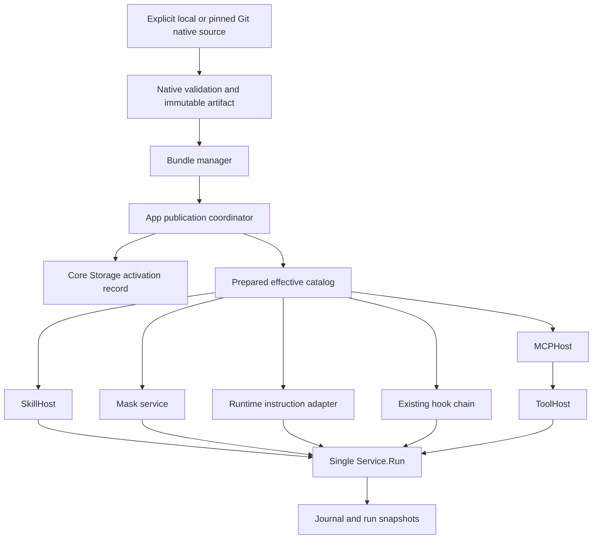

# Vivy Toolkits

**Date:** 2026-10-11\
**Status:** Detailed architecture proposal for review. Product direction is confirmed; the technical decisions below are proposed, and implementation is unscheduled.\
**Tracker:** [agent-vivy #20](https://github.com/ProjectViVy/agent-vivy/issues/20)\
**Revision:** r2 — product name Toolkit (工具包), native format only, and dedicated toolkit management UI; naming corrected by the user on 2026-10-11.\
**Action plan:** [TK-P1 plan package](../superpowers/plans/toolkits/index.md), requested by the user; planning refinements are recorded in section 22.\
**Baseline inspected:** `1d6c9e236c11d929dd3423ed63272e88ed13e367`\
**Inputs:** [upstream research](../research/suite-system-upstream-research-2026-10-11.md), [Mask discussion](../research/bundle-masks-discussion-2026-10-11.md), [Module standard](VIVY-MODULE-STANDARD.md), [Port catalog](VIVY-PORT-CATALOG.md), [Assembly contract](VIVY-ASSEMBLY.md), and [Mask architecture](../superpowers/specs/2026-09-21-mask-subsystem-design.md).

## 1. Intent and scope

A content bundle delivers related Skills, Masks, Rules, Hooks, and MCP declarations as one installable, versioned unit. Existing Vivy owners interpret those components. A bundle update changes governed content and declared runtime instances while preserving the compiled Module graph, Generation identity, and single Service.Run, Journal, Policy, and ToolHost path.

The primary reference is Codex; ZCode is the secondary reference. Their manifest conventions, provenance, lifecycle, and hook behavior inform this design. The pinned source comparison and its limits remain in the research report. This proposal does not adopt either project's runtime wholesale.

### 1.1 Confirmed product direction

- One bundle can contain several Masks.
- Native toolkit authors classify professional role guidance as Masks and reusable procedures as Skills. Reference material can inform that content, but Vivy provides no upstream format conversion pipeline.
- BMAD PM and Dev illustrate selectable expert roles; their names do not imply BMAD format compatibility.
- Define a Vivy-native toolkit format. Codex and ZCode are design references; upstream manifest import, format detection, and conversion tools are outside this project.
- Deliver a dedicated toolkit management section in the Vivy UI, covering the complete native toolkit lifecycle.
- Masks have **recommended Skill references**. Skills remain independently usable. Selecting a Mask does not enable, disable, restrict, or grant access to Skills, Tools, models, or credentials.
- One session selects at most one Mask. Each admitted run retains its captured Mask.

The user explicitly selected recommended association on 2026-10-11: “推荐关联，技能可独立使用（推荐）”.

### 1.2 Proposed first release

The complete v1 content model includes all five component kinds. Delivery can proceed in gated slices, but a build must reject any declared kind it cannot interpret; it must never report a partially understood bundle as fully active.

Sources are explicit local directories and pinned Git checkouts. Install copies validated content into an immutable managed store. Updates are explicit. Native bundles use `vivy-bundle.json` with `apiVersion: vivy.bundle/v1`. Only artifacts authored in this native format are accepted. There is no upstream manifest detection, importer, converter, or compatibility mode.

Installation and enablement are organism-wide in v1, matching the shared Mask catalog and effective owner configuration. Management must display that scope before enable; Rule Face filters and existing Skill/Tool policy can narrow use. Per-workspace installation overlays are deferred, and entering a repository never activates a bundle automatically.

The first implementation slice should include Skills **and Masks**, adding Masks to #20's historical minimum. MCP, Rules, and Hooks follow with their owner integrations and acceptance gates. Supporting all five kinds and the dedicated toolkit management UI is required before claiming full v1 support.

### 1.3 Exclusions

No runtime Go/UI Module loading, new public Port, alternate agent loop, automatic expert-team orchestration, automatic identity replacement, inbound webhook routing, new hook events, marketplace, ZIP installer, dependency solver, general userConfig renderer, automatic update watcher, or upstream format import/conversion at either authoring or install time. Installing a bundle does not install system dependencies or run package-manager commands.

The historical `suite` term in #20 refers to this content-package concept. The product name is **Toolkit** in English and **工具包** in Chinese; navigation uses **Toolkits / 工具包**. Each toolkit is delivered as a content bundle. Use Toolkit/toolkit in product copy and design discussion; reserve Plugin/plugin for the existing compiled Module system and upstream projects that use that term. The architecture keeps content bundles distinct from compiled code plugins and uses **content bundle**, `vivy.bundle/v1`, and `bundle.*` control operations. It does not rename existing cognitive bundles, release artifacts, SDK pack output, or compiled plugins. No `vivy.suite/v1` migration is needed because the inspected baseline has no such implementation.

## 2. Requirements and design choices

| ID | Observable requirement | Main sections |
| --- | --- | --- |
| B1 | A bundle exposes validated content through existing owners | 4, 8–12 |
| B2 | Several Masks can ship together; role and procedure content can be separated | 5, 9, 16 |
| B3 | Mask recommendations never alter authority or activation | 9 |
| B4 | Identity is unambiguous across sources, versions, and component kinds | 6 |
| B5 | A run never receives a mixture of two bundle activation epochs | 7, 13–14 |
| B6 | Install and validation execute no bundle commands or MCP connections | 7, 12–13 |
| B7 | Hook arming is a separate human operation bound to exact content | 11 |
| B8 | Invalid updates leave the previous published catalog usable | 13 |
| B9 | Disable/revoke prevents subsequent use while preserving historical evidence | 13–14 |
| B10 | Restart, checkpoint resume, and rollback preserve exact provenance | 7, 14–15 |
| B11 | Missing compiled owners and unknown native schema fields are visible failures | 4, 16–17 |
| B12 | Bundle data does not change Generation identity or expand Grants | 4, 18 |
| B13 | A dedicated toolkit UI exposes lifecycle, component detail, consent, and operation recovery | 17, 19–20 |
| B14 | Installation accepts only the Vivy native toolkit schema | 5, 16 |

### 2.1 Native format decision

The user selected a native-only format. `vivy-bundle.json` and `vivy.bundle/v1` are the proposed file/schema names; their field contract is defined in section 5. All authors produce this format directly. Codex and ZCode research informs the design, without introducing a runtime compatibility layer or an authoring converter.

An upstream-only plugin directory fails with `unsupported_format` and guidance to provide a native manifest. If unrelated upstream files coexist with a valid native manifest, only explicitly declared native content is considered. The loader does not interpret foreign manifest fields or infer a format from directory names.

### 2.2 Activation alternatives

| Approach | Benefit | Cost | Decision |
| --- | --- | --- | --- |
| Independently replace each owner's live configuration | Small initial patch | New runs can observe a mixed catalog; rollback cannot undo external effects | Reject |
| Publish at an organism-wide run-idle boundary | One live owner set; reuses Service and existing Hosts | A suspended run can delay publication; new run admission temporarily pauses | Recommend for v1 |
| Keep several executable epochs active concurrently | Updates need not wait | Versioned MCP sessions, hook dispatch, engine handles, cleanup and recovery | Defer |

The recommended boundary counts **all nonterminal runs**, including approval waits and resumable checkpoints. `len(active) == 0` alone is insufficient. The pending operation shows its blockers; operators can cancel the operation or explicitly terminate blocking runs using existing controls. No timeout silently cancels a user's work.

## 3. Verified baseline and integration gaps

Paths below describe the inspected source, rather than capabilities assumed from older design documents.

| Existing owner or seam | Observed behavior | Required change |
| --- | --- | --- |
| [SkillHost](../../internal/skillhost/host.go), [HostedSkillBackend](../../internal/runtime/skilladapter.go) | Stable-ID validation, ambiguity handling, budgets, activation scope; Eino lookup key is Host ID | Add one compiled read-only bundle source backed by the captured catalog |
| [EinoSkillBackend](../../internal/runtime/skills_backend.go) | Mutable local/project skill storage; directory names reject `:` | Keep local mutation separate; do not use bundle aliases as filesystem paths |
| [Mask contract](../../internal/maskcontract/masks.go), [Mask service](../../internal/modules/masks/service.go) | Built-in and custom definitions; selection CAS; captured run snapshots | Add explicit bundle origin and identity branch, read-only definitions, recommendation metadata |
| [Mask storage and admission](../../internal/storage/masks.go) | Atomic admission checks custom revision/digest and selection revision | Validate selected bundle Mask against the same expected bundle epoch |
| [Continuity admission](../../internal/storage/continuity.go), [goal/queue admission](../../internal/storage/work_control.go) | Distinct transaction entry points; continuity lacks the ordinary prompt capture fields in this baseline | Carry the same capture/checks through every admission branch; do not fix only ordinary RunAdmission |
| [Prompt snapshot](../../internal/runtime/prompt_state.go) | Immutable instruction; built-in/custom validation; Generation checks | Version the payload for bundle provenance while preserving old snapshots |
| [Project instructions](../../internal/runtime/project_instructions.go), [engine](../../internal/runtime/engine.go) | Project AGENTS.md discovery and pinned Eino agentsmd middleware | Add bounded bundle Rule inputs without writing project files |
| [Script hook construction](../../internal/app/hooks.go), [executor](../../internal/runtime/hooks_script.go) | Approved config entries become PreToolUse hooks; shell command protocol | Project armed bundle hooks into prepared chains; bind script resources and execution context to consent |
| [MCP backend](../../internal/runtime/mcp_backend.go), [MCPHost](../../internal/mcphost/host.go) | Live ReplaceServers; Host lifecycle, safe namespaces, schema checks | Prepare merged configs; prevent settings from publishing an independent conflicting catalog |
| [Engine reload](../../internal/runtime/compaction_service.go) | Defers while active/pending maps are nonempty; rebuild outside lock | Extend admission coordination for durable nonterminal runs and atomic publication |
| [App settings reload](../../internal/app/app.go) | MCP replacement and engine reload are separate steps | Route overlapping bundle/settings publications through one coordinator |
| [Core migrations](../../internal/storage/migrations) | Paired SQLite/PostgreSQL schema ownership | Add paired migrations at implementation time, with the then-current next ID |

`ReplaceServers` currently returns no error and normalizes its input map. It is not a validating, reversible transaction API. `ScheduleEngineReload` is a useful scheduling seam, not proof of cross-owner atomicity. Both need explicit preparation/publication integration before B5 can be claimed.

## 4. Ownership and composition



### 4.1 Responsibilities

| Owner | Owns | Does not own |
| --- | --- | --- |
| Proposed `internal/bundlecontract` | Pure identifiers, immutable records, errors, request/response values | SQL, Eino, process execution, RPC |
| Proposed `internal/bundles` | Native parsing, artifact validation, staging, source provenance, lifecycle proposals, compiled read-only Skill source | Model calls, grants, final prompt, arbitrary owner mutation |
| `internal/app` | Composition of existing owners; sole publication coordination | Alternate semantic interpretation of components |
| Core Storage | Install state, epochs, operation receipts, consent/revocation records, run admission transactions and evidence | Hook/MCP execution |
| SkillHost | Skill validation, names, availability, budgets, effective projection | Mask activation |
| Mask service | Definition listing, selection, body validation, recommendations, capture | Skill or Tool authorization |
| Runtime instruction adapter | Rule framing/order and instruction budget; existing Eino middleware | New Context Source with system-message authority |
| Hook execution path | Supported protocol, matching, timeout, deny/rewrite semantics | Consent acquisition from bundle text |
| MCPHost and existing runtime adapter | Connections, processes, schema and tool projection, retries, credentials | Package lifecycle or marketplace trust |
| ActionHost and existing RPC authentication | Authenticated management actions and session binding | Authority inferred from manifest declarations |

The manager and coordinator are compiled internal capabilities of the existing application. They do not introduce a public `std/bundle` Port, a new generic Provider registry, or a runtime-created Module. The compiled Skill source is present at startup; installed data changes its records, not the frozen Port graph.

Build-owned capability discovery reports which component owners are compiled. A bundle declaring an unavailable owner fails preparation with `owner_unavailable`. It can remain installed-disabled with a diagnostic. A minimal Generation does not gain an omitted Mask or MCP owner by installing content.

### 4.2 Internal contract shapes

The following signatures describe proposed pure-data seams. They are not public SDK Ports or ready-to-compile code. Expected revisions and operation IDs are required on mutations.

```go
type ComponentRef struct {
    InstallID string
    Kind      ComponentKind
    LocalID   string
}
type ReleaseRef struct {
    InstallID, BundleID, ReleaseDigest string
    ReleaseSequence int64
}
type CatalogIdentity struct {
    Epoch, ConfigRevision int64
    EffectiveDigest, GenerationID string
}
type CaptureCheck struct {
    Catalog CatalogIdentity
    RevocationRevision int64
}
type PrepareRequest struct {
    OperationID string
    ExpectedCatalog CatalogIdentity
    Mutation CatalogMutation
}
type PreparedCatalog struct {
    OperationID string
    Expected CatalogIdentity
    CandidateDigest string
    Releases []ReleaseRef
    // Owned immutable projections; no live transports or executable callbacks.
}
```

The bundle manager prepares typed content projections. The app coordinator owns their handoff to existing owners and calls Core Storage to commit activation. Runtime acquires a view plus a release function before admission and passes `CaptureCheck` into the existing transaction paths. Public callers cannot construct a trusted captured view or supply its bytes as authority. Interface method names and the concrete projection containers belong in the implementation plan after this ownership contract is approved.

## 5. Native manifest and artifact layout

This is a proposed schema example, not an existing CLI or parser.

```json
{
  "apiVersion": "vivy.bundle/v1",
  "id": "example/bmad-experts",
  "version": "1.0.0",
  "name": "BMAD expert roles",
  "description": "Product and development perspectives with reusable methods",
  "components": {
    "skills": [
      {"id": "create-prd", "path": "skills/create-prd/SKILL.md"},
      {"id": "implement-story", "path": "skills/implement-story/SKILL.md"}
    ],
    "masks": [
      {
        "id": "pm",
        "name": "Product Manager",
        "description": "Product perspective and requirements clarification",
        "path": "masks/pm.md",
        "recommendedSkills": ["create-prd"]
      },
      {
        "id": "dev",
        "name": "Developer",
        "description": "Engineering perspective and implementation discipline",
        "path": "masks/dev.md",
        "recommendedSkills": ["implement-story"]
      }
    ],
    "rules": [
      {"id": "delivery", "path": "rules/delivery.md", "faces": ["code"]}
    ],
    "hooks": [],
    "mcp": []
  },
  "resources": ["resources/prd-template.md"],
  "provenance": "provenance.json",
  "licenseFiles": ["LICENSE"]
}
```

### 5.1 Parsing rules

- UTF-8 JSON object, strict schema, no duplicate keys, no unknown fields, no trailing document. Missing component arrays normalize to empty arrays. At least one component is required.
- Bundle ID is `publisher/name`; each segment is lowercase ASCII `[a-z0-9][a-z0-9-]{0,31}`. This is a namespace claim, not publisher authentication.
- Component IDs are lowercase ASCII `[a-z0-9][a-z0-9-]{0,23}` and unique within their kind. Version is a nonempty bounded display string; v1 does not infer dependency ordering from it.
- Names are display strings. IDs, paths, and referenced files are never derived from display names.
- Paths are normalized POSIX relative paths. Reject absolute/drive/UNC paths, backslashes, empty or dot segments, parent traversal, NUL/control characters, Windows reserved names, trailing spaces/dots, and case-folded path collisions. Reject symlinks, special files, and hard-linked files during acquisition. Reopen from the private staged copy without following links.
- The runtime content set is explicit: manifest, declared component files, declared resources, provenance, and license files. No recursive runtime discovery, implicit import, wildcard include, or file-watching activation.
- Authoring directories may contain unrelated files. They are not copied and are listed as excluded in the preparation report. Any resource needed by a shipped component must be declared and included.
- Mask recommendations in v1 reference Skills in the same bundle by local ID. Missing references fail validation. Cross-bundle references and dependency resolution are deferred.
- All text is treated literally. No template evaluation or variable substitution in Mask, Rule, or Skill prose.

### 5.2 Initial hard bounds

These are proposed implementation limits, to be checked before allocation and shared across SQLite/PostgreSQL and control surfaces. Existing owner limits still apply; the lower limit wins.

| Input | Bound |
| --- | --- |
| Manifest or provenance document | 256 KiB each |
| Mask body | Existing `maskcontract.MaxBodyBytes`, currently 16 KiB |
| Mask name / description | Existing 128 / 1024 byte limits |
| Skill body | Existing SkillHost maximum, currently 512 KiB |
| Rule body / combined active bundle Rules | 16 KiB / 64 KiB before the stricter effective prompt budget |
| Declared files / total copied bytes | 4096 / 64 MiB |
| Any single non-component resource | 8 MiB |
| Components per artifact | 256 total; owner catalog bounds apply across all active sources |
| Bundle version / description | 128 / 4096 bytes |

Reject excessive input with a field-specific error. Do not silently truncate a role or rule, drop a declared component, or accept a catalog whose entries cannot fit the relevant Host's limits.

## 6. Identity and namespaces

Separate portable content identity, local installation identity, and runtime projection identity.

| Identity | Meaning |
| --- | --- |
| `BundleID` | Portable manifest ID, e.g. `example/bmad-experts` |
| `InstallID` | Host-generated UUID for one installation; stable across updates |
| `ReleaseDigest` | Exact normalized artifact content |
| `CatalogEpoch` | Monotonic Core Storage publication sequence for the whole effective content catalog |
| `ComponentKey` | Tuple `(InstallID, kind, localID)` |
| Display reference | `example/bmad-experts:pm`, accompanied by kind |
| Skill Host ID | `b_` + lowercase UUID without hyphens + `_` + local ID |
| MCP instance ID | Same encoding as Skill Host ID, interpreted in the MCP namespace |
| Mask ID | `bundle/<InstallID>/<localID>` |

Skill and MCP projections satisfy current safe-name alphabets without placing `:` or `/` into filesystem paths. They are explicit encodings of valid IDs, not sanitization of unsafe names. MCPHost retains its existing `mcp.<instance>.<remote-tool>` projection and remote-name/schema validation. Provider/model-specific limits on final tool names must still pass; no truncation or silent aliasing is introduced.

Allow one live installation per BundleID in an organism. A different source offering the same ID requires an explicit source-rebind operation, displayed with old/new provenance and requiring fresh executable consent. It never wins by installation order. InstallID tombstones prevent an uninstall/reinstall from inheriting old consent, Mask selections, or run identity.

Bundle Skill names presented for human lookup are qualified display references. Exact Host IDs remain the Eino lookup keys. Protected management tools should expose both fields. Unqualified aliases are not automatically registered for bundle Skills. Existing local/project overlay behavior is preserved within its owner; a conflicting stable ID from any source fails the effective catalog preparation.

The registry records the mapping once. Inspector, UI, prompt metadata, and error rendering derive from it. An identical component ID in two different kinds is valid; an identical ID within one kind is an error.

## 7. Artifact integrity and single source of truth

### 7.1 Managed storage

The configured organism state root contains a manager-owned content store:

```text
content-bundles/
  staging/<operation-id>/
  objects/<release-digest>/
    canonical-manifest.json
    inventory.json
    files/<declared relative paths>
```

These are proposed runtime paths, not repository authoring directories. Core Storage owns the active references; filesystem directory names and a `current` symlink are never an independent source of activation truth. Bundle code receives no raw database connection or credential store.

### 7.2 Digest recipe

Use a versioned `vivy.bundle.digest/v1` recipe:

1. Strictly parse and validate the native manifest.
2. Normalize omitted arrays to empty arrays; sort component arrays by kind/local ID, recommendations and file lists lexicographically, and object keys lexicographically. Arrays whose order is semantic, such as process arguments, retain order.
3. Serialize canonical JSON as UTF-8, without whitespace, with a specified JSON string-escaping policy and integer-only numeric fields. The implementation must provide golden vectors across all authoring and runtime entry points; a library's incidental map ordering is not the specification.
4. Preserve copied file bytes exactly. Compute SHA-256 for each declared file and build an inventory sorted by normalized path with byte length and digest. Semantic text normalization by an owner does not change these stored bytes.
5. Compute SHA-256 over the domain marker, an eight-byte big-endian length and canonical manifest bytes, then an eight-byte length and canonical inventory bytes. The manifest's original formatting and generated self-digest files are excluded. Component bodies, resources, provenance and license bytes are included through the inventory.

Define JSON string encoding concretely: leave valid non-control Unicode as UTF-8; escape quote and backslash; encode U+0000–U+001F as lowercase `\u00xx`; escape neither `/` nor HTML characters. Integers use base-10 without leading zeroes. Reject invalid UTF-8 and floats. This removes dependence on serializer defaults.

The source lock records origin, requested ref, resolved Git commit or local acquisition receipt, and the native schema/validator version. It is trusted acquisition metadata in Core Storage. Author-supplied provenance is inside the artifact and is explicitly labeled author-supplied. Neither establishes authenticity by itself. Local absolute paths, fetch timestamps, secret values, and machine-specific install IDs do not enter ReleaseDigest.

`EffectiveCatalogDigest` hashes the sorted active installation/release pairs, owner projection versions, nonsecret configuration revision, and executable consent references. GenerationID is recorded beside it and remains unchanged by installation. Mask definition digests continue to use the existing semantic digest; artifact digest and Mask digest have different scopes.

### 7.3 Acquisition and tampering

Local install copies files into private staging and hashes the copied bytes. A concurrent source edit cannot alter the staged artifact; inconsistent references fail staged validation. Local install does not promise an atomic snapshot of an arbitrary authoring directory.

Git acquisition resolves the requested ref to a commit and extracts only that pinned tree. Disable hooks, filters, submodule recursion, LFS execution, and arbitrary credential helpers in the acquisition process; use the host's approved credential resolution. Reject user-supplied Git command options and unsupported transports. No repository build/install script runs.

Preparation reads only the immutable managed copy. Validate all referenced bytes before publication and on startup recovery. Hold open immutable content handles or validated in-memory bytes for each prepared view; do not re-read mutable authoring paths during a run. Managed-directory writes occur only through the bundle owner. A digest mismatch fails closed and identifies the affected installation without printing private content.

## 8. Skills and supporting resources

Add one first-party read-only source through the existing `skillsource.Provider` seam. It projects `(HostID, display name, version, source hash, content, availability, provenance)` from the captured effective catalog. SkillHost remains the sole validation, conflict, budget, and authorization owner; HostedSkillBackend remains the sole Eino adapter.

Bundle Skills are immutable. Update/delete tools for user Skills must reject bundle IDs with `read_only_component`; a user can explicitly copy content into their own Skill through existing mutation controls. No bundle root is added as a writable project overlay.

Expose the qualified reference and bundle source in Skill metadata and descriptions. Native bundle Skills use ordinary inline execution. `agent`, `model`, fork/context overrides, and tool-grant declarations are not accepted native Skill fields. `DeclaredTools` is descriptive and never a grant.

v1 bundle Skills are on-demand and user-invocable. Persistent instruction guidance is authored explicitly as a bounded native Rule.

Resources remain in the immutable artifact. Extend the existing Skill resource/base-directory projection so the protected read tools can resolve declared bundle resources through a confined, read-only mount or owner resolver. The present adapter assigns a base directory only to local Skills, so simply attaching a new Source does not finish resource support. Resolution must verify the declared inventory, preserve existing filesystem policy, and never expose the entire managed store. A Skill needing executable scripts must still use governed Tool execution; installation does not execute them or add a filesystem Grant.

## 9. Masks and recommended Skills

### 9.1 Definition and origin

Extend Mask metadata with an explicit `origin: builtin | custom | bundle` and optional bundle provenance. Retain existing `BuiltIn` compatibility where required, but do not infer editability from `!BuiltIn`; only custom definitions are editable. Bundle definitions are read-only views of immutable artifacts, not copied mutable rows in `mask_definitions`.

Bundle provenance contains InstallID, BundleID, local component ID, ReleaseDigest, and definition revision. Recommended Skills are typed component references resolved to exact Host IDs and display metadata. They are not embedded as authority-bearing commands in the Mask body.

Use a monotonic per-install release sequence for the bundle definition revision. Rollback publishes a new sequence referencing old bytes, preventing ABA confusion. The definition digest retains the existing ID/name/body semantics. Recommendation changes are covered by ReleaseDigest and the release sequence even when the body digest is unchanged.

### 9.2 Selection and admission

- Extend Mask ID validation to the bundle form. `builtin/*` and `custom/<uuid>` retain their current semantics.
- List/get merges built-in, custom, and bundle-owned definitions with deterministic pagination; it returns origin, availability, recommendations, and source.
- SetSelection checks the bundle is active and the definition is available under the current epoch; CAS still uses the session's selection revision.
- Capture reads the selection and resolves the definition from the **same catalog view** used by run admission. Core Storage checks the expected epoch and selection revision in the admission transaction.
- The run snapshot stores the exact Mask body, definition digest/revision, and bundle provenance. It never resolves a selected ID against a later artifact during resume.
- Missing or disabled selected bundle Masks are displayed as unavailable. New runs fail before model invocation with `mask_unavailable`; no silent switch to an unmasked persona.

The current custom-versus-built-in branching in Mask service, storage checks, and prompt validation must become explicit three-origin branching. Treating every non-built-in ID as a custom database row is incorrect.

### 9.3 Recommendation contract

Selecting PM may show “Recommended: Create PRD.” It does not change SkillHost ActiveIDs, model selection, grants, tool inventory, or executable consent. The same Skill remains independently selectable when another Mask or no Mask is selected.

Recommendations are presentation/discovery metadata. A recommended Skill may be unavailable due to current Host scope or policy; show that reason. Do not bypass policy because the manifest reference is valid. Switching a Mask during a run changes the next run's selection only.

### 9.4 Updates and user edits

Updating the same Mask local ID preserves session selection and changes subsequent runs after activation. Removing a selected Mask blocks publication with `mask_in_use`. Deleting a bundle similarly blocks while sessions reference its Masks. The operator may change those selections explicitly and retry; bulk reassignment requires a separate explicit operation with per-session expected revisions.

Disable is allowed with references: selections remain intact but unavailable. Re-enable restores availability when the same install/Mask still exists. Copying a bundle Mask creates a new custom UUID and records optional source provenance; subsequent bundle updates never overwrite it. Recommendations on a copied Mask remain references, so unavailable source Skills must be shown as unavailable rather than silently copied or enabled.

Mask framing, persona priority, prompt budgets, and the virtual empty selection remain owned by the existing Mask/runtime contracts. Bundle expert roles do not create child sessions or a multi-agent team.

## 10. Rules and prompt integration

Rules are literal instruction documents with stable IDs and an optional explicit Face allowlist. They cannot declare arbitrary numeric priority, override system/persona authority, evaluate templates, or execute includes. Default Face scope is all supported Faces; the authoring report must make broad scope visible. v1 does not add file-glob activation or workspace auto-discovery.

Runtime provides one bounded bundle instruction source to the existing Eino agentsmd integration. Use synthetic confined file keys and a read-only backend backed by the captured epoch; never create or overwrite a workspace AGENTS.md. Existing project discovery retains its own semantics.

Order bundle Rules deterministically by BundleID and local Rule ID, then append the existing ordered project-instruction files. Frame bundle guidance as lower-priority task guidance: explicit user requirements and project-specific instructions prevail when applicable; runtime/persona authority remains above it. This is an instruction hierarchy, not a claim that textual ordering can enforce security. Tool and credential policy remain server-side.

Captured bundle Rule bytes remain unchanged for the run. Project files retain their existing loading behavior; this proposal does not claim a snapshot of the entire mutable workspace. Keep those provenance domains distinct.

Eino agentsmd supports recursive `@import` and warns/skips some missing files. Native bundle Rules forbid import directives in positions that Eino interprets as includes. The confined backend rejects undeclared paths as a hard error. At admission, preflight the complete selected bundle Rule block against both the bundle and effective prompt budgets. Do not rely on Eino's cumulative skip behavior to remove an admitted Rule silently.

For non-Code Faces, preserve existing persona/FrozenCore composition and only inject explicitly applicable Rules through the same owner-controlled instruction path. A Rule cannot replace the persona, Mask framing, FrozenCore, or prompt composer version.

## 11. Hooks and consent

v1 supports only the existing **PreToolUse** script-hook protocol. New event keys, webhook declarations, and unknown matchers are hard validation failures. The closed #13 does not supply authorization to add events.

Proposed native entry fields are `id`, `event`, `command`, `matcher`, `timeoutMs`, `cwd`, and `envFrom`. `event` must be `PreToolUse`; matcher uses the existing `path.Match` semantics. `timeoutMs` must be positive and no larger than the configured Host ceiling. `cwd` is `bundle` or `workspace`; the default is `workspace` to preserve task locality. `envFrom` maps explicit process environment names to host-managed secret/config references, never literal secret values. No general shell interpolation by the manifest loader is added.

Hook command strings execute only through the existing script executor and ToolHost governance path after arming. Bundled resources resolve against the immutable artifact; extend the executor's explicit cwd/environment inputs rather than constructing a shell `cd` prefix. Executable payloads remain external process input and do not become compiled Vivy code.

Arming is an authenticated human control action distinct from enable. Consent binds InstallID, ReleaseDigest, supported event, hook ID, command, matcher, timeout, cwd policy, environment bindings, and the declared resource inventory. v1 conservatively requires fresh arming for every new ReleaseDigest. A manifest cannot set `approved: true`, carry transferable approval, or inherit trust from a publisher label.

Inspect/UI shows installed, enabled, and armed as separate states. Unarmed hooks are explicitly inactive; all other valid components can be active. This is a declared authorization state, not silently ignoring an unsupported component. A bundle described as a mandatory policy gate must not be represented as enforced while its hook is unarmed.

Order compiled governance first, existing operator hooks in their existing order, then bundle hooks by BundleID/local ID. Include this order and hook identities in the run evidence. Existing deny, timeout, process-failure, argument-rewrite, and reauthorization behavior remains authoritative. Disarming an admitted hook must block the next affected call rather than omit the hook and thereby weaken the captured guard chain.

Approval describes the reviewed configuration and bundled bytes. It does not attest to an interpreter, binary, or service that the operating environment later replaces. Preserve that distinction in diagnostics without claiming the hook is sandboxed.

## 12. MCP and local configuration

MCP entries declare `id` plus either an existing supported endpoint transport or a stdio command/args, with explicit cwd and environment/credential references. Unsupported transports or auth modes remain rejected/deferred under the existing Eino gate.

The proposed native fields are `id`, `endpoint`, `command`, `args`, `cwd`, `envFrom`, `authEnv`, and `resourceBridge`. Exactly one of `endpoint` or `command` is required. `args` is an ordered string array for stdio only. `cwd` accepts `bundle` or `workspace` for stdio; it defaults to `workspace`. `envFrom` and `authEnv` name required local bindings, resolved through the current credential/config owner; an HTTP instance cannot carry stdio-only fields. `resourceBridge` defaults to false and requires the existing explicit MCP-to-ContextHost bridge when true. The loader maps the derived instance ID into MCPServerConfig.Name, resolves approved bindings at the owner boundary, and derives Enabled from bundle state and consent. `Enabled`, `DeferredReason`, literal environment values, and Tool exposure policy cannot be set by the bundle. Existing host-supported endpoint validation and policy apply; unsafe or credential-bearing URLs are rejected.

Bundle-owned and user-configured instances remain distinct sources. Derive one effective configuration catalog; never copy bundle entries into user settings as a second editable source of truth. Reject conflicts before publication. Disabling/uninstalling a bundle removes only its owned instances, subject to the same run/publication boundary.

No connection, subprocess launch, tools/list, or credential resolution occurs during install or preparation. An instance becomes eligible only after the operator explicitly authorizes the displayed connection/process declaration and required bindings exist. This is separate from hook arming and from permissions for subsequent Tool calls. A combined UI can collect these choices, but the backend records separate decisions bound to exact content.

MCPHost remains responsible for lazy connection, discovery, schema hash, safe remote tool names, retry policy, circuit state, and ToolHost projection. A configured but unreachable server is `unavailable`, not a failed package installation. Static malformed configuration prevents activation; remote health does not make publication perform external I/O.

v1 user configuration is limited to typed binding records for supported credential/environment references and explicit per-instance configuration fields. No generic bundle-supplied settings form, arbitrary `${...}` evaluation, secret literal, or application-wide settings override is accepted. Machine-local binding changes increment the effective configuration revision without changing ReleaseDigest. A process/endpoint/cwd change invalidates the relevant executable consent. Credential value rotation follows the existing credential owner; values never enter digests, logs, or snapshots.

Remote inventories may change independently of package content. Run evidence records the effective instance configuration identity and existing discovered schema/Tool identities when used. It does not claim that a ReleaseDigest freezes a remote server's implementation or all future responses. Existing stale-schema/instance checks must reject substitution under a captured identity.

## 13. Lifecycle and atomic publication

### 13.1 States and operations

Install state and operation state are separate:

```text
Installation: installed-disabled -> enabled -> disabled -> tombstoned
Source condition: attached | orphaned
Operation: validating -> staged -> prepared -> waiting-for-idle
           -> committed -> published
           -> failed or cancelled before commit
```

`orphaned` means the source is unavailable or removed; already installed content remains readable/usable under existing enable and consent state. Update requires explicit source reassociation. Source disappearance does not uninstall content.

Every mutating request has an operation UUID and expected catalog revision. Core Storage stores a canonical nonsecret input digest and receipt. Retrying the same operation/input returns the same result; reusing an ID with different input fails. Cancellation after durable commit cannot pretend to undo publication; rollback is a new operation.

### 13.2 Install and prepare

1. Authenticate the caller, validate source arguments and resource limits.
2. Acquire/copy immutable input without executing source content.
3. Validate schema, paths, hashes, component owners, IDs, recommendation references, prompt bounds, executable declarations and origin conflicts.
4. Derive all component projections and a single candidate effective catalog. Revalidate affected user settings and existing sources for collisions.
5. Persist the disabled installation/release and operation receipt only after its object directory has been durably promoted. Install returns disabled by default.
6. For enable/update, prepare owner objects without publishing or performing external I/O. Any static failure leaves the previous active epoch unchanged.

MCP/hook consent can be granted to an installed candidate before enable. Unconfigured/unapproved executable entries remain explicitly inactive in the candidate. A preparation report distinguishes static validation failures from inactive executable components.

### 13.3 Publication protocol

One app-owned coordinator serializes bundle publication and settings changes that affect the same owners. Preparation can perform expensive file validation before draining. Publication uses these steps:

1. Persist a pending operation and desired candidate against expected epoch/config revisions.
2. Enter a Service admission gate: stop accepting **new root runs** with retryable `catalog_update_pending` and operation ID. Queued user messages remain queued without a run ID. Resume and child work belonging to already admitted roots can continue on the old epoch so those roots can finish; track all their admissions in the same drain set.
3. Wait until Core Storage reports no nonterminal runs in the drain set and Service reports no active execution/admission reservations or tool operations. Suspended runs are blockers. Show bounded blocker metadata; never discard them to make progress.
4. Under the publication/admission exclusion, recheck expected revisions, current Mask references, consent, source identity, candidate artifacts, and owner budgets. Discard or reprepare stale candidates. Do not hold a database transaction open while waiting.
5. Make the prepared catalog ready in memory, with inert MCP transports and validated hook chain. All fallible static construction occurs before commit.
6. Commit the new active epoch, install states, projection/config references, and operation receipt in **one Core Storage transaction**. The artifact objects already exist durably. This is the durable linearization point.
7. Publish one effective-view pointer for Runtime and management reads while the admission gate remains held. Owner adapters read that view, rather than independent mutable caches. Retire old resources through their existing bounded cleanup paths. A candidate cannot start external processes during this step.
8. Release the gate. New admissions capture the new epoch. Emit the committed status through existing diagnostics/event channels.

There is no filesystem/database distributed transaction: immutable objects are written first; only the database chooses what is active. An unused object is a garbage-collection candidate. An active pointer cannot reference a missing or unverified object.

The current immediate MCP settings callback must be included in this coordinator whenever it affects the shared effective catalog. Publishing MCP first and scheduling engine reload later violates B5. Ordinary unrelated settings keep their existing owner path.

If publication cannot complete after the database commit, keep admission closed and enter recovery. Do not serve a mix or report a rollback that never happened. Recover the committed epoch from verified objects; if that is impossible, report `catalog_recovery_required`. An explicit rollback commits a new epoch once old artifacts and current grants are revalidated.

### 13.4 Disable, revoke, cancel, uninstall

Enable/update can wait for idle. Disable and executable disarm also commit an immediate **revocation fence** through Core Storage, checked at subsequent model and tool boundaries. This fence can only remove availability; it cannot introduce new content or permissions. The full removal catalog is published through the same drain protocol.

For a run that captured the revoked bundle, the next governed boundary fails with `bundle_revoked`; the user may cancel or restart after publication. A model request or external tool call already dispatched cannot be retroactively undone. Existing cancellation can be requested explicitly; return that limitation with the operation status. Hook disarm similarly fails a call that required that hook instead of bypassing it.

Cancelling an uncommitted enable/update operation reopens admission on the old epoch. Cancelling the pending publication of a disable does not silently clear its already-committed fence; re-enable is explicit. Re-enabling does not clear historical fences for runs predating revocation. V1 drains those runs to a terminal state before new enable publication.

Uninstall requires disabled state, no nonterminal run references, and no session selections of its Masks. It tombstones the installation; it never deletes user workspaces, user Skills, custom Mask copies, credentials, or project files. Historical artifact retention is governed by run/checkpoint evidence, not by installation visibility.

## 14. Run admission, resume, and concurrency

### 14.1 Capture transaction

Admission reserves the current view through the coordinator, resolves the session Mask from it, derives applicable Rules and available Skills, and builds the existing prompt snapshot. Extend RunAdmission with expected CatalogEpoch/config revision and a versioned bundle snapshot. Core Storage atomically persists it with the existing message, run, started event, and prompt, and verifies the epoch, revocation state, and Mask selection CAS.

On a CAS mismatch, discard the prepared capture and return a retryable conflict before model invocation; a bounded caller retry may recapture. Never splice the new Mask into an already-built old-epoch prompt. Release admission reservations on every failure path.

Apply this contract to ordinary runs, continuity/reference admission, goal rounds, queued work, child activation, and edit/retry paths that create a new run. The baseline's ContinuityAdmission does not carry Prompt/ExpectedMask even though other branches do; the existing backlog records that gap. B1 must reconcile it with the owning fix and ensure bundle/prompt capture commits in the same transaction for every branch. An unsupported branch must fail before starting a bundle-bearing run rather than stamp evidence it did not persist. Forking a session copies selection according to existing rules; its next new run captures the then-current epoch.

### 14.2 Snapshot contents

| Field | Purpose |
| --- | --- |
| Schema/composer versions and GenerationID | Validate interpretation and compiled runtime |
| CatalogEpoch and EffectiveCatalogDigest | Exact published view |
| Sorted InstallID/BundleID/ReleaseDigest pairs | Artifact provenance |
| Component projections and config revision references | Stable Skill/MCP/hook identities |
| Selected Mask body, digest, revision, source | Existing immutable prompt behavior |
| Applied Rule IDs/digests and literal rendered block | Exact instruction evidence |
| Armed hook identities and consent references | Captured governance chain |
| Revocation baseline and owner projection versions | Recovery and availability checks |

Large Skill/resource bytes remain in retained immutable artifacts referenced by digest. Mask/Rule bytes used in the prompt are stored with the run as execution evidence; that deliberate snapshot is not a mutable second definition authority. No secret values or machine-local acquisition paths are copied into model-visible metadata.

### 14.3 Runtime and resume

The run context carries the captured immutable view. Skill List/Get, Rule reads, Mask framing, and hook membership use that view; management UI lists the latest published view. Live authorization may narrow availability through policy/revocation, but cannot replace captured content with a newer version.

Resume loads the persisted snapshot and verifies artifacts, Generation compatibility, consent identities, and current revocation fences before invoking Eino. Missing artifacts fail `snapshot_unavailable`; there is no fallback to the latest bundle. Under the v1 drain rule, an ordinary update cannot publish while that resumable run is nonterminal. Recovery must rebuild the prior active owner set before allowing such a resume.

A child run admitted by an already admitted parent during draining inherits the parent's bundle epoch as provenance, while passing the existing child admission/Policy path. Mask inheritance remains governed by the existing explicit child-session rules; this feature does not add automatic inheritance. New scheduled/automatic root runs queue until publication or cancellation. This distinction is required to avoid a parent waiting forever on a child blocked by its own drain gate.

### 14.4 Locking and ownership

Use one publication/admission coordinator with a fixed lock order: coordinator reservation, then owner-local preparation without shared mutation, then short Core Storage transaction. Never hold the storage transaction while awaiting a run, a network call, or process cleanup. Existing organism lease ownership remains the single-writer prerequisite; a second process may not publish under a stale lease.

Catalog List/Get and Mask selection operations either pin a coherent published view or return a retryable transition result. They never expose the newly committed epoch with old owner caches. Snapshot handles are copied/read-only and reference-counted where needed; artifact GC cannot race a held handle.

## 15. Persistence, recovery, and retention

Core Storage is the only schema owner. Proposed logical records are:

| Record | Contents and authority |
| --- | --- |
| Bundle installation | InstallID, unique live BundleID, source lock, selected release, enabled/disabled/tombstone state, revision |
| Bundle release | InstallID, monotonic release sequence, ReleaseDigest and verified artifact reference |
| Catalog epoch and active pointer | Immutable sorted release/config/consent references plus effective digest |
| Bundle operation receipt | Operation ID, input hash, expected revision, state, committed result and safe diagnostics |
| Executable consent and revocation | Subject, exact content/config identity, human actor, revision, revocation fence |
| Run bundle snapshot | Run ID, immutable versioned payload and digest, retained artifact references |

Do not store a separately editable copy of each bundle Skill, Rule, or Mask body in SQL. Prepared indexes are derived from artifacts. The run snapshot is an immutable record of what was admitted. New tables/indexes and any selection-validation changes use paired append-only SQLite/PostgreSQL migrations; physical schema and numeric migration IDs are assigned during implementation after checking current main.

Recovery cases:

| Crash point | Recovery behavior |
| --- | --- |
| Before object promotion | Remove abandoned staging after confirming no live operation owns it |
| Object promoted, no database reference | Treat as unreferenced; GC later |
| Pending operation before publication commit | Restore old active epoch and pending/blocker status; allow explicit resume/cancel |
| New epoch committed, pointer not published | Reconstruct that committed epoch before reopening admission |
| Referenced file missing/hash mismatch | Close affected admission and report recovery required; never fetch mutable latest content automatically |
| During owner cleanup | Retry idempotent bounded cleanup; do not start duplicate MCP processes |

Retain artifacts referenced by installations, current/pending epochs, nonterminal runs, checkpoints, or retained run evidence. Historical deletion follows the existing user-controlled history/retention boundary and drops the corresponding references in the same transaction. GC uses a storage-derived reachability set plus live handles and a quarantine period; uninstall alone cannot delete evidence needed for replay. v1 does not add a separate bundle retention scheduler with independent policy.

## 16. Native authoring and expert role example

### 16.1 Native authoring workflow

```text
Native manifest and explicitly declared content
  -> strict native validation
  -> component and source inspection
  -> immutable artifact
  -> install disabled
  -> explicit enable and executable authorization
```

Authors write the native manifest and components directly. Role guidance belongs in Masks; reusable procedures belong in Skills. A Mask may recommend same-bundle Skills. Resources and licenses are explicitly declared. Native validation reports malformed or unsupported fields without transforming them into another schema.

Local and Git installation sources must already contain the native format. The source lock records the selected origin and exact acquired content; a converter version or compatibility report is not required. Optional author-supplied provenance can identify reference material or derived content, without granting it runtime authority.

### 16.2 Expert roles inspired by BMAD

A native expert bundle may define a PM Mask for product perspective, requirements questioning, and tradeoff principles; a Dev Mask for engineering perspective and communication; and independent Skills for creating a PRD, implementing a story, or reviewing code. PM recommends the PRD Skill, while Dev recommends implementation/review Skills.

These are native declarations. Vivy does not parse BMAD role files or translate BMAD menus, workflows, or commands. Authors decide the native content deliberately. Expert roles do not imply multiple agent execution, model overrides, or automatic handoffs.

### 16.3 Source attribution

Authors preserve applicable source attribution and license files when reusing content. The manifest inventory includes those files. Source/version metadata remains useful for updates and review, independently of any format conversion. This architecture makes no BMAD compatibility or licensing claim.

## 17. Management, inspection, and errors

Proposed management operations use the authenticated ActionHost/control plane, not new model-visible management Tools:

```text
bundle.list / get / inspect
bundle.install / prepareUpdate / enable / disable / rollback / uninstall
bundle.operation.get / cancel
bundle.bindings.set
bundle.hook.arm / disarm
bundle.mcp.authorize / revoke
bundle.source.rebind
```

These names describe typed operations to expose through the existing control transport. They use the existing RPC server. Their user-facing flows are part of the dedicated toolkit management UI; staged delivery must identify unavailable actions explicitly. Actions declare mutation scope and schema through existing ActionHost conventions. Read responses are bounded and redact secrets/source credentials; write responses carry the operation ID, committed revision, and publication state.

Inspect distinguishes:

- Installation/source identity, release digest, source attached/orphaned state, and claimed publisher versus trusted acquisition origin.
- Available compiled owners and native schema support.
- Installed, enabled, pending activation, and published epoch.
- Each component's stable ID, origin, availability, body/schema hash, and inactive reason.
- Mask recommendations and unresolved current availability.
- Executable consent state and revocation state independently of enablement.
- Current run blockers and whether a change applies now or after publication.
- Native validation results and artifact/source integrity diagnostics.

Use a bounded structured error vocabulary: `invalid_manifest`, `unsupported_schema`, `unsupported_format`, `unsupported_component`, `unsupported_event`, `unsafe_path`, `limit_exceeded`, `digest_mismatch`, `identity_conflict`, `component_conflict`, `reference_missing`, `owner_unavailable`, `configuration_missing`, `approval_required`, `revision_conflict`, `catalog_update_pending`, `bundle_revoked`, `mask_in_use`, `read_only_component`, `snapshot_unavailable`, `catalog_recovery_required`, `cancelled`, and `unavailable`. Existing owner errors retain their meaning; the management boundary maps them with component/operation identity and retryability without leaking internal commands, paths, or secrets.

### 17.1 Dedicated toolkit management UI

Deliver a first-level **Toolkits** navigation entry in the Vivy application, labeled **工具包** in Chinese, with a dedicated page for native toolkits. This is a required product surface, not an Inspect-only endpoint or a subsection hidden in the Mask library. Use the existing compiled UI composition and authenticated ActionHost clients; installing a bundle never loads UI code from the bundle. This belongs to Vivy, not the Studio lifecycle shell. Existing compiled Module/Generation inspection retains its separate authority and must be clearly distinguished if linked from this page.

| Surface | Required information and actions |
| --- | --- |
| Toolkit library | Search/filter by name, source and state; installed version, enabled state, component counts, authorization summary, pending operation or failure; install entry |
| Install flow | Choose a native local directory through the host picker or supply a Git source/ref; show resolved source/version, component inventory and validation result; install disabled; never execute content during preview |
| Toolkit details | Overview and source/version; separate Skills, Masks, Rules, Hooks and MCP lists; inspect native declarations and read-only content; link to the corresponding owner UI |
| Lifecycle controls | Enable/disable, prepare update, inspect old/new version and component changes, publish update, rollback and uninstall; show organism-wide scope and actionable failures |
| Authorization and bindings | Clearly distinguish enabled from armed/authorized/configured; inspect hook/process/endpoint declarations, provide supported bindings, grant/revoke consent; never echo secret values |
| Operation status | Validation, waiting-for-idle, publication, success or failure; identify blocking runs, link to existing run controls, retry safely, cancel an uncommitted operation; recover status after navigation/reload |
| Diagnostics | Unsupported native schema/owner, source orphaning, missing binding, unavailable MCP, digest mismatch and selected-Mask references, with a concrete next action |

The install source is resolved by the backend. A browser-local path or upload result does not establish server access or toolkit activation. Use existing host file-selection capabilities where available; remote browsers can use Git sources or a host-provided directory reference. ZIP upload and upstream plugin import are not offered.

Toolkit details expose component status separately: a toolkit can be enabled while a hook awaits arming or an MCP server lacks a binding. Display both the overall state and those limitations. A successful install must not be rendered as successful activation. An update diff identifies changed component bodies, added/removed Masks and Skills, executable declaration changes, affected selections and fresh consent requirements before publication.

The library and details share backend-derived state. Keep dirty binding input across recoverable errors, use expected revisions for edits, retain operation IDs for ambiguous responses, and reload authoritative operation status after reconnection. Show empty, loading, unavailable and permission-denied states distinctly. Provide responsive layouts, keyboard-accessible controls and localized text through the existing UI infrastructure.

### 17.2 Links to existing component UI

The Mask library continues to own Mask selection and custom editing. It identifies bundle ownership, exposes recommendations and read-only/copy actions, and links back to the originating toolkit details. Toolkit detail Mask rows link into that existing selection flow, without a second session-selection store. Skill rows similarly link to existing Skill inspection/use controls. Hook and MCP rows expose owner-derived availability and authorization rather than inventing local enable flags.

The toolkit section owns package lifecycle; component screens own their established component interactions. No duplicate authoring editor or independent frontend catalog is introduced. UI state is a projection of committed backend state, with pending operations shown explicitly.

## 18. Eino capability check and custom-code boundary

The local module cache matching [go.mod](../../go.mod) was inspected: Eino `v0.9.13`, EinoExt MCP `v0.0.9`. No new dependency or provider protocol is proposed.

| Need | Pinned API inspected | Reuse or boundary |
| --- | --- | --- |
| Skill discovery and lookup | `adk/middlewares/skill/skill.go`: `Backend.List`, `Backend.Get`, `FrontMatter`, `AgentHub`, `ModelHub` | Keep HostedSkillBackend/SkillHost. Bundle role metadata never populates AgentHub or ModelHub overrides |
| Ordered instruction injection | `adk/middlewares/agentsmd/agentsmd.go`: `Config`, `Backend`, `New`, `BeforeModelRewriteState` | Adapt read-only captured bundle Rules into existing middleware; preflight budgets and restrict includes |
| Immutable persona/Mask instruction | Existing Runtime `promptMiddleware.BeforeAgent`, `literalGenModelInput`, `WrapModel` using Eino ADK/model seams | Extend snapshot values and framing; retain existing execution and budget path |
| MCP tool conversion and execution | `eino-ext/components/tool/mcp/mcp.go`: `Config`, `GetTools`, tool helper `Info`/`InvokableRun` | Preserve current MCPHost/runtime adapter; no new transport or OAuth implementation |
| Agent execution and checkpoint resume | Existing Engine and Service use Eino ADK and stored run context | Bundle capture supplies data to the same path; no bundle Runner or supervisor |

The inspected APIs provide execution/injection primitives. They do not own Vivy's package installation registry, Core Storage activation transaction, Mask selection CAS, or Generation authority. The minimal custom work is package validation/storage, immutable content projections, and coordination at the existing Service admission boundary. An Eino adapter cannot replace those product-specific authorities without creating another source of truth.

Only `internal/runtime` and `internal/provider` may import Eino/EinoExt. Bundle contracts, storage, manager, and UI remain independent of Eino types. Any later missing transport/model/orchestration capability is `DEFERRED-INDEFINITE` under the plugin standard; this document does not authorize a custom substitute. If a future Eino API supplies a compatible primitive, replace the thin runtime adapter while retaining Vivy's authority and persistence contracts.

## 19. Integration map and delivery gates

This is architecture sequencing, not a scheduled executable implementation plan. The written specification must be reviewed before task-level planning and product code.

| Slice | Main files/packages | Deliverable and gate |
| --- | --- | --- |
| B0 — contract and artifact | New `internal/bundlecontract`, `internal/bundles`; Core Storage records/migrations | Strict native parse, confined immutable objects, deterministic digest, no executable side effects |
| B1 — publication and run evidence | `internal/app`, `internal/runtime/service.go`, `compaction_service.go`, storage admission/recovery | One epoch, drain coordination, durable commit/recovery, immediate narrowing fences |
| B2 — Skills and Masks | Skill source/adapter, `maskcontract`, Mask service/storage, prompt snapshot; toolkit UI foundation | First usable bundle with multiple Masks and independent Skills; resource confinement and recommendations; toolkit navigation, library, native installation and basic detail/lifecycle UI |
| B3 — MCP | Existing MCP backend/Host plus settings integration | Owned configuration merge, consent/bindings, no independent publication path |
| B4 — Rules and Hooks | Project instruction adapter, engine, hooks, consent actions | Bounded literal Rules; only supported armed PreToolUse hooks; coherent captured chains |
| B5 — dedicated toolkit UI completion | ActionHost/RPC; compiled Vivy UI composition; toolkit pages and existing Mask/Skill links | Complete all five component tabs, lifecycle, update diff, authorization/bindings, blockers and operation recovery; native-only installation; mandatory before v1 acceptance |

All slice builds reject unsupported declared kinds. B2 cannot claim full v1 coverage. Tests and code changes are created only during the separately authorized implementation phase. The architecture adds no generated Assembly edit by hand; any compiled wiring changes use the existing SDK generation path.

## 20. Acceptance and failure matrix

These are required future verification scenarios, not results of this documentation delivery.

| Scenario | Required result |
| --- | --- |
| Install PM/Dev bundle with two Skills | Disabled install is inspectable; enable exposes both Masks and Skills through their existing owners |
| Select PM then use implementation Skill | Selection recommends PRD; independent implementation Skill remains usable subject to ordinary policy |
| Switch Mask during response | Current run retains old body; next run captures selected Mask |
| Bundle Mask copy and update | Custom copy remains unchanged; bundle definition updates after publication |
| Remove a selected Mask or uninstall its bundle | `mask_in_use` with bounded reference information; no silent clearing |
| Duplicate BundleID from another source | Identity conflict; explicit source rebind required |
| Duplicate component ID or protected Tool alias | Candidate rejected before publication |
| Invalid JSON, duplicate keys, unknown event, unsupported kind | Entire native artifact validation fails |
| Traversal, symlink, hard link, case collision, oversized file | Acquisition/validation rejects it without reading outside staging |
| Resource read outside declared inventory | Owner denies it; no broader filesystem grant |
| Native expert-role authoring | Manifest explicitly declares separate Masks/Skills and valid recommendations; no conversion step |
| Upstream-only directory supplied | `unsupported_format`; no format detection, conversion, or side effects |
| Dedicated toolkit UI | Navigation leads to library, native install, details and five component lists; lifecycle operations reflect committed backend state |
| UI update/auth/recovery | Change preview, consent requirements, run blockers, CAS conflicts and ambiguous operation retries remain visible across reload |
| Toolkit and Mask UI navigation | Same backend-owned origin/availability and session selection; no duplicate frontend authority |
| Unarmed hook or unauthorized MCP | No process/connection starts; inactive state is visible |
| Hook command/resource/cwd/binding changes | Prior executable consent does not authorize changed declaration |
| Armed hook deny, rewrite, crash, or timeout | Existing fail-closed/revalidation semantics and governance evidence preserved |
| Update while normal/child/approval-wait/checkpoint run exists | Pending status names blockers; old epoch remains coherent; no premature MCP replacement |
| Child required to finish draining parent | Child can run under parent's epoch through existing admission/Policy |
| Concurrent settings save, update, Mask selection | CAS conflict or coherent single publication; never hybrid state |
| Ordinary, continuity, goal, queue, child, and edit/retry admission | Same durable capture and expected-epoch checks; no started marker without its snapshot |
| Preparation fails after some owner objects constructed | Close candidate objects; old epoch remains usable; no external effects |
| Crash on either side of publication commit | Recover old or new committed epoch exactly, with idempotent operation receipt |
| Disable/disarm during run | Next governed boundary fails; no silent guard removal; already-dispatched effects are not represented as undone |
| Missing/corrupt retained artifact on resume | Explicit snapshot/recovery error; never substitute latest bytes |
| MCP schema/instance changes | Existing stale-identity checks prevent substitution; diagnostic includes safe instance identity |
| Minimal Generation lacks Mask/MCP owner | Missing-owner diagnostic and no activation or dynamic Port loading |
| Rollback after consent revocation | New epoch only after revalidation; no resurrection of revoked approvals |
| SQLite and PostgreSQL migration/recovery | Same logical outcomes, CAS, receipt, rollback and retention behavior |
| Fresh install and upgrade with old Mask snapshots | Existing built-in/custom semantics and old snapshot reader remain valid |

Implementation verification must include owner-focused tests, migration/recovery and concurrent-admission tests, the repository `just ci` gate, and real product smoke for delivered control/UI paths. Network-dependent MCP evidence must distinguish deterministic local fixtures from actual remote integration.

## 21. Review decisions and limitations

Native-only authoring, a dedicated toolkit UI, and the Mask recommendation relationship are confirmed. The remaining major review choices are the exact native file/schema names and field contract, organism-wide activation scope and idle publication, disabled-by-default installation with separate executable consent, source/identity collision policy, and the selected-Mask removal policy. This draft gives a concrete recommendation for each so implementation planning has a coherent target.

The idle boundary deliberately prioritizes one live owner set over immediate updates. A long-lived paused run can hold an update indefinitely. The UI must expose that cost and allow cancellation; background force-update is prohibited. If uninterrupted updates later become a product requirement, review a separate multi-epoch lifecycle design with versioned MCP sessions and checkpoint recovery rather than loosening this gate piecemeal.

No bundle loader, schema, control API, toolkit UI, or execution behavior is implemented by this document. #20 remains the implementation tracker. The earlier research retains its historical four-kind scope; this proposal extends it with Masks and the confirmed recommendation contract.

## 22. Planning refinements

The user requested a detailed supermanagement plan package after r2. [TK-C1](../superpowers/plans/toolkits/contracts.md) owns the exact proposed cross-Story types, action names and implementation seams; the [index](../superpowers/plans/toolkits/index.md) owns status and dependencies. This request authorizes planning, not implementation or a claim that all technical choices are accepted.

The plan resolves these implementation choices within the existing product scope:

- Reuse the protected `skill_view` supporting-file path for declared toolkit text resources. Keep toolkit Eino BaseDirectory empty; no new filesystem mount or Tool is needed. This selects the owner-resolver option in section 8.
- Native Skill frontmatter accepts only name and description, with literal body. Local/project Skills keep their existing contract. Toolkit Skills never mount Tools through frontmatter.
- Use a compiled T1 `vivy/toolkits` control-action inventory and a separate compiled `vivy/toolkits-ui` extension through existing standard Ports. The manager is app-owned internal code; no new bundle Port/factory is added. The package format never carries these executable Modules.
- Register `/toolkits` through the existing UI Assembly; the source lives in `plugins/vivy-toolkits-ui` as a compiled UI extension under repository conventions. User-facing names remain Toolkits/工具包.
- Provide explicit native preview followed by install of the exact retained preview digest. Updates/rollback/rebind expose a prepared diff before explicit publication. Action IDs are qualified as `vivy.bundles.*` under the T1 owner, with static effect classes and existing Policy checks.
- Preserve custom-copy recommendation/source metadata and include it in request idempotency without changing the digest of legacy metadata-free create requests.
- Cover continuity, goal, primary/queue, child, report and edit/retry admission branches in the same snapshot acceptance contract; reconcile the pre-existing continuity gap with its owner.

These are specification refinements for an executable plan. They add no implemented feature or release evidence. The pending design-review tradeoffs in section 21 remain visible in the plan index.
