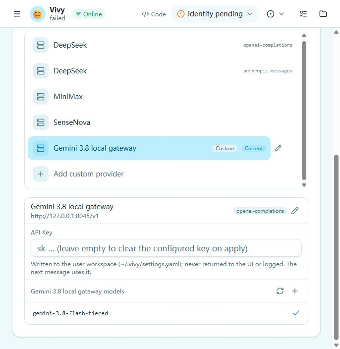

# Manual acceptance

1. At `http://127.0.0.1:3017/settings?tab=model`, keep the existing custom
   `Gemini 3.8 local gateway` selected and enter the credential locally in
   its API Key field. Do not put the key into a verification record.
2. Return to `http://127.0.0.1:3015/` and send the prepared workspace
   list/read prompt. Confirm protected tool results, the exact nonce in the
   answer, one completed terminal, and an idle Run.
3. Send a follow-up, cancel a separate active request, and confirm another
   message still works without a remaining active Run.
4. Record the human result and redacted Run/call/result identities. Until
   then, D14 and issue 91 remain open.

The initial instrumented smoke ended at the explicit missing-key failure of
`run_32691d05730312ad`. The owner subsequently reported success after the
credential handoff; the custom-provider manual smoke is therefore reported
passed. The complete tool/follow-up/cancellation checklist above was not
separately confirmed and remains pending. The previous SDK success did not
save a key in Vivy.
The current package supports the selected custom provider; an embedded-vendor
environment workaround is no longer the required route.

The visible configuration handoff is captured below. The credential input is
write-only and the screenshot contains only its placeholder.

