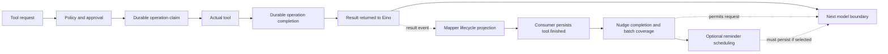

# Core Insight: Where Vivy's Agent Loop Should Shrink

Date: 2026-10-19

Status: Source-backed architectural diagnosis and deletion proposal. No runtime changes implemented by this document.

Priority: Resolve these core execution dependencies before treating new Recipes, examples, or development workflows as the solution.

## 1. The central finding

Vivy already delegates model/tool iteration to Eino. The most important simplification is to reduce the number of surrounding components that can prevent that iteration from advancing.

The problem is **distributed authority over progress**. A tool can have finished and its operation outcome can already be durable, while subsequent model progress still depends on lifecycle projection, consumer-maintained completion state, an advisory reminder barrier, and model observation settlement. These components protect different promises, but their failure and waiting policies are combined on the foreground path.

The removal target is not every check, state object or hash. It is the additional authority granted to auxiliary state: the ability to veto a model request, withhold stream completion, or hold a shared execution lock.

Three conclusions guide deletion:

1. Keep the existing durable boundary around real tool effects. It is not equivalent to the legacy lifecycle events.
2. Remove advisory and presentation work from prerequisites for progress. Preserve execution guarantees currently mixed into those mechanisms.
3. Make optionality real inside the runtime. A small Recipe cannot remove a feature that `NewEngine` or `Service` installs unconditionally.

A smaller module list, fewer lines, or green unit tests alone would not establish that these dependencies have disappeared.

## 2. Evidence standard and scope

Source baseline: `origin/main@e96092966cfbfa443648374948e7e7e16dd01683`. Local product source remains based on the older `b4db00bd`; remote files were inspected with `git show` and `git grep`. All implementation line references below refer to the audited remote commit, not a later upstream revision.

The review follows normal execution, refusal, recoverable failure, approval recovery, model streaming, publication and cancellation. It also examines the requirements that introduced the dependencies. It is not an audit of every plugin, provider or UI component.

- **Confirmed:** control flow, data ownership or error propagation visible in code.
- **Risk:** a consequence possible under stated conditions, not reproduced here.
- **Open:** a hypothesis requiring targeted evidence before being treated as a defect.
- **Proposal:** a behavior or architecture change requiring an explicit decision.

No live provider experiment, production Journal access, fault-injection run or performance measurement was performed. Existing tests were inspected, not rerun against an extracted remote checkout. This review does not claim to have reproduced the user's failed Run or an actual deadlock.

The broader [slimming review](2026-10-19-agent-loop-slimming-review.md) covers product scope and development workflow. This document refines its ownership claims and establishes prerequisites for deletion.

## 3. Four different facts currently mixed together

| Fact | Meaning | Current representation | Required authority |
| --- | --- | --- | --- |
| Execution ownership | May this operation execute, and did it already execute? | Policy/approval and durable ToolOperation claim/completion; Work has its own committed identity | Must control effects and replay |
| Tool outcome | What result or failure should the model receive? | Adapter result plus typed failure marks in nudge state | Must reach the model accurately |
| Presentation history | What should transcript and inspector display? | `tool.requested`, reconstructed `tool.started/finished`, mapper and message projection | Must represent execution truth without becoming another execution authority |
| Advisory behavior | Would repeated failure benefit from a reminder? | Nudge window, batch, notice and scheduling event | Optional; should not decide whether continuation is possible |

Not all representations are interchangeable duplicates. Streamed call/result correlation and effect receipts have distinct purposes. The problem is that presentation and advisory state have independent stop/wait conditions, while outcome classification is attached to advisory state.

### `tool.started` does not mean execution started at that moment

`mapper.go:636–675` reconstructs `tool.started` immediately before `tool.finished` when processing the result. It does not emit that start event at tool execution entry.

The real effect bracket is `ClaimToolOperation -> invoke -> CompleteToolOperation` at `tool_operation.go:198–246`. SQLite persists operation transitions and their `tool.operation` Journal events transactionally.

Therefore:

- The legacy started/finished interval is not a reliable measure of actual tool duration.
- Retaining those events while deleting operation records would remove the real effect fence.
- Diagnosis must distinguish requested, claimed, completed and projected states. This does not establish that the UI lacks all other running indicators.

Sources: [lifecycle projection](https://github.com/ProjectViVy/agent-vivy/blob/e96092966cfbfa443648374948e7e7e16dd01683/internal/runtime/mapper.go#L636), [operation execution](https://github.com/ProjectViVy/agent-vivy/blob/e96092966cfbfa443648374948e7e7e16dd01683/internal/runtime/tool_operation.go#L149), [transactional completion](https://github.com/ProjectViVy/agent-vivy/blob/e96092966cfbfa443648374948e7e7e16dd01683/internal/storage/sqlite/tool_operations.go#L115).

## 4. An ordinary tool call traced to continuation

For a normal governed tool using the operation coordinator:

1. Eino produces a structured call. The mapper correlates its ID/arguments and creates requested-event state.
2. The adapter validates arguments, evaluates policy, applies permitted hooks/middleware and binds the effective invocation.
3. The coordinator admits the operation. Approval may suspend before claim.
4. A durable claim establishes execution ownership. The actual tool follows the claim and a subsequent execution check.
5. The adapter prepares the bounded result. Completion commits before an ordinary result returns to Eino. Completion persistence failure returns an error and leaves an unresolved claim.
6. Eino receives the result. Separately, the mapper processes a result event, reconstructs lifecycle events and parks a `completedCall` copy.
7. `Service.consume` persists `tool.finished`, transfers the completion into nudge state and updates its outstanding-ID set.
8. Before the next request, nudge `Take` waits for the trailing tool-result IDs to be covered by durable completions. The consumer can seal a batch; `Take` can also seal a fully satisfied batch itself, including recovery cases.
9. If selected, reminder scheduling must persist before the request proceeds. Model observation imposes additional request, chunk and settlement obligations.



This is a dependency graph, not a promise that asynchronous messages have a single wall-clock order. It shows the additional handoff after the normal operation is already complete.

### Why deleting a barrier alone is unsafe

| Path | Difference from ordinary coordinated execution |
| --- | --- |
| Early invalid arguments or policy refusal | A model-visible refusal may return before an operation is admitted |
| Allowlisted invocation failure | Returns diagnostic text with nil Go error; typed outcome travels through nudge state |
| Approval | Admission precedes interruption; claim/execution follow valid resume |
| Question | Uses a separate interrupt/result path |
| Work-control tool | Uses Work commit/deduplication rather than generic ToolOperation |
| Completed-operation replay | Returns stored result/failure without re-executing the body |

Each path needs a defined authoritative outcome boundary before consumer barriers disappear. Reuse existing governed execution and storage boundaries rather than inventing a transaction framework.

Sources: [dispatch](https://github.com/ProjectViVy/agent-vivy/blob/e96092966cfbfa443648374948e7e7e16dd01683/internal/runtime/tooladapter.go#L564), [result return](https://github.com/ProjectViVy/agent-vivy/blob/e96092966cfbfa443648374948e7e7e16dd01683/internal/runtime/tooladapter.go#L825), [consumer](https://github.com/ProjectViVy/agent-vivy/blob/e96092966cfbfa443648374948e7e7e16dd01683/internal/runtime/service.go#L3731), [Take](https://github.com/ProjectViVy/agent-vivy/blob/e96092966cfbfa443648374948e7e7e16dd01683/internal/runtime/nudge_state.go#L320).

## 5. How auxiliary work acquires execution authority

### 5.1 Reminders became a mandatory coordination protocol

**Confirmed.** `NewEngine` always installs `newNudgeMiddleware`. Initial execution, approval resume and steering resume create nudge state. Even successful batches producing no reminder must satisfy the handoff.

The state includes a batch, remaining IDs, completed calls, satisfied recovery siblings, failure marks, a repetition window, notice, sealed IDs, terminal error and notification channel. Register/Complete/Seal reject invalid combinations. Take waits for coverage or cancellation. Reminder persistence failure aborts the model boundary.

The original requirement was useful: allow correction after a failed call. It was combined with reminders at the third and fifth repeated failure within ten calls. Correction does not inherently require that window, scheduling event or recovery protocol.

**Deletion insight:** separate correction from coaching. Preserve recoverable results; retire reminder/window semantics and state needed only to support them. Deleting the small signature hash alone leaves the dominant coordination intact.

The nudge mutex is not held during Journal I/O or provider calls. This is not a claim of a simple mutex-held-across-I/O deadlock inside nudge.

Sources: [unconditional construction](https://github.com/ProjectViVy/agent-vivy/blob/e96092966cfbfa443648374948e7e7e16dd01683/internal/runtime/engine.go#L364), [initial state](https://github.com/ProjectViVy/agent-vivy/blob/e96092966cfbfa443648374948e7e7e16dd01683/internal/runtime/service.go#L3211), [resume state](https://github.com/ProjectViVy/agent-vivy/blob/e96092966cfbfa443648374948e7e7e16dd01683/internal/runtime/service.go#L4973), [design requirements](https://github.com/ProjectViVy/agent-vivy/blob/e96092966cfbfa443648374948e7e7e16dd01683/docs/architecture/NUDGE-DESIGN.md).

### 5.2 Failure semantics depend on advisory state

**Confirmed.** `tooladapter.go:884–895` converts selected errors to diagnostic results only when nudge state exists. `markInvocationFailure` writes through that state. Cancellation, native interrupts and infrastructure errors are deliberately excluded from the recoverable allowlist.

**Risk.** Removing nudge before extracting classification would make some correctable failures fatal again and remove typed refusal metadata.

**Open recovery question.** A recoverable failure can be committed as result text with an empty operation `Failure`, while its classification remains in transient nudge state. `toolOperationResolution` returns stored Result/Failure without rerunning classification. Verify whether replay preserves typed outcome metadata. Diagnostic text can survive even if structured classification is lost; this does not prove every consumer then treats the call as successful.

**Deletion insight:** keep one outcome representation independent of reminders, including recovery meaning. Adapt existing outcome/storage representations if needed; do not add a general error framework, soften arbitrary infrastructure failures, or retry effects with unknown outcomes.

Sources: [classification](https://github.com/ProjectViVy/agent-vivy/blob/e96092966cfbfa443648374948e7e7e16dd01683/internal/runtime/tool_failure.go#L45), [conditional conversion](https://github.com/ProjectViVy/agent-vivy/blob/e96092966cfbfa443648374948e7e7e16dd01683/internal/runtime/tooladapter.go#L884), [replay](https://github.com/ProjectViVy/agent-vivy/blob/e96092966cfbfa443648374948e7e7e16dd01683/internal/runtime/tool_operation.go#L306).

### 5.3 Observation controls data delivery and end-of-stream

**Confirmed.** `observeStream` calls `obs.Chunk` before forwarding a chunk and `obs.End` before exposing EOF. Their errors propagate into the stream. Generate similarly rejects a response when observation fails.

For stream-mode calls, Chunk waits for mapper settlement before reserving budget and persisting emitted events. End persists usage/call-finished evidence and may synchronously invoke warming. Receiving model text therefore does not establish that the observed call has completed or that the loop can advance.

These are intentional accounting, ordering and durability semantics, not evidence of a deadlock. The architectural question is which observations deserve execution authority.

**Deletion insight:** retain necessary provider admission/accounting; reduce transient observations and display obligations on the producer path. Replacing the wrapper with callbacks while promising unchanged synchronous durability would conceal a contract change.

Sources: [stream wrapper](https://github.com/ProjectViVy/agent-vivy/blob/e96092966cfbfa443648374948e7e7e16dd01683/internal/runtime/model_stream_observer.go#L193), [Chunk/End](https://github.com/ProjectViVy/agent-vivy/blob/e96092966cfbfa443648374948e7e7e16dd01683/internal/runtime/service.go#L3356).

### 5.4 Optional diagnostics share a helper that terminates Runs

**Confirmed control path.** `cachewarmer.journal` ignores the return of `persistAndPublish` for the optional `cache.warmed` marker. But that helper calls `emitTerminal` itself when append fails. Ignoring the return does not make the diagnostic best effort.

Warming requires explicit streaming-mode configuration and model support; a successful observed call also needs reported usage before End invokes it. It is absent from the default unconfigured path. When eligible, warming adds a synchronous provider request with a 60-second timeout, followed by its settlement work.

Diagnostic event-budget exhaustion skips the marker; Journal append failure can terminate the Run. Ordinary warming provider errors are recorded and swallowed, and pre-call budget denial skips warming. It is incorrect to say every warming error is fatal.

**Deletion insight:** delete warming when unnecessary. More generally, optional-evidence helpers must not secretly own Run termination. Keep failure policy explicit at the required operation boundary without creating another persistence subsystem.

Sources: [optional diagnostic](https://github.com/ProjectViVy/agent-vivy/blob/e96092966cfbfa443648374948e7e7e16dd01683/internal/runtime/cachewarmer.go#L210), [terminal side effect](https://github.com/ProjectViVy/agent-vivy/blob/e96092966cfbfa443648374948e7e7e16dd01683/internal/runtime/service.go#L5192).

### 5.5 Shared locking includes publication and extension work

**Confirmed.** `persistAndPublish` holds `projectionMu` across append, selected message projection, tool-search activation updates and synchronous sink/hooks. Admission also holds this service-wide lock across substantial preparation.

**Risk.** A blocked sink/hook can delay other work using the lock. The headless sink writes synchronously to its output writer. A persistence timeout cannot interrupt waiting for a mutex or a sink API without a context.

**Counterevidence.** The normal Web Bus uses nonblocking sends and drops slow subscribers. Observer providers are notified through worker wakeups; channel network delivery is queued. Session projection errors are logged rather than returned as fatal errors, although projection latency remains synchronous.

**Deletion insight:** keep necessary commits serialized but remove derived work and external delivery from their critical section. Preserve session deletion and terminal consistency. Do not blame slow browsers or introduce another authoritative queue.

Sources: [critical section](https://github.com/ProjectViVy/agent-vivy/blob/e96092966cfbfa443648374948e7e7e16dd01683/internal/runtime/service.go#L5192), [publish](https://github.com/ProjectViVy/agent-vivy/blob/e96092966cfbfa443648374948e7e7e16dd01683/internal/runtime/service.go#L5405), [Web Bus](https://github.com/ProjectViVy/agent-vivy/blob/e96092966cfbfa443648374948e7e7e16dd01683/internal/events/bus.go#L46), [headless writer](https://github.com/ProjectViVy/agent-vivy/blob/e96092966cfbfa443648374948e7e7e16dd01683/internal/app/headless.go#L220).

### 5.6 Cancellation-aware is not time-bounded

**Confirmed.** Runs use `WithCancel(WithoutCancel(requestCtx))` to survive browser disconnects. BudgetPolicy bounds counts, not elapsed time. Nudge Take and mapper settlement have no independent deadline. The stream pump calls upstream Recv directly; downstream closure is detected later at Send.

**Risk.** Progress depends on explicit Run cancellation and upstream operations honoring it or eventually returning. Detached persistence timeouts do not bound all these waits. No stalled upstream or complete lock cycle was reproduced.

**Deletion insight:** first remove waits needed only by auxiliary state. Avoid adding a watchdog, retry loop and recovery table around every wait. Each remaining long operation needs a clear cancellation owner and tested release path.

Sources: [Run context](https://github.com/ProjectViVy/agent-vivy/blob/e96092966cfbfa443648374948e7e7e16dd01683/internal/runtime/service.go#L1561), [budgets](https://github.com/ProjectViVy/agent-vivy/blob/e96092966cfbfa443648374948e7e7e16dd01683/internal/runtime/budget.go#L23), [stream pump](https://github.com/ProjectViVy/agent-vivy/blob/e96092966cfbfa443648374948e7e7e16dd01683/internal/runtime/model_stream_observer.go#L219).

## 6. Hashes: a real hot-path example, not a universal diagnosis

The application installs an AuditHook by default. Each event reaching it gets a payload SHA-256 before the digest is passed to the debug sink. Computation happens before the logging layer decides whether to emit the message. This is auxiliary work on synchronous publication.

No measurement establishes that hashing caused the incident. The stronger removal argument is that this optional diagnostic correlation need not belong to the execution guarantee. Its cost includes the surrounding hook/logging path, not merely a hash operation.

| Family | Purpose and cadence | Judgment |
| --- | --- | --- |
| Audit payload SHA-256 | Per event reaching the default hook; diagnostic correlation | Strong deletion candidate with the auxiliary audit path; preserve canonical Journal and necessary secret-safe logging |
| Nudge FNV signature | Advisory repetition window | Delete with reminders; the signature function is much smaller than the surrounding protocol |
| Cache-prefix SHA-256 | Optional warming evidence | Delete with warming |
| Operation request/effective-argument digests | Bind recovery to the exact invocation | Retain until an equally explicit existing representation replaces the guarantee |
| Approval arguments and file preconditions | Prevent execution of changed operations/targets | Retain at the authorization/effect boundary |
| Checkpoint checksum/version/prompt identity | Validate actual recovery input | Retain at recovery; review compatibility requirements separately |
| Source-tree digest | Assembly/publication identity | Not a per-turn source scan; optimize development duplication separately |

Sources: [default audit hook](https://github.com/ProjectViVy/agent-vivy/blob/e96092966cfbfa443648374948e7e7e16dd01683/internal/app/app.go#L805), [audit computation](https://github.com/ProjectViVy/agent-vivy/blob/e96092966cfbfa443648374948e7e7e16dd01683/internal/runtime/audit.go#L35), [nudge window](https://github.com/ProjectViVy/agent-vivy/blob/e96092966cfbfa443648374948e7e7e16dd01683/internal/runtime/nudge_window.go), [source catalog](https://github.com/ProjectViVy/agent-vivy/blob/e96092966cfbfa443648374948e7e7e16dd01683/sdk/internal/assembly/source.go#L72).

## 7. Why minimal and plugin rules alone will not fix this

Recipes select modules, not every behavior installed inside the retained application/runtime code.

Confirmed examples:

- Nudge middleware is unconditional, with new state in each execution leg.
- Work-plan guidance is unconditional. When Work is absent it returns without guidance; when Work exists, its state-read error can fail the model boundary.
- App wiring installs audit independently of choosing a reporting/observer feature.
- Model observation and generic persistence failure policy remain part of the core runtime.

A minimal artifact can omit many modules and retain these failure edges. Module-omission tests cannot establish behavioral isolation inside the retained core.

The test of optionality is: **when this capability is absent, which constructors, waits, storage reads and fatal-error paths disappear?** A plugin directory alone does not remove feature-specific Service responsibilities.

Sources: [engine handlers](https://github.com/ProjectViVy/agent-vivy/blob/e96092966cfbfa443648374948e7e7e16dd01683/internal/runtime/engine.go#L364), [Work state read](https://github.com/ProjectViVy/agent-vivy/blob/e96092966cfbfa443648374948e7e7e16dd01683/internal/runtime/work_plan_guidance.go#L23), [app hooks](https://github.com/ProjectViVy/agent-vivy/blob/e96092966cfbfa443648374948e7e7e16dd01683/internal/app/app.go#L805).

## 8. Specific deletion map

This is a ranked decision map, not an instruction to delete files immediately. Preserve readers for supported historical events/checkpoints. Feature retirement does not authorize modifying released migrations or destroying user state.

| Candidate | Concrete scope | Prerequisite / retained guarantee | Architectural effect |
| --- | --- | --- | --- |
| D1. Remove proactive warming | `cachewarmer.go`, configuration/wiring and feature-only diagnostics/tests | Remove the extra paid call too; retain accounting for foreground calls and readable history | Removes a synchronous provider round trip and auxiliary terminal edge |
| D2. Remove per-event audit digest path | `AuditHook`, default wiring and digest-only logging | Keep canonical Journal and necessary bounded, secret-safe error logs | Removes auxiliary work and a hook from publication |
| D3. Retire reminder/window semantics | `nudge_window.go`, reminder rendering/emission and scheduling requirements | Extract typed outcomes from nudge first; preserve correctable errors | Removes the product promise generating the reminder protocol |
| D4. Retire nudge handoff and parked copies | `nudge_state.go`, `nudge_middleware.go`, mapper completions, consumer outstanding IDs and resume batch restoration | Cover normal, refused, question, Work and replay outcomes at authoritative boundaries | Removes extra owners and consumer-to-next-request dependency |
| D5. Retire synthetic tool-start ownership | Start reconstruction in `toolResultEventsParts` and duplicate lifecycle authority | Derive real claim/completion projection; represent pre-claim refusals separately | Makes execution truth and timing intelligible |
| D6. Remove derived work from shared commit lock | Projection/publication work in `persistAndPublish` and related call sites | Preserve deletion/terminal consistency and replay order; Journal remains authoritative | Prevents output/derived work from owning the critical section |
| D7. Collapse tool visibility lifetimes | Activation/mount projections and session/recovery rebuilding | Decide fixed Run surface or one native large-catalog mechanism; retain permissions | Removes selection synchronization and mismatch-fatal paths |
| D8. Retire same-Run steering | Queue steering, history surgery and duplicate context reconstruction | Explicit cancel/new-Run semantics; retain necessary approvals/questions | Removes an interaction-driven recovery state machine |
| D9. Isolate product-specific admission | Companion authority, toolkit/rules and Work guidance in generic flow | Required capabilities belong to selected modes; no silent replacement of corrupt authority | Shrinks actual core dependencies |

D1/D2 are relatively independent candidates. D3-D5 constitute the central ownership change and need joint design. D6 requires concurrency/replay evidence. D7-D9 change product semantics and should not be bundled into the first core cut.

Do not prioritize deleting `operationFlights` merely because it is another map. It joins an in-process duplicate while durable claims prevent repeated effects. Removing it changes successful joining into conflict/unknown behavior, a lower-priority tradeoff.

Keep the tool-operation crash matrix, call-ID correlation, permissions and recovery fences. Repetition-count tests can disappear with reminders; error-correction, outcome-fidelity and no-duplicate-effect tests must survive through production construction.

### What is actually being deleted

The intended reduction is not only source files. For each candidate, identify the removed product promise, state owner, synchronous wait, failure edge, configuration, and feature-only tests/documentation. Preserve meaningful safety tests and historical compatibility explicitly.

Do not move a rejected state machine into a plugin while leaving the core waiting for its acknowledgment. Do not add a generic handler registry or new event broker to replace a handful of deleted features. No numeric LOC or latency target is justified before measuring the resulting implementation.

## 9. Target ownership after contraction

```text
Service admits one Run with explicit immutable execution inputs
  -> Eino owns model/tool iteration
  -> governed tool boundary owns permission, execution and recoverable outcome
  -> existing durable owner records necessary effect/outcome facts
  -> result returns to Eino for the next model request
  -> existing Journal supplies transcript and inspector projections
```

Presentation and optional analysis read committed facts without acknowledging them back to the loop as a prerequisite. Necessary call accounting remains attached to actual calls. Required recovery must not reconstruct every optional observer state.

Existing operation completion already provides much of the durable-before-result guarantee for ordinary effects. The difficult work is covering exceptional paths and choosing what must be durable, not writing another runner.

### Eino capability check

The pinned `github.com/cloudwego/eino v0.9.13` source was inspected. `adk.NewChatModelAgent`, `adk.NewRunner`, `Runner.Run`, `ResumeWithParams`, `ChatModelAgentConfig.MaxIterations`, and `compose.ToolsNodeConfig` provide the loop, recovery, iteration bound and tool integration. `UnknownToolsHandler` exists for non-existent calls; the current nudge design explicitly leaves it unused.

A bounded error adapter can stay at the existing runtime boundary. Preserve Eino import quarantine. No demonstrated gap requires a new loop or generic scheduler.

The current producer observer implements semantics ordinary callbacks do not automatically reproduce: synchronous persistence, propagated observation errors, and ordering before stream forwarding. Retain the minimal required wrapper or explicitly relax these semantics before adopting a lighter native observation path.

## 10. Locate the actual incident before assigning its root cause

Use an isolated reproduction with existing request capture, tool instrumentation and Journal evidence. No new monitoring framework or production-data access is required.

| Last confirmed boundary | Next question | Area to inspect, not a diagnosis |
| --- | --- | --- |
| Visible model text only | Was a complete structured tool call emitted and parsed? | Provider protocol, stream completion, observation settlement |
| Structured call / `tool.requested` | Refused, awaiting approval, or admitted? | Selection, validation, policy, hooks and interaction state |
| Operation admitted | Was claim acquired? | Approval, duplicate ownership and Run checks |
| Operation claimed | Did the tool return? | Tool/process/network and cancellation |
| Operation completed | Did Eino receive its result and issue another request? | Adaptation, projection, nudge handoff and recovery |
| `tool.finished` persisted | Did batch coverage release and model Begin occur? | IDs/nudge state, input middleware and pre-call accounting |
| Next model request began | Did the provider return and settle? | Provider/transport, observer and optional warming |
| Final model completion | Did terminal commit and cleanup finish? | Terminal storage, publication and lifecycle |

Absent legacy `tool.started` does not prove a tool never began. Completed operation does not prove later projection or continuation succeeded. These distinctions prevent patches to the wrong layer.

## 11. Evidence required before approving the central deletion

Reuse existing fixtures and production construction. Do not create another acceptance harness that excludes the middleware under review.

| Probe | Required proof |
| --- | --- |
| Causal real read-tool exchange | Exact call ID and fresh result enter the second request; final response follows; one terminal and idle cleanup |
| Pause consumer before legacy `tool.finished` | Establish current wait; after contraction, producer-owned facts permit progress without consumer acknowledgment |
| Fail completion persistence after an effect | No normal result advances Eino; restart never blindly repeats the effect |
| Replay recoverable failure | Output and typed unsuccessful outcome survive without re-execution |
| Early refusal / unknown tool | Correctable result reaches the model without an effect or missing-call wait |
| Approval with siblings | Completed siblings do not repeat; the decided call preserves identity and continues |
| Auxiliary diagnostic append failure | Optional evidence cannot create an unintended terminal under the revised contract |
| Slow Web subscriber versus blocked output sink | Distinguish already nonblocking Bus behavior from synchronous sink/lock exposure |
| Cancel during remaining waits | The owner releases; no orphan Run or hidden retry |
| Minimal omitting optional capabilities | Optional constructors, state reads and barriers are absent from execution |

The existing `TestToolOperationCrashMatrix` covers admitted-before-claim, claimed-before-invoke, effect-before-completion and completion-before-checkpoint. Preserve those semantics. Observer tests cover several propagation and cleanup cases; a test named backpressure does not prove indefinite slow-reader or stalled-upstream liveness.

These probes are requirements, not results from this review. Establish current behavior before comparison. Measure provider time, actual tool time, persistence, derived-state waits and cleanup separately. No speedup percentage is supported yet.

Source: [existing crash matrix](https://github.com/ProjectViVy/agent-vivy/blob/e96092966cfbfa443648374948e7e7e16dd01683/internal/runtime/tool_operation_crash_test.go#L43).

## 12. Decisions before implementation

1. Is repeated-failure coaching required? Recommendation: remove it while preserving ordinary correction.
2. Which facts need durable acknowledgment before another effect/request? Recommendation: explicit execution, approval and outcome facts, not every presentation/advisory event.
3. Can transcript projection temporarily lag execution? Recommendation: yes, with reliable replay and honest pending state, not fabricated timing.
4. Is proactive warming worth a foreground call? Recommendation: remove it without demonstrated value.
5. Can basic Runs freeze tool selection and queue follow-ups? Recommendation: prefer those simpler semantics; evaluate large-catalog search and same-Run steering separately.

Revise existing product documents explicitly when adopting these decisions. An auxiliary feature does not become harmless simply because it is called optional, uses bounded memory, or lives behind an interface. Its failure and waiting authority must also be optional.

## 13. Verification and remaining uncertainty

Performed: source tracing at the pinned commit, existing-test inspection, local Eino API inspection, and independent checks of effect ownership and observation/publication. No runtime source changed, no production data was accessed, and no full CI or real-provider run supports these conclusions.

Confirmed findings identify real failure/latency edges and ownership obligations. Risks describe conditions that could stall or misclassify execution. The current manual incident, typed metadata on recovery, cancellation under a stalled provider, and performance impact remain unverified.

The immediate deliverable is a defensible deletion boundary: preserve the real effect fence, remove auxiliary authority over continuation, and prove the result through actual tool feedback. Recipes and examples should demonstrate that smaller core rather than conceal its old dependencies.
