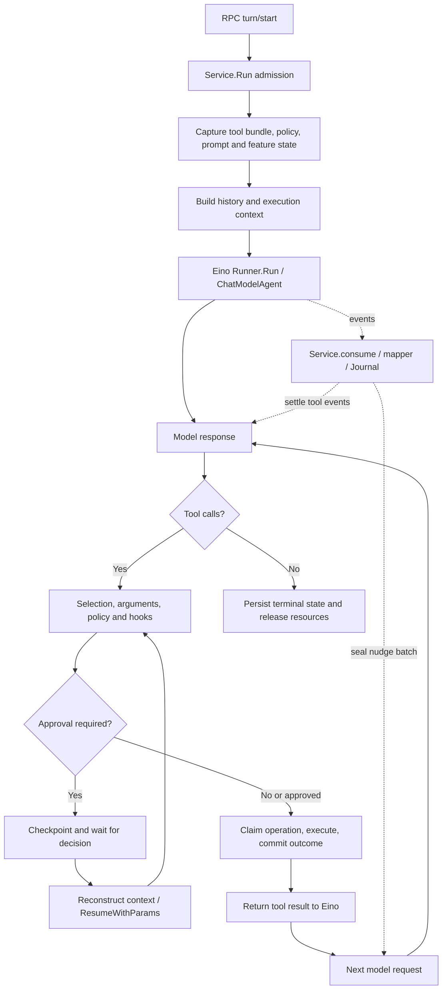

# Vivy Agent-Loop Slimming Review

Status: Draft proposal for discussion; not an approved architecture change.

Date: 2026-10-19

## 1. Decision in brief

Vivy should reduce the responsibilities surrounding its existing Eino agent loop. Reliable tool execution and continuation should be the primary acceptance criterion. Delete unnecessary state, synchronous dependencies, and duplicated ownership before adding further safeguards.

The principal problem is not simply hashes or line count. A basic model/tool exchange depends on surrounding mechanisms agreeing about completion, visibility, persistence, and recovery. Some mechanisms intended to improve reliability introduce additional ways for the exchange to stop.

The proposed target is one existing `Service.Run` path, one Eino runner, one authoritative tool execution boundary, and a small usable default capability set. Optional features must be removable without breaking this path. Do not introduce another runtime, plugin framework, event framework, or test framework.

This review proposes deliberate behavior reductions: removing proactive cache warming and reminder scheduling, simplifying same-run steering, and narrowing durability-before-visibility requirements. These are product decisions, not behavior-preserving refactors.

## 2. Evidence and limitations

The motivating observation is that the model responds, but tool invocation fails or continuation stops. This review identifies structural failure surfaces; it does not establish the definitive cause of that particular incident.

- Audited source: `origin/main@e96092966cfbfa443648374948e7e7e16dd01683`.
- Local checkout during review: `b4db00bdaa47dba58e03ba41d8906b9cf10503d4`. Remote files were read with `git show`; the checkout was not updated.
- Method: static source inspection, existing-test inspection, pinned Eino API inspection, repository size inventory, and official reference comparison.
- No production journals were read. No live-provider reproduction, latency benchmark, or full CI run was performed for this review.
- No implementation, configuration, or normative instruction changes are included.

A waiting path demonstrates a synchronization dependency, not a reproduced deadlock. A deletion proposal does not establish a measured performance gain.

### Size inventory

Physical lines include comments and blanks. Classification uses path/header heuristics. Downloaded dependencies, Studio submodule contents, binary assets, and configuration/data files are excluded.

| Category | Files | Lines |
| --- | ---: | ---: |
| Production source and development scripts | 910 | 228,826 |
| Tests and source fixtures | 703 | 156,165 |
| Generated source | 7 | 1,721 |
| Vendored/third-party source | 7 | 504 |
| Prose documentation | 1,691 | 96,930 |
| Agent rules/skills and their helper scripts | 21 | 3,290 |

`internal/runtime/` contains 121 production files / 44,512 lines and 148 test files / 43,622 lines. Central files include `engine.go` (561), `service.go` (5,507), and `tooladapter.go` (1,033).

These counts do not establish that every line is unnecessary. They show that the host runtime has a much broader scope than model/tool iteration. Splitting large files without deleting responsibilities would not resolve the coupling.

## 3. Current execution path



The dotted edges are important: execution emits events, but model progress also depends on state advanced by event consumption.

All source locations below refer to the audited remote commit, not the older local checkout.

| Boundary | Location | Responsibilities |
| --- | --- | --- |
| Entry | `internal/rpc/control.go:1399`, `:3658` | Dispatch turn start to `RunWithOptions` |
| Admission | `internal/runtime/service.go:925–1618` | Concurrency, reload, options, bundle, prompt, workspace and durable admission |
| Initial execution | `service.go:3114–3228` | History, policy, operations, mounts, activation, observers, nudge and cancellation |
| Native loop construction | `internal/runtime/engine.go:390–427` | Eino `ChatModelAgent` and `Runner` |
| Tool dispatch | `internal/runtime/tooladapter.go:564–855` | Selection, arguments, policy, hooks, approval and execution |
| Effect ownership | `internal/runtime/tool_operation.go:198–246` | Claim, execute and complete; unresolved outcomes cannot be blindly replayed |
| Event consumption | `service.go:3731–3916` | Persist events, update completion state, suspend, resume or finish |
| Approval/question resume | `service.go:4859–4989` | Reconstruct context and call `Engine.Resume` |
| Terminal processing | `service.go:5233` onward | Durable terminal and cleanup |

Initial execution and recovery already use the same Eino loop. Preserve that unity while removing duplicated context construction.

## 4. Findings ordered by impact on the basic loop

### 4.1 Reminder scheduling participates in continuation correctness

**Confirmed:** `nudgeMiddleware.prepare` waits for the tool-result batch to be registered and sealed by the event consumer. Failure to persist a reminder scheduling event aborts the next model call. The consumer maintains outstanding IDs, nudge maintains batch state, and the mapper maintains open calls and parked completions.

Some recoverable tool invocation failures become ordinary model-visible results only when a nudge state exists in the execution context.

**Consequence:** a feature intended to help recovery has become a prerequisite for recovery and continuation. Several owners must agree that the same tool batch completed.

**Proposal:** delete reminder scheduling, its batch lifecycle, and its synchronization barrier. Preserve bounded tool-error results independently of reminders. Move required durable completion into the existing tool execution boundary before removing any barrier that currently enforces it. The mapper should project facts rather than authorize progress.

Sources: [nudge middleware](https://github.com/ProjectViVy/agent-vivy/blob/e96092966cfbfa443648374948e7e7e16dd01683/internal/runtime/nudge_middleware.go#L92), [error conversion](https://github.com/ProjectViVy/agent-vivy/blob/e96092966cfbfa443648374948e7e7e16dd01683/internal/runtime/tooladapter.go#L884), [consumer](https://github.com/ProjectViVy/agent-vivy/blob/e96092966cfbfa443648374948e7e7e16dd01683/internal/runtime/service.go#L3731).

### 4.2 Observation can block or terminate execution

**Confirmed:** the streaming model observer waits for mapper tool settlement before processing chunks. The wait ends on settlement or context cancellation. Mapped chunks and usage events are persisted synchronously. Model completion also waits for usage and finish records.

**Consequence:** execution and event consumption depend on each other. Slow or failed observation/persistence can appear as stalled continuation. This is a concrete coupling risk, not proof of a current deadlock.

**Proposal:** distinguish authoritative business facts from display and diagnostic events. Keep approvals, necessary tool-operation evidence, final messages and Run terminal state durable. Let token deltas and optional diagnostics use bounded best-effort delivery or aggregation through existing facilities. Keep hard budget enforcement separate from usage presentation.

This revises the broad durability-before-visibility contract. A crash may lose uncommitted display deltas; confirmed effects and committed messages remain authoritative. Required effect evidence must not be silently discarded.

Sources: [model observer](https://github.com/ProjectViVy/agent-vivy/blob/e96092966cfbfa443648374948e7e7e16dd01683/internal/runtime/service.go#L3356), [settlement wait](https://github.com/ProjectViVy/agent-vivy/blob/e96092966cfbfa443648374948e7e7e16dd01683/internal/runtime/mapper.go#L777).

### 4.3 Tool availability has overlapping representations and lifetimes

**Confirmed:** construction distinguishes fixed, deferred, suppressed and hidden tools. Native ToolSearch is combined with session activation and suppressed/mounted projections. Dispatch checks the selected set, with a mount exception. A non-selected tool returns an ordinary error; invalid arguments already use a recoverable refusal path.

**Consequence:** advertised, permitted and restored sets can diverge. Recoverable model mistakes receive inconsistent treatment.

**Proposal:** admit one tool surface for a basic Run and its recovery. Configuration changes take effect on the next Run. Retain native Eino ToolSearch only where a genuinely large surface warrants it; delete parallel activation/mount mechanisms. Return bounded errors for non-executed calls where correction is appropriate, without granting access to the tool.

Tradeoffs: immediate skill-driven hidden-tool mounting is removed; advertising more tools may increase prompt size. Measure that before choosing a large-catalog variant.

Sources: [construction](https://github.com/ProjectViVy/agent-vivy/blob/e96092966cfbfa443648374948e7e7e16dd01683/internal/runtime/engine.go#L297), [selection check](https://github.com/ProjectViVy/agent-vivy/blob/e96092966cfbfa443648374948e7e7e16dd01683/internal/runtime/tooladapter.go#L564).

### 4.4 Same-run steering creates a costly recovery promise

**Confirmed:** steering can cancel an execution leg, checkpoint, inject history, and resume the same Run. The consumer explicitly avoids resuming inside the still-open iterator because checkpoint serialization requires the prior execution to drain.

**Consequence:** an interaction convenience couples queues, cancellation, checkpoints, history modification and cleanup.

**Proposal:** default to one next-turn queue. Urgent interruption becomes cancel followed by a new Run. Preserve necessary approval/question recovery. Do not replace steering with another custom scheduling framework.

This deliberately removes seamless same-Run steering and changes its UI/event contract.

Source: [steering and resume](https://github.com/ProjectViVy/agent-vivy/blob/e96092966cfbfa443648374948e7e7e16dd01683/internal/runtime/service.go#L3832).

### 4.5 Admission includes optional feature work inside a broad critical section

**Confirmed:** the roughly 694-line admission function holds `projectionMu` across storage reads and multiple preparation steps. Non-coding faces can require cognitive authority preparation. Uninitialized persona has an explicit onboarding branch; other preparation failures can reject admission.

**Consequence:** feature failures and preparation latency expand the failure surface of basic conversation. A broad service lock can amplify delays across otherwise separate work.

**Proposal:** prepare immutable inputs outside the smallest necessary commit/consistency critical section, retaining a final authoritative concurrency check. Remove companion-specific branching from generic execution. A selected companion mode may explicitly require its authority state; a basic coding/tool mode should not depend on that subsystem.

Do not silently substitute a different identity when authority state is corrupt. Separating product modes and prerequisites is an explicit contract decision.

Source: [admission](https://github.com/ProjectViVy/agent-vivy/blob/e96092966cfbfa443648374948e7e7e16dd01683/internal/runtime/service.go#L925).

### 4.6 Proactive warming adds a foreground provider round trip

**Confirmed:** warming is opt-in. When active and eligible, model settlement synchronously invokes another provider request with a 60-second timeout. Its heuristic describes gross potential savings, not demonstrated net benefit.

**Proposal:** delete proactive warming, its configuration and maintenance branches. Ordinary provider-side caching remains usable. Do not create a new background service to preserve an unproven optimization.

Source: [cache warmer](https://github.com/ProjectViVy/agent-vivy/blob/e96092966cfbfa443648374948e7e7e16dd01683/internal/runtime/cachewarmer.go#L98).

## 5. Validation and state disposition

| Mechanism | Disposition | Boundary or qualification |
| --- | --- | --- |
| Source-tree and Module digests | Keep at assembly/publication; reduce redundant development work | No evidence of full source-tree scanning on every model turn |
| Module/Port compatibility | Validate at assembly | Preserve external source pins and trust boundaries |
| Immutable configuration and schema validity | Validate at construction | Actual model arguments still require invocation-time checks |
| Overlapping prompt/persona/mask/rules identities | Consolidate with the capabilities they describe | Delete redundant copies before deleting checks that protect them |
| Nudge batches and scheduling evidence | Delete with the feature | Preserve independent tool-error semantics |
| Completion mirrors | Give execution facts one owner | Event mapping must not decide whether an effect happened |
| Activation/mount visibility state | Remove from the basic Run path | Large catalogs may use one native discovery mechanism |
| Approval parameter/target binding | Retain | Execution must match the approved operation |
| Effectful operation receipts | Retain | Unknown outcomes cannot be blindly retried |
| Read-only operation bookkeeping | Review separately | Re-executed reads may differ; replay equivalence cannot be assumed |
| Checkpoint integrity/version checks | Retain at recovery | Ordinary turns should not acquire unnecessary recovery obligations |
| Authorization, argument/path validation, cancellation and hard limits | Retain and centralize | These protect concrete execution boundaries |
| Transient token/diagnostic persistence | Remove from execution control | Requires an explicit display/replay contract revision |

Source hashing already deduplicates roots within a catalog construction and rechecks captured source before publication. Measure build-time cost separately from continuation latency. See [source catalog](https://github.com/ProjectViVy/agent-vivy/blob/e96092966cfbfa443648374948e7e7e16dd01683/sdk/internal/assembly/source.go#L72).

## 6. Reference anchors and Eino capability check

The implementation anchor should be the repository-pinned Eino API. Pi and DeepSeek Harness are product and composition references, not specifications to copy wholesale.

| Reference | Useful lesson | Limit |
| --- | --- | --- |
| [Eino ADK quickstart](https://www.cloudwego.io/docs/eino/overview/eino_adk_quickstart/) | Model, tools, feedback and history form the loop; middleware adds bounded behavior | Each additional middleware still needs justification |
| [Eino deer-go entry point](https://github.com/cloudwego/eino-examples/blob/main/flow/agent/deer-go/main.go) | Compose existing framework capabilities | A short entry file is not the complete research-agent implementation |
| [Pi](https://pi.dev/) and its [loop source](https://github.com/earendil-works/pi/blob/main/packages/agent/src/agent-loop.ts) | Keep the loop legible and product scope intentional | Pi also has validation, error handling, hooks and lifecycle state |
| [DeepSeek Harness](https://www.deepseek.com/en/harness/) | Compose capabilities through explicit extension boundaries | Plugin composition alone does not ensure small size or failure isolation |

Pinned API inspection used `github.com/cloudwego/eino v0.9.13`:

- `adk.NewChatModelAgent`, `adk.NewRunner`, `Runner.Run`, and `ResumeWithParams` already own iteration and recovery.
- `compose.ToolsNodeConfig` supports tools, ordered execution, tool middleware, and `UnknownToolsHandler`.
- `ChatModelAgentConfig.MaxIterations` provides a native iteration bound.
- Vivy already uses native skill, tool-search and compaction facilities where configured.

The work is principally reducing Vivy-owned orchestration and clarifying failure semantics. No replacement loop is justified by this review. Preserve the runtime/provider import boundary. Check pinned APIs before implementation rather than copying moving upstream examples.

## 7. Product and development assumptions to reconsider

The species concept can define identity and long-term capability without making a basic tool exchange depend on the full species subsystem.

Current assumptions deserving explicit revision:

1. **All established first-party providers belong to the default Generation.** Replace this with a small usable default and explicitly selected capability sets.
2. **All visible events require synchronous durability.** Narrow this to authoritative business facts; specify transient display behavior separately.
3. **Every internal capability needs the full public extension ceremony.** Preserve public trust and compatibility contracts; avoid multiplying internal descriptors, evidence and projections without actual consumers.
4. **Seamless same-Run continuity is a default requirement.** Prefer simple turn boundaries unless demonstrated needs justify more.
5. **Every delivery needs multiple records and broad verification by default.** Use risk-proportionate checks and one concise record for ordinary changes.

Workflow mandates are repeated across root instructions and skills. Documentation volume is a maintenance signal, not proof that every record is waste. Static inspection cannot establish that a particular skill caused a regression. The actionable concerns are duplicated authority and rules that encourage mechanisms without evaluating their combined cost.

`minimal.vivy.yml` contains seven core modules but no protected-tool provider. It is not by itself a usable minimal coding agent. Examine the existing `lite.vivy.yml` as a starting point for a small usable set; preserve the same production construction and execution path for all variants.

## 8. Proposed replacement development rules

These rules should replace overlapping instructions rather than create an additional mandatory layer.

1. **Accept the complete loop.** A request causes the intended tool execution, the result reaches the next model request, and the Run finishes or explicitly suspends with resources accounted for.
2. **Let Eino own iteration.** Custom machinery requires a concrete gap in the pinned API and a removal boundary.
3. **Optional features must not gate continuation.** Authorization, hard limits and necessary durability are explicit exceptions. Required capabilities must be declared by the selected product mode.
4. **Give each execution fact one owner.** Completion, effective tool selection and terminal state must not require parallel state machines to agree.
5. **Validate where facts change.** Validate immutable inputs at construction, arguments at invocation, and recovery identity at recovery. Repeated checks need a distinct changing input or trust boundary.
6. **Prefer deletion before addition.** New handlers, state, caches, options and background tasks need actual requirements; identify replaced machinery where possible.
7. **Make the default a small usable product.** Basic tools and continuation work without cognitive, reporting or other optional capabilities. All variants use the same runtime path.
8. **Scale verification and records to risk.** Use the core sentinel and affected checks during development; run required full gates on a stable candidate. Skills reference one authoritative rule source.

Preserve storage ownership, credential/policy boundaries, effect safety and worktree isolation. These proposed rules do not authorize silent weakening of current contracts.

## 9. Acceptance: causal tool execution and continuation

Existing tests are substantive. `tool_search_e2e_test.go` uses production `NewEngine` and `Service` for search, execution and a final response. `faithful_pipeline_test.go` checks tool data in the second model input, but its helper in `nudge_contract_test.go` constructs the ADK agent directly and bypasses production middleware assembly. These provide different forms of evidence.

The concentrated gate should reuse existing fixtures and production constructors:

1. Create a temporary workspace containing a fresh synthetic value in a file.
2. Start a Run through production construction with the real read-only file tool.
3. A deterministic model endpoint returns a tool call with a specific call ID.
4. Accept the next model request only if it contains the matching ID and exact tool result.
5. Return a final answer containing the value only after that assertion.
6. Assert exactly two model calls, one actual tool execution, one terminal, necessary durable facts and idle cleanup.

Use a local protocol endpoint when checking provider serialization and stream parsing. Use the real application/Recipe path for product smoke. A scripted Eino model helps focused testing but does not prove transport or full application wiring.

| Scenario | Required outcome |
| --- | --- |
| One real read tool | Exact result reaches the next model request and final answer |
| Multiple calls | Every permitted call has a matching result; no duplication or orphan state |
| Invalid arguments/unknown tool | Bounded error permits correction; no unauthorized execution |
| Policy denial | Denied effect does not occur; the model can explain or choose another action |
| Approval and restart | Approved operation executes at most once, with exact approved inputs |
| Cancellation | No new effects admitted after cancellation; no orphan active Run |
| Optional diagnostic/module failure | Basic loop works where the mode does not require that capability |
| Required persistence failure | Explicit failure or unresolved outcome; no false success or blind replay |
| Slow/disconnected UI | Core progress does not depend on UI acknowledgment |

An authorized real-provider smoke is separate from deterministic, network-free CI. This draft does not claim that such a smoke passed.

## 10. Deletion-first implementation sequence

| Stage | Deliverable | Acceptance |
| --- | --- | --- |
| 1. Establish baseline | Add the causal sentinel to existing facilities; record failures and timing | Production construction proves the exact result-to-next-request transition |
| 2. Remove direct blockers | Delete nudge scheduling and warming; decouple tool errors from reminders | Correction and continuation work without those subsystems |
| 3. Reduce state ownership | One tool surface, one completion owner, shared initial/resume context and simpler queue | No duplicated effects, orphan Runs or ambiguous recovery |
| 4. Shrink product and rules | Small usable default; delete obsolete configuration, events, docs and duplicate mandates | Small and extended products share the execution path and pass relevant scenarios |

Decide each stage's precise contract changes first. Existing gates remain effective until their governing rules are explicitly revised. Avoid a rewrite that changes provider transport, storage, tools and UI simultaneously.

Track maintained code deleted, state owners removed, synchronous failure edges removed, and observed request/tool/continuation timings. Do not invent a LOC or speedup target before measurement. Moving code into another package is not a deletion outcome.

The desired result is a core path a maintainer can follow end to end: why a tool may execute, when its result becomes available to the model, and exactly which conditions can stop progress. Optional capabilities must not become hidden prerequisites.

## 11. Recipe-based development and PR responsibility

Discussion follow-up: minimal should be a supported, usable development baseline. New optional features must enter through existing plugin boundaries. A feature is complete only when adding it to an explicit Recipe enables it and removing it leaves the basic loop functional.

A Recipe defines the assembled capability set and starts the validation scope. Reuse an appropriate existing Recipe; create one when a distinct dependency combination or acceptance scenario warrants it. Kernel correctness changes remain explicit kernel changes, not artificial plugins.

Developer validation should cover the feature, the Host/Port contracts it consumes, actual Recipe assembly/startup, and its end-to-end scenario. Changes to shared runtime, transport, storage or authority boundaries require additional affected checks. A narrow Recipe must not become a way to avoid testing shared impacts.

The proposed division is:

| Stage | Owner | Evidence |
| --- | --- | --- |
| Development | Contributor | Selected Recipe, feature tests and affected shared contracts |
| PR updates | Lightweight GitHub checks | Reproducible Recipe checks and required core-loop coverage |
| Stable merge candidate | Maintainer-triggered GitHub integration | Supported official Recipes and shared integration/release gates |
| Merge | Maintainer | Results correspond to the current candidate; failures resolved |

Contributors need not reproduce the entire integration environment locally, but remain responsible for regressions their changes cause. Full integration means supported official combinations, not every possible plugin permutation. Existing unconditional CI rules and workflows must be revised together before this becomes effective.

A small chat Face should support human testing with actual model tokens: show the selected Recipe/model, messages, tool requests/results, explicit status, cancellation and approvals when required. It must use the production RPC, `Service.Run`, ToolHost and provider adapter, with isolated test data and existing credential handling. It must not introduce a second loop or depend on optional full-product modules. Deterministic local-model CI and human real-provider checks remain distinct evidence.

## 12. Runnable examples as the developer entry point

The repository should provide one `examples/` entry point covering the full contributor journey. Completeness means a developer can start, implement, validate and submit a feature without reconstructing instructions from historical plans. It does not mean creating a demonstration for every internal abstraction.

### Existing material and gap

At the audited commit there is no tracked `examples/` tree. `plugins/hello-fs` is an existing sample v1 Module with source and tests. Its README refers to `recipes/hello-fs.vivy.yml`, which is absent from that tree. This establishes a documented-command gap; no attempt to execute that missing-recipe command was made in this review.

Reuse and repair existing material before inventing replacements. If an example is moved into `examples/`, move its authoritative source and update callers; do not maintain another copy under `plugins/`.

### Proposed learning path

The following tree is a proposed destination, not a claim that these examples or commands already exist:

```text
examples/
  README.md
  01-minimal/
  02-tool-plugin/
  03-feature-recipe/
  04-chat-face/
  05-model-provider/
  06-approval-and-failure/
```

| Example | Question answered | Acceptance |
| --- | --- | --- |
| `01-minimal` | How do I start the smallest usable species? | Production minimal runs a basic tool exchange and returns to idle |
| `02-tool-plugin` | How do I implement one optional capability? | A small namespaced tool is discovered through its declared Port, executes and returns a result to the model |
| `03-feature-recipe` | How do I assemble and validate only the required features? | Explicit minimal dependencies plus the example feature; adding/removing it preserves the baseline |
| `04-chat-face` | How do I test the same product path interactively? | The actual small chat Face drives the selected Recipe through production RPC, including tool continuation |
| `05-model-provider` | How do I adapt a model through the existing boundary? | Uses a supported pinned Eino/EinoExt API and verifies outbound model identity and tool protocol |
| `06-approval-and-failure` | How do I handle denial, errors, cancellation and recovery? | Existing authority and lifecycle paths remain correct; no duplicate effects or stranded Run |

The minimal example references the canonical minimal Recipe rather than copying it. The feature-composition example reuses the tool example's module source. The chat example teaches use or extension of the real small Face rather than forking it. Provider and recovery examples should be added only when their supported seams and prerequisite workflow are established.

### What an example contains

Each example contains a short README with prerequisites, supported commands, expected observable results, a representative failure case, and cleanup instructions. Add module source, descriptor and tests only when that example teaches a new module. Add a Recipe only when a distinct composition is needed; otherwise reference its canonical location. Use existing shared verification infrastructure rather than a bespoke runner in every directory.

The README should identify what can be changed safely, which existing Host/Port it uses, how to run deterministic checks, and how to perform an optional real-provider check. A contributor should be able to follow it from a clean checkout. Dependencies, source pins and Grants must be explicit. Secrets and runtime state must not be committed.

Example code may be source for a selected development artifact, but normal product execution must not load configuration or runtime data from an example directory. Runtime facts must remain owned by the assembled artifact. Examples must never enter the default product merely because their source is present.

### Maintenance and CI

- Treat published examples as supported executable documentation. A README command is not accepted until it has been exercised through the supported workflow.
- Reuse existing test and build commands. Do not introduce a parallel example SDK, validator, registry or workflow format.
- A change to an example or its shared SDK/Host must run its affected example checks. Maintainer integration verifies the supported example set at the merge candidate.
- Deterministic CI must require no paid provider credentials. Human real-token validation is explicit and reports the tested provider/model and outcome without exposing secrets.
- If an interface change breaks an example, update or retire that example in the same PR. Do not leave stale instructions or silently treat a public example as a fixture.
- New features need an appropriate runnable usage/acceptance scenario, not necessarily a new tutorial directory. Reuse an existing example when it teaches the same extension pattern.

Deliver the first three examples as one usable vertical path before expanding the catalog. Then add the actual chat Face walkthrough, followed by provider and failure/recovery examples. Do not create empty numbered directories to imply completeness.

This examples plan is still a proposal. The directory, small Face, recipe-specific CI entry point and new governance rules have not been implemented by this documentation update.

## 13. Draft verification record

- Inspected remote source and existing tests at the audited commit, and pinned Eino APIs locally.
- Reviewed official Eino, Pi and DeepSeek reference material.
- No live incident reproduction or performance measurement was completed.
- This delivery adds a research draft only. Full product CI and browser smoke are not applicable; no executable behavior or product contract changed.
- Proposed rule changes, deletions and acceptance tests remain unimplemented and unverified.
