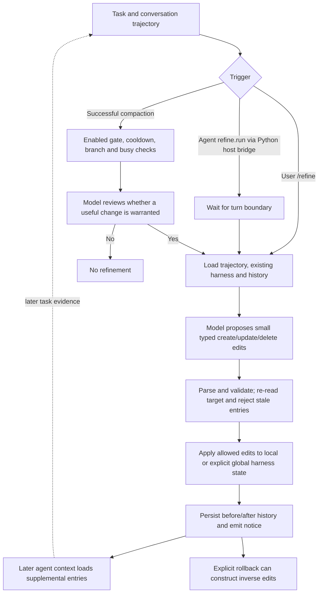
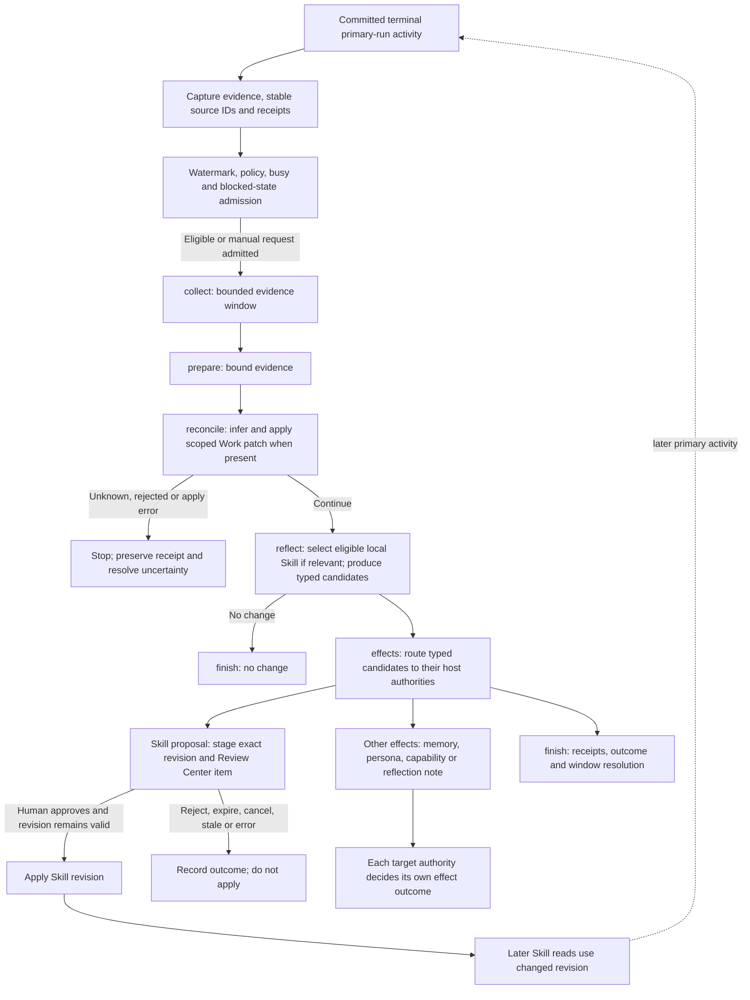
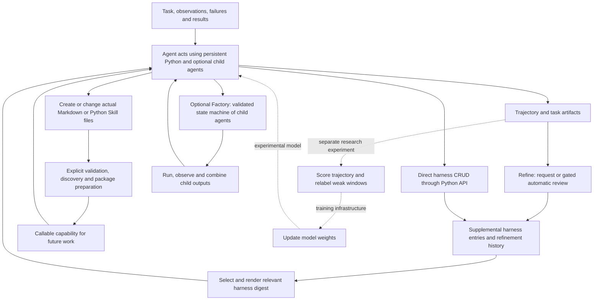
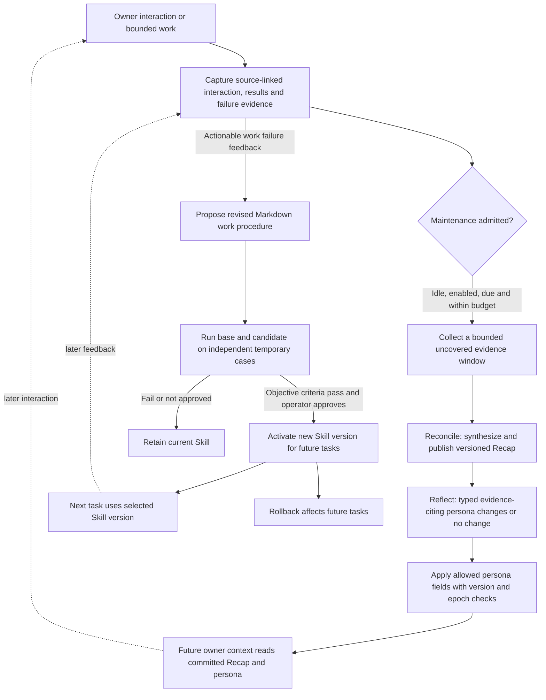

# Research and decision snapshot: Rig, Vivy, Prime Agent, and the Python workbench

Date: 2026-10-25

Status: Research checkpoint with an accepted hybrid architecture, Prime-anchored automatic evolution and Vivy persona extension. Section 17.7 records the separately authorized native Rig subagent implementation in vivy-test; Python/apixis remains future work. This mirror does not authorize original Vivy runtime changes.

Update, 2026-10-27: DESIGN's two-harness and trimmed-workbench decisions supersede
the older evolution/orchestration scope below. Section 18 adds a read-only Go
Vivy migration assessment in vivy-test only; it is not mirrored to the original
checkout and does not authorize implementation or change the accepted scope.

Latest workbench investigation, 2026-10-27: section 19 traces the pinned Prime
implementation, records a fresh Windows REPL test run, and proposes a bounded
workbench scope and acceptance loop. The owner prioritizes workbench validation
before durable. The owner subsequently accepted section 19.9's closure scope,
exclusions and transplant/local implementation ownership, including fresh-state
restart and the separate native-memory consumer gate before durable. This
supersedes earlier proposal labels for those choices; detailed adapter contracts
and the implementation plan remain work to do, with no runtime acceptance implied.
Section 19.7 adds the component-level transplant audit, including all nine
Python-backed Skills found in this pinned checkout's top-level `skills/`.
Section 19.8 adds Python-side tool loading, explicitly requested by the owner.

Scope: Preserve this conversation's findings and latest direction in both repositories.

This report is intentionally saved identically under `docs/research/` in
`vivy-test` and `agent-vivy` at the owner's explicit request. It is a dated
handoff snapshot, not a second runtime configuration or a new architecture
contract. Subsequent experiment implementation belongs in `vivy-test`.
Nothing here authorizes changing the original Vivy repair work or its contracts.

## 1. Latest owner direction

The latest clarification takes precedence over the earlier proposal to move
every capability into Python:

- Keep Pi-style, frequently used coding tools directly available to the model.
- Reuse capabilities already supplied by Rig as selected plugins; wrap only
  where actual product behavior or recipe selection requires it.
- Put advanced, external, and long-tail capabilities into the Python workbench.
  MCP is an example of this deferred surface, not a reason to reproduce Prime's
  entire service catalog, OAuth UI, skill installer, or management platform.
- Carry forward Vivy's useful deferred-tool idea: discover detailed capabilities
  when needed instead of injecting all tool schemas into every model request.
- The workbench is preparation for the owner's PEN system. PEN's meaning,
  contracts, and requirements have not yet been explained. Do not invent them.
- The owner asked to preserve the research and subsequently accepted a miniature
  architecture diagram. Section 16 records the documentation/review checkpoint;
  runtime implementation requires a subsequent implementation task.
- Latest evolution decision: use Prime's concrete continual-harness formats and
  refinement lifecycle as the anchor, with automatic evolution and a focused
  Vivy persona-evolution addition. Section 15 supersedes earlier suggestions of
  a bespoke evolution format or mandatory manual review for every change.

Earlier accepted experiment constraints remain:

- Independent Rust experiment, one YAML recipe and one build-time composition
  path; gateway-first model access.
- Pi coding-agent is the functional reference, with incremental delivery.
  Equivalent Rust/Vivy extensions are wanted, not execution of existing Pi
  TypeScript extensions.
- More, Fast, Good, Frugal: reuse existing components, run useful tasks early,
  keep owned interfaces and total maintenance small.
- No species hash enforcement, standalone plugin SDK, universal Port catalog,
  provenance/conformance platform, or Studio lifecycle in the experiment.
- Do not turn the original Vivy checkout into an experiment dependency.
  Original Vivy repair is a separate effort.

## 2. Inspected baselines and evidence limits

| Project | Inspected revision or source | Interpretation |
| --- | --- | --- |
| vivy-test | Local main `2b03b44`, 2026-10-25 | Existing experiment; latest commit fixes UTF-8 terminal startup. |
| Rig | `55cd481a2421fd5da468b5bd6afc6ac876883599` | Pin used by the experiment; do not substitute historical Rig API assumptions. |
| Pi | `f321e5bdd26b3624bfb2ab182a334d0a5edb698a`, coding-agent 1.4.0 | Prior source inventory; see vivy-test's existing PI-BASELINE.md. |
| Original Vivy local main | `525d50a67152d6e9f5cc2eb469c889c6f26c21ab` | Older local checkout, not the current remote product baseline. |
| Original Vivy remote main | `9cd2801f8090723a652d3e835f72d83715b82121`, 2026-10-20 | Inspected separately through Git objects and official sources; root was not updated. |
| Prime Agent | `5c898d1b27b109bd2d383c68d60a30536e39cc22`, 2026-10-24 | Source, runtime protocol, prompts, and historical changes inspected. |

Research used source/docs/Git history inspection. It did not run a new product
test, benchmark, or model comparison. Existing experiment verification belongs
to its earlier implementation records. The owner reported that the project
passed their test; this report does not infer details of that test.

Source inspection used reference material already available in agent-vivy's
ignored workspace. Successors working on vivy-test should follow its own
reference-setup instructions, not clone or vendor the original Vivy project.

## 3. What Rig supplies, and what belongs to Vivy

At the inspected revision, distinguish the crates:

- `rig-core`: model/provider, completion/streaming, tool, conversation and
  related foundation contracts.
- `rig-agent` and `rig-memory`: agent execution, hooks, tool dispatch,
  conversation/state handling, compaction and related primitives.
- `rig-harness`, `rig-ecs`, `rig-basics`, `rig-tui`: the broader coding-agent
  and plugin environment already reused by vivy-test.
- `rig-rmcp`: an available MCP integration option. The owner's latest choice
  favors the advanced Python surface; do not add both MCP stacks by default.

Rig does not provide Vivy's exact Service.Run/Journal/Policy contract, typed
Port authority model, Grant semantics, or Generation evidence pipeline.
Its reusable coding-agent parts must not be described as full Vivy parity.

Earlier chat estimates were roughly 20-25/100 for rig-core alone, 55/100 for
direct reuse across the broad Vivy product, and 80-90/100 for the coding-terminal
slice using the full Rig ecosystem. These were subjective scope estimates,
not measured feature coverage, effort estimates, or acceptance results.
The later narrowed hybrid direction has a different denominator; do not use
these numbers to justify an implementation schedule.

Rig's upstream launcher documentation described Linux/macOS support. The
experiment's native Windows path is local adaptation with its own recorded
evidence; it must not be confused with an upstream platform guarantee.

## 4. Original Vivy and the remake donor branches

Vivy's useful composition concept is:

```text
Recipe -> selected Modules -> typed wiring -> compiled artifact
```

The original implementation also carries Port ownership/cardinality, trust,
Grants, source identity, lifecycle, conformance and Inspect obligations.
The experiment retains recipe-selected compilation without inheriting that
whole platform.

The local engine separates fixed-visible and deferred active tools and uses
Eino's `adk/middlewares/dynamictool/toolsearch`. This is evidence for the
owner's remembered deferred-tool mechanism, not a claim that the future
Python workbench already implements it.

The remake refs are not 16 accepted replacement implementations:

- 16 feature donor branches plus integration and archive refs were inspected.
- Feature areas include core fixes, providers, Notebook, reports, toolkits,
  BML, Recap, cognition, skill evolution, persona, workflow, ACP, tool
  parallelism, chat UI, miscellaneous changes, and warming.
- The integration plan says the published feature refs are raw donors and
  are not build/product-accepted. R10-R24 are blocked; R25 is a historical
  warming handoff.
- Feature branches share source base `202aac38`. The archive preserves the
  frozen history; integration is the planning/contract line.
- Code existing in the historical main tree does not prove the reorganized
  donor feature has been accepted against the repaired core.

Remote main's TODO also leaves material work open: toolkits acceptance,
unified memory/Recap integration, Eino child/DAG lifecycle gates, session
continuity, ACP integration/platform checks, and provider migration.
Do not present directory presence or donor branch counts as shipped capability.

## 5. Prime's actual evolution: correction to earlier discussion

An earlier answer treated retained bash/edit implementation files and stale
instruction text as evidence that those tools remain default model tools.
That was incorrect. Actual tool registration, the current core prompt, and
historical changes show the normal built-in model surface is `python_repl`.
SDK/custom tooling and old transcript rendering are separate concerns.

| Change | Evidence and meaning |
| --- | --- |
| 2026-05-08, PR #3, `4a7a55c9a` | Made ipython the only default-active tool; removed read/write/grep/find/ls; bash/edit remained explicitly selectable. The author's stated reason was matching the RLM-trained tool surface. |
| 2026-07-06, PR #323, `a20988132` | Removed bash/edit from the built-in tool registry. Shell work and editing continued through Python; some legacy implementations remained for custom use/replay. |
| 2026-10-01, PR #3211, `a3700282c` | Removed ineffective tool-selection flags. |
| Inspected current source | The core prompt says one tool, python_repl; session construction adds it to the configured tool set. |

Prime selected Python-first interaction early. The reviewed records do not
establish that a long-running hybrid design was benchmarked and found inferior.
Training-interface consistency is an explicit motive. Keeping large data
outside the main model context and enabling programmable composition are
documented RLM objectives. Reduced duplicate interfaces is an engineering
inference, not a published measured benefit.

"Python-only" here describes the normal model-facing action interface.
Prime's host, supervision, sessions and much of its management are Rust.

## 6. Prime's skills, MCP, and harness state are distinct

### Skills

Rust discovers Markdown skills and Python skill packages, parses metadata,
handles collisions, and advertises a compact inventory. Python skills have
SKILL.md, pyproject.toml, and an importable package. Host bootstrap uses uv
editable installs with incremental manifest checks and reports unavailable
packages. A Python skill does not need its own model tool schema.

Some core Python packages are only host-request wrappers: compact, goal,
refine, agent_message, agent_observe and rlm_heartbeat rely on Rust handlers.
Copying those Python packages alone does not transfer the capabilities.

### MCP

A generic Python MCP client offers catalog/connection discovery, live tool
search/description and calls. Adding a service is generally configuration plus
authentication, not a new per-service skill package.

Rust owns configuration, service/connection management and authentication.
Python resolves configuration through host requests, opens stdio or HTTP
connections, discovers schemas and performs calls. It reuses matching
connections and rebuilds changed ones, applies tool filters and timeouts, and
reports incomplete discovery as failure. Calls on the same connection are
serialized in the inspected implementation.

This division is evidence, not a requirement to copy Prime's entire
management surface into the experiment.

### Harness state

Harness entries store prompt notes, memories, skill callable references,
subagent descriptions and refinement history. A harness "skill" entry is not
installation of executable code. Python owns a file-backed harness-state
implementation; refinement scheduling and integration with the main run use
host facilities. Do not conflate this store with the session transcript.

## 7. RLM and long-context handling

RLM means Recursive Language Model. In this discussion it is a harness/execution
method around existing models, optionally supported by model training for that
environment. It is not a requirement for a new base-model architecture.

A characteristic flow is:

```text
Goal + reference to large data
  -> model writes Python to inspect/filter/split it
  -> intermediate data stays in variables/files
  -> selected evidence enters model context
  -> optional child-model analysis
  -> integration and further inspection
```

Assigning a large object to a Python variable does not make the model see its
contents. Printed output, displayed values, attachments and explicit messages
are the parts that can enter model context. Printing the entire object loses
the context-saving benefit.

Important boundaries:

- Prime's inspected ordinary text admission constructs a user message. Do not
  claim arbitrary pasted long text is automatically externalized.
- To avoid paying for a huge first model input, ingestion must store the material
  before that request and provide a reference plus necessary description.
- Modern conventional coding agents can also search files, retrieve excerpts,
  compact history and delegate. Python does not uniquely enable those behaviors.
- Exhaustive semantic analysis still requires reading the relevant material.
  Recursive calls can increase cost and latency; no benchmark here proves savings.
- A Python workbench is useful without recursive subagents. RLM is a possible
  later capability, not the current experiment's minimum requirement.

## 8. Proposed minimal workbench boundary

This section records assistant recommendations, not newly accepted APIs.

Keep the model-facing frequent coding tools and add the optional workbench:

```text
Model -> direct read/write/edit/shell tools -> selected Rig/Vivy plugins
      -> python_repl -> deferred capability discovery/calls + data composition
```

The useful workbench primitives are persistent execution, named intermediate
state, bounded inspection/output, external capability discovery and invocation,
managed long-running work, and file/artifact delivery.

- Reuse an existing tool implementation if Python also needs that capability.
  Do not maintain independent edit/shell semantics on both sides.
- Keep one host owner for the agent loop, gateway model calls, transcript,
  cancellation and execution lifecycle.
- Use ordinary Python functions and packages where sufficient. A universal
  Plugin interface or public SDK is not a prerequisite.
- Persistence between cells does not imply recovery of arbitrary Python objects
  after worker restart. Preserve authoritative data in files when necessary.
- A cell is not a transaction. Partial writes or remote effects can precede an
  exception; do not automatically replay failed cells.
- Keep structured protocol traffic separate from stdout/stderr. Capture output
  honestly, preserve call identity, and make cancellation/status observable.
- A trusted Python process with OS access is not a security sandbox.

The current experiment already has an optional stdlib-only Python worker,
top-level await, state across ordinary calls, bounded output and Windows process
ownership. Its DESIGN records namespace loss on timeout/cancellation/restart
and explicitly excludes automatic installs, background tasks, snapshots,
subagent APIs and programmatic tool bridges. Those exclusions must not be
reported as implemented merely because they were discussed today.

## 9. Recipe/build semantics and unresolved choices

The established Rust recipe continues to choose compiled components. Selecting
a Python workbench plugin at build time is compatible with that experiment.

A future recipe selecting Python capability packages would also need to package
those sources and dependencies. That can be one assembly/build delivery, but
it does not make interpreted Python packages native Rust code compiled into
one executable. The earlier suggestion to ship a fixed Python environment was
a proposal, not an accepted packaging decision.

Still unresolved, awaiting the owner:

- PEN's actual purpose, requirements and relationship to the workbench.
- Which external capabilities should enter the first deferred catalog.
- Whether advanced tool descriptions stay exclusively in Python or can be
  promoted into the direct model tool set.
- Minimum metadata/discovery interface and necessary host bridge operations.
- Packaging, dependencies, restart semantics and observability for advanced work.

No implementation order, migration, public API, or full-Python conversion is
authorized by this checkpoint. Preserve the working experiment while the owner
explains the next idea.

## 10. Source map

- [Rig pinned overview](https://github.com/0xPlaygrounds/rig/blob/55cd481a2421fd5da468b5bd6afc6ac876883599/README.md)
- [Vivy Assembly contract at inspected remote main](https://github.com/ProjectViVy/agent-vivy/blob/9cd2801f8090723a652d3e835f72d83715b82121/docs/architecture/VIVY-ASSEMBLY.md)
- [Remake integration plan at inspected ref](https://github.com/ProjectViVy/agent-vivy/blob/0059b73138b3830fd3bfc1c041b9bc8353e93a33/docs/superpowers/plans/remake-20261019/index.md)
- [Vivy remote-main open board](https://github.com/ProjectViVy/agent-vivy/blob/9cd2801f8090723a652d3e835f72d83715b82121/docs/TODO.md)
- [Prime PR #3: explicit RLM training-interface rationale](https://github.com/PrimeIntellect-ai/prime-agent/pull/3)
- [Prime PR #323: removal of bash/edit built-in entries](https://github.com/PrimeIntellect-ai/prime-agent/pull/323)
- [Prime PR #3211: tool-selection flag removal](https://github.com/PrimeIntellect-ai/prime-agent/pull/3211)
- [Prime's RLM explanation](https://www.primeintellect.ai/blog/rlm)
- [Prime core model-facing interface](https://github.com/PrimeIntellect-ai/prime-agent/blob/5c898d1b27b109bd2d383c68d60a30536e39cc22/crates/pa-core/src/prompts/layers/core.md)
- [Prime workbench usage rules](https://github.com/PrimeIntellect-ai/prime-agent/blob/5c898d1b27b109bd2d383c68d60a30536e39cc22/crates/pa-core/src/prompts/layers/usage.md)
- [Prime REPL protocol](https://github.com/PrimeIntellect-ai/prime-agent/blob/5c898d1b27b109bd2d383c68d60a30536e39cc22/prime-agent-runtime/src/rlm/repl.md)
- [Prime generic MCP client](https://github.com/PrimeIntellect-ai/prime-agent/blob/5c898d1b27b109bd2d383c68d60a30536e39cc22/prime-agent-runtime/src/rlm/mcp.py)
- [Prime skill discovery](https://github.com/PrimeIntellect-ai/prime-agent/blob/5c898d1b27b109bd2d383c68d60a30536e39cc22/crates/pa-core/src/skills/discovery.rs)
- [Prime Python skill bootstrap](https://github.com/PrimeIntellect-ai/prime-agent/blob/5c898d1b27b109bd2d383c68d60a30536e39cc22/crates/pa-core/src/kernel/bootstrap/venv.rs)
- [Prime ordinary prompt admission](https://github.com/PrimeIntellect-ai/prime-agent/blob/5c898d1b27b109bd2d383c68d60a30536e39cc22/crates/pa-core/src/session_engine/admission.rs)

This delivery changes research documentation only. Validation is content review,
identical-copy comparison and Git whitespace checks. It does not establish new
runtime behavior or supersede either repository's implementation evidence.

## 11. Later discussion: embodied-agent workflows

The owner clarified that the Gemini example concerned a model operating a
physical robot, constructing a simulation environment, and learning execution.
The following are vendor-reported demonstrations, not independently reproduced
results. Keep the two experiments separate:

- Google's October 13, 2026 Argon announcement describes a human cornhole video
  being turned into environment coordinates, whole-body joint motions, and
  simulation code, then transferred to Apptronik's Apollo. Google reports seven
  consecutive successful shots. The announcement alone does not establish that
  this example trained a new neural controller, nor expose complete trial counts
  or controller implementation. Generating a simulation scene/program does not
  mean implementing a new physics engine.
- Google's robotics article describes a separate tabletop experiment: an RGB
  photo becomes a MuJoCo twin, tasks and a closed-loop trajectory generator;
  4,500+ randomized simulation episodes are exported for VLA fine-tuning. Google
  reports real-robot success increasing from 56% to 75%, and completion time
  decreasing from 35 to 24 seconds. The article does not fully specify the model,
  fine-tuning time, or who launched every training/deployment step.

Neither account establishes that Argon updated its own weights during the task.
Do not combine the VLA metrics with the Apollo demonstration, or claim a fully
unattended, reproducible training system from these announcements.

Architectural inference: a workbench can produce reusable executable capabilities
(scripts, optimized parameters, datasets, or model artifacts) through experiment
and feedback. This supports exploring the hybrid workbench; it does not establish
that every tool must move to Python, that RLM is required, or that a new plugin
platform is necessary. Rust/Rig can retain runtime ownership while Python runs
the relevant data-processing, simulation, optimization, or training programs.

Sources inspected on 2026-10-25:

- [Google announcement: Speeding up robotics development](https://blog.google/innovation-and-ai/models-and-research/gemini-models/introducing-gemini-4-argon/)
- [Google robotics article: Action improvement via simulation](https://developers.googleblog.com/gemini-4-argon-for-robotics/)

## 12. MCP SDK selection

The official SDK list inspected today places both Python and Rust in Tier 1.
This reflects protocol support and maintenance commitments, not a measured
comparison of production failure rates. Do not justify Python by claiming the
official Rust SDK is inherently immature or unreliable.

Python's current stable line is v2, with a breaking migration from v1; v1 is in
maintenance. Rust's rmcp provides client support, child-process stdio and
Streamable HTTP. Pin the chosen dependency and verify the actual target servers;
old tutorials and examples are not sufficient compatibility evidence.

Recommendation for this experiment: put MCP client connection ownership in the
Python workbench and avoid a duplicate Rust MCP connection manager. This fits
the deferred-tool boundary and lets large results remain in Python for local
processing. A Python client can call servers implemented in other languages.
This recommendation is not an implemented MCP bridge or a finalized public API.

Acceptance should exercise connection, tool discovery/calls, timeout,
cancellation and child-process cleanup, and reconnection after worker restart.
No comparative SDK reliability benchmark or new MCP integration test was run.

- [Official SDK tiers](https://modelcontextprotocol.io/docs/sdk)
- [Python v2 changes](https://github.com/modelcontextprotocol/python-sdk/blob/main/docs/whats-new.md)
- [Rust SDK](https://github.com/modelcontextprotocol/rust-sdk)

## 13. Data collection and event-recording direction

The owner identified poor Journal modeling in original Vivy as a concern and
stated that future Vivy requires excellent event records. This discussion did
not audit the original Journal, approve its replacement, or change its canonical
contracts. The owner accepted preserving this discussion; the design below is
a proposed experiment direction, not a shipped feature or frozen schema.

### 13.1 What Prime actually records

At the inspected Prime revision:

- The session is append-only JSONL with typed entries, IDs, parent IDs and
  timestamps. It includes conversation messages, tool-start/progress entries,
  model changes, compaction and other session facts.
- Python results carry status, duration, stdout/stderr, exceptions, kernel
  restart information and selected shell/agent-message details. These are richer
  than a single combined output string, but are not an audit of every operation
  performed by arbitrary Python code.
- Worker recovery and orphan-process journals serve lifecycle recovery separately
  from the conversation record.
- Session telemetry explicitly emits counts, durations and categories, excluding
  prompt text, model output, tool arguments and results. It is not a training
  trajectory store.
- The inspected Python MCP call paths return results to Python without an
  explicit per-call persistent event write at those boundaries. This is a scoped
  source finding, not proof that no other instrumentation exists anywhere.

Primary code references at `5c898d1b27b109bd2d383c68d60a30536e39cc22`:

- [Session entries](https://github.com/PrimeIntellect-ai/prime-agent/blob/5c898d1b27b109bd2d383c68d60a30536e39cc22/crates/pa-types/src/session.rs)
- [Python tool results](https://github.com/PrimeIntellect-ai/prime-agent/blob/5c898d1b27b109bd2d383c68d60a30536e39cc22/crates/pa-core/src/tools/ipython.rs)
- [Recovery journals](https://github.com/PrimeIntellect-ai/prime-agent/blob/5c898d1b27b109bd2d383c68d60a30536e39cc22/crates/pa-daemon/src/journal.rs)
- [Telemetry contract](https://github.com/PrimeIntellect-ai/prime-agent/blob/5c898d1b27b109bd2d383c68d60a30536e39cc22/crates/pa-core/src/session_engine/telemetry.rs)
- [MCP dispatch](https://github.com/PrimeIntellect-ai/prime-agent/blob/5c898d1b27b109bd2d383c68d60a30536e39cc22/prime-agent-runtime/src/rlm/mcp.py)
- [MCP base client](https://github.com/PrimeIntellect-ai/prime-agent/blob/5c898d1b27b109bd2d383c68d60a30536e39cc22/prime-agent-runtime/src/rlm/mcp_base.py)

### 13.2 Minimum useful recording model

Keep the model-visible tool set small without making execution records coarse.
Preserve the chain of observation, action, environment response and evaluation:

```text
User goal
  -> model request (actual visible context and configuration)
  -> model response / native tool or Python cell
       -> nested MCP call(s), results, errors
       -> cell output and produced artifacts
  -> subsequent model observations
  -> test result or human feedback, with its source
```

Distinguish data available inside Python from data actually shown to the model.
A large MCP response reduced to a short summary must not later be treated as if
the model saw the full response. Record effective prompts, tool definitions and
settings through durable references or snapshots sufficient to reconstruct the
model-visible request, subject to declared retention and redaction.

Reuse Rig's existing session persistence for conversations. Supplement it with
internal workbench events linked to existing message/tool-call IDs; do not make
a second authority for conversation state. Let Python emit structured events
over the existing bridge and let the Rust host own correlation and persistence.
Choose the concrete storage hook only after inspecting the pinned implementation.

Proposed automatic collection boundaries:

| Boundary | Minimum facts |
| --- | --- |
| Model request/response | Actual input references, model/settings, output, usage, error |
| Native tool / Python cell | Call identity, arguments/code, start/end, status, duration |
| MCP call inside Python | Parent cell, server/tool identity, arguments, result, error |
| Workbench lifecycle | Start, exit, reset, new kernel-instance identity |
| Evaluation | Test or human feedback, source, associated task/run |

A previously suggested candidate execution-event envelope is `version`, `event_id`, `session_id`, `run_id`,
`parent_id`, `operation_id`, `seq`, `timestamp`, `kind`, and `payload`. This is
illustrative, not a required SDK or an accepted replacement for Prime's harness
and refinement formats. Section 15 governs the evolution-format decision.
Reuse existing identifiers where possible.
The host sequence records receipt order; parent/operation links express causality
and pair start/end events. Timestamps alone do not order concurrent causes.

Collection belongs in runtime/adapters, not in model-authored voluntary logging.
Do not instrument every Python function or variable assignment. Arbitrary direct
HTTP/filesystem calls that bypass managed wrappers are outside detailed tracing;
cell code and captured output do not prove a complete side-effect audit.

Keep events small. Store large results, images, patches, datasets and model files
as referenced artifacts. Separate model-context truncation from storage retention;
mark truncation, omitted/redacted content and missing artifacts explicitly. Do not
claim full reproducibility when relevant data was not retained. Redact credentials
at collection boundaries and keep collected data local by default.

### 13.3 Failure semantics and training-data boundaries

- Persist an operation's start before a managed side effect. A start without a
  terminal record means its outcome is unknown, not necessarily failed. Surface
  persistence failures; do not claim durable recording when a write failed.
- Never automatically repeat a potentially effectful operation just because its
  completion record is absent. Local logging cannot guarantee exactly-once remote
  execution across a crash.
- Restoring a transcript does not restore Python memory. Record kernel resets,
  preserve necessary data as explicit artifacts, and do not add arbitrary object
  snapshots for this first experiment.
- Keep model declarations, process exit status, test outcomes and human acceptance
  distinct. They are different evidence, not one undifferentiated success flag.
- Derive training/evaluation datasets later from retained trajectories and sourced
  labels. Do not make a training-data schema the runtime's primary record format.
- No event bus, standalone collection service, general event-sourcing framework,
  or new Journal platform is required by this proposal.

### 13.4 Current implementation and next evidence

In vivy-test, `plugins/vivy-python/src/worker.py` already emits separate stdout,
stderr, result, error and done frames. The Rust receiver in
`plugins/vivy-python/src/lib.rs` largely combines text into tool output. The
existing `/export` JSONL in `plugins/vivy-basics/src/session.rs` exports conversation
entries; it does not establish detailed internal workbench tracing.

The inspected Rig harness has session persistence (`rig-ecs/src/session_log.rs`
and `rig-harness/src/host/session.rs`). Before implementing, verify the exact pin,
extension seam, durability and failure behavior instead of duplicating that path.

Future acceptance should show one run containing a native call, a Python cell,
nested MCP success/failure, a large artifact and a worker reset, all correctly
correlated; it should also show an interrupted operation remaining unknown and
the precise subset of data exposed to the model. These checks have not been run.

This update records research only. The original Vivy repair, PEN requirements,
MCP integration, event APIs and implementation scheduling remain separate work.

## 14. Correction: original Vivy already has a DIVA evolution path

The subsequent inspection corrected an incomplete comparison with old Agent
Diva: original Vivy's remote main `9cd2801f8090723a652d3e835f72d83715b82121`
already contains a real local Skill proposal bridge. Its locked Laputa source
is `0e0027c5f60ad67614d3613c2d5e21d567c4b412`. The legacy Evolution page using
demo data does not mean that all backend evolution is a demo.

The inspected path is:

```text
Committed primary-run terminal activity
  -> ObserverHost capture with stable IDs and receipts
  -> input watermark / trigger policy / busy-state checks
  -> compiled diva/v1 strategy
  -> collect -> prepare -> reconcile -> reflect -> effects -> finish
  -> typed memory/persona/Skill/etc. effects, each with its own authority
  -> local Skill revision + Review Center
  -> human approval -> apply -> later reads use the changed Skill
```

Capture excludes workflow/inference output and the cognitive supervisor's own
bookkeeping runs, avoiding their reuse as fresh conversation evidence. DIVA
selects an enabled user-owned Skill before proposing an update to the same
identity. The host retains source evidence, rationale, operation and approval
identity; rejection, expiry, cancellation, stale revisions and application
failures have durable outcomes. Restart reconciliation handles pending reviews
and approved-but-unapplied revisions. Approval timeout never grants consent.

These are source findings, not a new end-to-end acceptance result. The remake
R18 skill-evolution lane remains blocked for re-intake against the repaired core.
Its plan calls for semantic revision checks under the no-hash contract, local
Skill evolution by default, and EvoMap experimental/default-off. Generic strategy
composition is separate. Historical implementation does not prove current repair
acceptance, and a reviewed modification does not prove improved task performance.

Sources:

- [Vivy cognitive capture](https://github.com/ProjectViVy/agent-vivy/blob/9cd2801f8090723a652d3e835f72d83715b82121/internal/runtime/cognitive_service.go)
- [Vivy strategy binding](https://github.com/ProjectViVy/agent-vivy/blob/9cd2801f8090723a652d3e835f72d83715b82121/internal/runtime/cognitive_binding.go)
- [Vivy Skill proposal bridge](https://github.com/ProjectViVy/agent-vivy/blob/9cd2801f8090723a652d3e835f72d83715b82121/internal/runtime/cognitive_skill_proposal.go)
- [Pinned DIVA strategy](https://github.com/ProjectViVy/laputa/blob/0e0027c5f60ad67614d3613c2d5e21d567c4b412/laputa/evolution/diva/strategy.go)
- [Remake R18](https://github.com/ProjectViVy/agent-vivy/blob/979a10c1/docs/superpowers/plans/remake-20261019/lanes/R18-skill-evolution.md)

## 15. Accepted direction: Prime formats first, automatic evolution, Vivy persona

The owner explicitly clarified the anchor: use Prime's format, then add Vivy's
distinctive persona evolution. This is more specific than merely borrowing a
Prime-like philosophy. Do not design a new evolution format and label it similar
to Prime, or port DIVA's full workflow and approval platform into the experiment.

### 15.1 Concrete upstream baseline

Start from Prime `5c898d1b27b109bd2d383c68d60a30536e39cc22`:

- `harness/harness_state.json`: `schema`, `entries` keyed by kind then ID, and
  `refinements`. Existing kinds are `prompt`, `memory`, `skill`, `subagent`, and
  `factory`. Their presence in the format does not require implementing every
  runtime capability in the first experiment.
- `HarnessEntry`: preserve the upstream vocabulary, including `id`, `kind`,
  `title`, `content`, `path`, `scope`, `reference`, `arguments`, `metadata`,
  `source`, `created_at`, `updated_at`, and `version`.
- Refinement proposals: `summary`, `rationale`, `expectedOutcome`, and `edits`;
  edits use `create`, `update`, or `delete` over the selected entry kinds.
- Refinement history: `refinement_history.jsonl`, applied before/after records,
  scope and rollback linkage. Keep expected benefit distinct from measured
  evaluation; Prime's event `outcome` can contain the proposed expected outcome.
- Upstream scopes are `local` and `global`. Earlier suggestions of additional
  project/persona scopes are not a frozen replacement enum. Resolve ownership
  and directory mapping without casually changing the baseline format.

Inspect actual readers/writers before copying a schema. Preserve supported
semantics and explicitly document any extension or unsupported behavior. This
decision does not promise untested import/export compatibility with upstream,
nor require replacing Rig's entire session store with Prime's implementation.
It anchors evolution state/proposals/history; execution events must link to that
state without creating a competing source of truth.

### 15.2 Automatic lifecycle and proportionate checks

Use one small automatic lifecycle:

```text
New task evidence -> decide whether refinement is useful -> small typed edits
  -> checks appropriate to the changed content -> apply at a task boundary
  -> retain history -> observe later outcomes and support rollback
```

Automatic evolution is the desired normal behavior, not a mandatory approval
queue. Budget/cooldown and a legitimate no-change result keep it bounded. The
exact trigger thresholds remain implementation choices. Do not promote transient
task state into global memory, and keep scope assignment under host ownership.

Checks match the modification:

- A sourced preference or declarative lesson needs evidence, scope and conflict
  checks, not a full benchmark.
- An executable Python helper needs relevant isolated functional checks before
  automatic adoption. Reusing Prime's skill-reference format does not itself
  install or validate Python code; artifact creation is a separate operation.
- A claimed performance improvement needs actual evaluation evidence. Do not
  claim measured gains merely because a change applied successfully.

The earlier suggestion to begin with manual-only refinement and require full
baseline/candidate evaluation for every edit is superseded by this direction.
This is not authorization to bypass existing original-Vivy approval contracts;
the new policy belongs to the independent experiment.

### 15.3 Focused persona addition

Add persona growth to the same refinement lifecycle rather than building another
evolution engine. Evolving observations about the user, expression preferences,
relationship experience and self-understanding should remain evidence-linked,
correctable and versioned. Explicit owner-defined identity constraints and
mission remain fixed inputs unless the owner changes them.

Prime has no native `persona` kind at the inspected revision. The representation
is not yet frozen: inspect whether existing entry metadata/reference fields are
sufficient; if a distinct kind is needed, make it an explicit versioned Vivy
extension and update validation/readers accordingly. Do not assume upstream
readers preserve unknown kinds. Keep the new surface limited to persona needs.

Rust plugin and recipe changes still require rebuilding and testing the selected
artifact. Automatic behavioral evolution does not silently replace build-time
species composition. Model-weight training remains outside the initial scope.

### 15.4 Delivery boundary and references

Implement later in vivy-test, preserving the working coding core and Python
workbench. Do not alter original Vivy's repair lane, introduce a standalone SDK,
general evolution platform, new approval center, or species hash enforcement.
The owner requested a durable decision record, not implementation in this turn.

- [Prime harness formats and storage](https://github.com/PrimeIntellect-ai/prime-agent/blob/5c898d1b27b109bd2d383c68d60a30536e39cc22/crates/pa-core/src/refinement/mod.rs)
- [Prime proposal schema and application](https://github.com/PrimeIntellect-ai/prime-agent/blob/5c898d1b27b109bd2d383c68d60a30536e39cc22/crates/pa-core/src/refinement/planner.rs)
- [Prime refinement execution](https://github.com/PrimeIntellect-ai/prime-agent/blob/5c898d1b27b109bd2d383c68d60a30536e39cc22/crates/pa-core/src/session_engine/refine.rs)
- [Existing DIVA persona-effect boundary](https://github.com/ProjectViVy/laputa/blob/0e0027c5f60ad67614d3613c2d5e21d567c4b412/laputa/evolution/effects.go)

Verification for this documentation update: inspect the source-backed claims,
review the diff, compare both saved copies, and run Git whitespace checks. No
runtime behavior or new automatic-evolution capability is delivered here.

## 16. Accepted diagram and architecture review checkpoint

The owner approved documenting the miniature architecture and requested a final
review focused on hidden architectural risk and low-value code growth. The
implementation authority is `vivy-test/docs/DESIGN.md`, section "Hybrid architecture
and first-stage boundary". The original sketch is preserved in vivy-test at
`docs/research/assets/2026-10-25-owner-architecture.png`. This mirrored research
report records the decision; it is not a second specification to keep synchronized.

The accepted shape is one recipe-built Rig host with direct coding tools and the
existing optional Python worker. Rust retains the main model/gateway path, sessions,
terminal, context and refinement commits. Python supplies deferred MCP/data work
and future consumers when specified. Rig skills remain file-backed; Prime-shaped
harness state owns learned entries. ACTMEM is a view of local working state, not
another memory service. Python variables are ephemeral. External memory and PEN
remain unspecified and are not prerequisites for this experiment.

Three useful slices set the boundary: preserve/verify the Pi-style coding core;
deliver one deferred MCP task with lifecycle and correlated evidence; then add
bounded automatic Prime-shaped refinement and persona growth. The full Pi inventory
remains in `vivy-test/docs/PI-BASELINE.md`. A postponed capability is a gap, not
parity. There is no new SDK, Port catalog, custom TUI, daemon, generic RPC platform,
automatic package installer, model training or complete Prime port in these slices.

The review inspected the current workbench seam: `worker.py` cancels remaining
asyncio tasks after each cell. Persistent MCP clients therefore need deliberate
lifecycle ownership. The design also requires branch/reset handling, host callback
dispatch while awaiting Python, bounded context and artifacts, and a single writer
with crash reconciliation for harness state/history. Arbitrary Python I/O is not
a sandboxed or completely traced managed effect. These are design constraints,
not runtime fixes delivered by this document update.

Fresh independent review found two gaps, resolved in the design: local learned
state must follow the conversation branch (compatible revision or explicit reset),
and refinement bookkeeping must remember considered evidence, including no-change
outcomes, to prevent duplicate consumption after resume. Shared profile learning
persists across rewind and uses explicit rollback. The pinned Rig log reports write
failure without stopping effects; the new Python/MCP bridge needs an acknowledged
record-before-dispatch seam. This is not a claim of global fail-closed native tools,
nor a mandate to replace Rig's persistence with a second Journal.

Every new owned layer must deliver a concrete behavior that direct Rig/SDK reuse
cannot supply. Review owned-code/dependency changes and remove superseded owners;
do not set a line-count quota or reward additional infrastructure. Known remaining
implementation choices include the Rig append hook, minimal bridge frames and the
state/history commit procedure. Verify those with actual API and failure-path
evidence before claiming the corresponding slice complete.

Verification for this checkpoint: fresh read-only architecture review, document
consistency and local-link checks, original sketch byte comparison, identical
research copies and `git diff --check`. No runtime code, original-Vivy product
contract or repair-lane behavior changes. No runtime CI is needed for this
documentation-only checkpoint; implementation claims still require real-path tests.

## 17. Recursive Rig agents with Python/apixis orchestration

Date: 2026-10-25. Status: accepted architecture direction for a minimal experiment;
not an implemented subagent capability or a completed implementation plan. The
owner explicitly requested the same decision record in both repositories.

Latest scope: section 17.7 supersedes section 17.6's single-child acceptance.
Python/apixis remains the future direction; the native delivery adds Pi-example
roles, batches and chains, with default depth one and no graph dependency.

### 17.1 Clarification and decision

The owner corrected an intermediate interpretation: Python should orchestrate
Rig subagents, not run a separate Python agent engine. The earlier question about
where a Python-owned agent loop sends model requests is therefore superseded.

One YAML recipe compiles an agent unit with selected capabilities. A subagent is
another instance of that same Rig harness, with its own task, conversation and,
when used, Python execution namespace. It may have a different model or a narrower
tool selection. Recursive delegation reuses the implementation; it does not clone
the repository, copy the parent's complete context, or launch another terminal.

```text
Any Rig agent
  -> its Python workbench
       -> simple delegation, or optional apixis flow
            -> correlated Python-to-host requests
                 -> Rust/Rig creates, runs, waits for and stops subagents
                      -> child Rig agent with its own context/workbench
                           -> may delegate again within host limits
  <- bounded results, task identities and artifact references

Rust-owned execution state -> existing TUI status and agent views
```

Recursion and graph orchestration are separate capabilities. Recursive agents can
delegate without a graph. apixis becomes useful for parallel investigations,
dependency ordering, joins, review and conditional rework; it is not mandatory
for every delegation. Treat it as an optional Python library, not a second global
agent runtime or a replacement for recipe-driven Rust assembly.

RLM additionally treats large context as data in the workbench: code can select,
transform and delegate bounded pieces. Recursive spawning alone does not establish
the complete RLM context-processing behavior.

### 17.2 Ownership and implementation boundaries

- Reuse Rig's optional `rig_basics::subagents::SubagentsPlugin` and its
  `SpawnSubagent` execution path. Native delegation and Python-originated
  delegation must converge on that same host lifecycle.
- Rust/Rig owns agent identities, conversations, model/gateway access, credentials,
  usage, admission limits, cancellation and authoritative execution records.
  Python owns orchestration code and invocation-local flow state; graph state
  references host task IDs rather than maintaining a competing task registry.
- A small bidirectional bridge needs create, wait/collect and cancel behavior.
  Operation names, wire frames and the exact Rig adapter are not frozen by this
  record. Service host requests while a Python cell awaits results, preserving
  parent identity and cancellation; do not block the host event loop or re-enter
  the same locked Python worker for a child.
- Separate each agent's workbench state. Keep graph state small: task handles,
  summaries and artifact references, not copied transcripts, large datasets or
  live MCP clients. Actual model-visible context and internal Python data remain
  distinct.
- Project status from host state into the existing TUI. A Python orchestration
  interface does not justify an invisible backend-only feature or a second TUI.
- Bound nesting, concurrent work and execution budgets at the host. Exact limits
  belong in the later implementation plan; the graph's step counter is not a
  token, cost or agent-concurrency limit.
- The initial acceptance case is foreground, read-only research. Process survival,
  durable graph restoration, arbitrary namespace snapshots and coordinated
  parallel code edits are not part of that first case. This records a candidate
  next experiment without silently reordering the existing delivery gates.

Context/tool selection and Python process separation are not an OS sandbox.
Rig subagents at the inspected pin run within the host; do not claim each has
Prime's worker-process isolation. Arbitrary Python execution can access resources
outside a managed tool surface, so a tool allowlist is not a complete permission
boundary. Original Vivy's repair and Go/Eino contracts remain outside this design.

### 17.3 What Prime actually does

At Prime revision `5c898d1b27b109bd2d383c68d60a30536e39cc22`, Python's
`rlm.spawn()` sends `host_request("rlm.run", ...)`. Rust's `RlmHostBridge`
validates and routes the request to the child-session host;
`SupervisorChildSessions` creates and supervises child workers. Python factory
code combines `rlm.spawn`, `rlm.collect` and `rlm.delete_subagent` into workflows.
Thus the accepted split is closely related to Prime's actual architecture:
Python composes work while the host executes agents.

Prime's factory is its own state-machine/DAG implementation, not apixis. Its
executor registry lives in kernel memory and does not survive kernel restart;
supervisor-owned children can survive that kernel restart. Do not copy those
continuity promises into the first vivy-test experiment. Prime also implements
daemon continuity, worker supervision, scheduling, messaging, model adapters and
an extensive terminal product. A small model-visible Python tool surface does
not remove those product costs.

### 17.4 apixis fit and concrete constraints

Inspected apixis revision: `411c0e22e9f46520e407a8b7fc18116093055a73`.
Source inspection found Command-driven routing, concurrent batches, ordered
result merging, conflicting-field checks, node timeouts, streaming, interruption
hooks and graph/context ownership checks. No integration run or comparative
performance benchmark was performed; "advanced" is not a verified rating.

- Requires Python 3.12+, whereas the current workbench accepts 3.11+; select an
  explicit compatible optional environment before integration.
- `abort` resolves the graph invocation at its checkpoint, but an already-started
  node may continue running. Stop host-owned subagents explicitly and account for
  effects already performed; discarding graph results is not cancellation.
- Snapshots deep-copy state and restoration belongs to the same compiled graph
  identity. The API does not by itself supply cross-process durable recovery or
  rollback of external effects.
- Default snapshots can retain large copied state; store references and bounded
  summaries. Graph step limits count node batches, including a parallel batch as
  one step, rather than model or financial budgets.
- The existing worker cancels outstanding asyncio tasks after each cell. Start
  with an awaited foreground flow and deliberately handle the event runtime's
  task lifecycle; do not assume graph/event/MCP background tasks survive cells.

### 17.5 First acceptance case, scale and evidence

Suggested minimal acceptance: a parent uses apixis to run two research subagents
in parallel; one delegates a smaller task to a grandchild; results join into one
report. Verify distinct child contexts, visible TUI states, correlated results,
representative child failure and cancellation of the related work when the parent
is stopped. Admission at a configured depth/concurrency limit must be observable.
Use scripted model responses for deterministic checks, then a real-gateway smoke.
This is a proposed acceptance case, not a claim it has passed.

Inspection counted about 1,770 physical lines in Rig's subagent implementation and
895 in its dedicated test file, including comments and blanks. Reuse those
capabilities; do not reproduce them as Vivy-owned infrastructure. The discussion's
2,000-5,000 additional owned production-line range was an unvalidated planning
estimate for the bounded foreground integration, excluding tests and scripts. It
is not a quota, schedule or estimate for complete Pi parity. The bridge, lifecycle
and acknowledged recording seam need a focused feasibility check before a firm
implementation estimate.

Pi coverage remains in `vivy-test/docs/PI-BASELINE.md`. Recursive subagents and
graph orchestration are additions beyond Pi's default coding core at the inspected
revision; they do not complete its MCP, Code Mode, RPC, terminal-extension or
session semantics. Gateway-first and Rust functional-equivalence decisions remain.

At recording time, vivy-test main `c7ca8c9` and the separate Plan worktree commit
`b43d448` did not select `SubagentsPlugin` and had no Python subagent bridge or
apixis integration. No runtime capability is added by this documentation update.
The implementation authority stays in vivy-test's DESIGN; this identical research
snapshot in agent-vivy is for handoff only. Validation for this record consists
of source/diff review, matching mirror bytes and Git whitespace checks, not
runtime or product CI.

### 17.6 Owner simplification: Pi-like delegation first

The owner subsequently requested a simpler first iteration: delegation comparable
to Pi's subagent example, without complex orchestration or making a new gate
platform a prerequisite. This supersedes the earlier parallel-children/grandchild
acceptance case in sections 17.2 and 17.5, not the future Python/apixis direction.

The minimal implementation choice is direct reuse of Rig's native subagent plugin:
assign a self-contained task, run it with independent context, and receive its
result. Use existing `task`, `message`, `wait` and terminal views. A Python bridge,
apixis dependency, parallel joins, automatic review/rework, daemon continuity and
graph restoration are not first-iteration requirements. No new loop or registry.

First acceptance: one foreground read-only research child, visible progress and
result, a representative failure, and parent cancellation reaching the child.
Use Rig's existing `SubagentPolicy.max_depth = 1` in the initial recipe to prevent
grandchild delegation. The one-child acceptance scenario does not imply a new
global concurrency enforcement mechanism. Select appropriate read-only tools for
the acceptance case; a prompt alone does not enforce read-only behavior.

Keep existing trust/approval and failure/cancellation behavior. Rig supplies depth
checks and approval extension points, but their presence is not proof that every
tool has a configured permission policy. Do not construct a new authorization
framework to unblock this small slice, and do not claim OS sandboxing. If later
requirements need stronger admission controls, add the specific missing control.

Pi's pinned subagent extension example supports single, parallel and chain modes,
with independent Pi subprocesses and streamed progress. Only basic delegation is
the initial reference; parallel/chain modes and exact process/UI/API compatibility
are not first-delivery obligations. It is an example extension, not Pi's default
built-in agent mode. Source: [Pi subagent example](https://github.com/earendil-works/pi/blob/f321e5bdd26b3624bfb2ab182a334d0a5edb698a/packages/coding-agent/examples/extensions/subagent/README.md).

This scope removes Python/Rust bridging and graph lifecycle from the initial
integration, so the earlier 2,000-5,000-line estimate for the larger slice must not
be reused as an estimate for this one. Actual implementation remains pending;
this update changes documentation only and preserves the prior delivery gates.

Pinned source references:

- [Rig subagent plugin](https://github.com/0xPlaygrounds/rig/blob/55cd481a2421fd5da468b5bd6afc6ac876883599/plugins/rig-basics/src/subagents.rs)
- [Rig spawning and inheritance](https://github.com/0xPlaygrounds/rig/blob/55cd481a2421fd5da468b5bd6afc6ac876883599/plugins/rig-basics/src/subagents/spawn.rs)
- [Prime Python spawn bridge](https://github.com/PrimeIntellect-ai/prime-agent/blob/5c898d1b27b109bd2d383c68d60a30536e39cc22/prime-agent-runtime/src/rlm/__init__.py)
- [Prime Rust host dispatch](https://github.com/PrimeIntellect-ai/prime-agent/blob/5c898d1b27b109bd2d383c68d60a30536e39cc22/crates/pa-core/src/session_engine/rlm_host.rs)
- [Prime child supervisor](https://github.com/PrimeIntellect-ai/prime-agent/blob/5c898d1b27b109bd2d383c68d60a30536e39cc22/crates/pa-daemon/src/rlm_children/host.rs)
- [Prime factory ownership](https://github.com/PrimeIntellect-ai/prime-agent/blob/5c898d1b27b109bd2d383c68d60a30536e39cc22/prime-agent-runtime/src/rlm/factory.py)
- [apixis graph lifecycle](https://github.com/JJJJSTIYYYY/apixis/blob/411c0e22e9f46520e407a8b7fc18116093055a73/docs/core/graph/README.md)
- [apixis state and concurrency](https://github.com/JJJJSTIYYYY/apixis/blob/411c0e22e9f46520e407a8b7fc18116093055a73/docs/core/graph/state.md)
- [apixis Python requirement](https://github.com/JJJJSTIYYYY/apixis/blob/411c0e22e9f46520e407a8b7fc18116093055a73/pyproject.toml)

### 17.7 Owner-approved native delegation delivery

The owner expanded the initial slice to Pi-example-level delegation, approved a
Rig-native Vivy plugin, and explicitly requested implementation. Independent
`vivy-test` branch `feat/subagents`, based on `5477eee`, owns this runtime change;
`agent-vivy` receives only this matching archive. No merge or push is part of this
delivery, and the separate Plan branch remains untouched.

Simplest viable choice: wrap Rig's pinned SubagentsPlugin and SpawnSubagent in a
recipe-selected component, retaining its task/message/wait, conversations,
reports, usage and persistence. Add only role snapshots, agent-local cwd,
bounded admission and finite parallel/chain adapters. Python orchestration would
require a bidirectional bridge and abort ownership; separate worker processes
would add transport and lifecycle machinery. Neither is needed for the approved
same-process, same-project experiment. The cost is shared process failure scope
and shared workspace writes; these are explicit experiment boundaries.

Approved and implemented scope:

- Built-in scout, planner, reviewer and worker; home agents/*.md, then trusted
  project .rig/agents/*.md. YAML role metadata reuses the existing parser.
  Roles refresh on delegation; active/restored children keep frozen prompts.
  Invalid overrides disable the role; an optional name must match its filename.
- Native single delegation and follow-up, task_parallel with 1-8 tasks, and
  task_chain with {previous} substitution and stop-on-failure. Four children
  run per session, including follow-up turns; root launches queue. Nested spawn
  at full capacity is refused to avoid ancestors blocking all descendant slots.
- Default max_depth one, preserving explicit native configuration. Role/request
  tools cannot widen parent/role access. Reviewer has shell, so it is not a
  read-only sandbox; worker inherits parent tools.
- Independent conversations in the same process. Optional cwd is canonicalized
  within the current project and applied through native WorkDir. Instructions,
  skills and trust remain the host project's context; no host chdir, cross-project
  context reload, automatic Git worktree or OS isolation is implied.
- Workflow-owned reports are claimed before parent acceptance and produce one
  aggregate. Parallel success survives another child's failure. Child previews
  are at most 50 KiB including truncation/reference text; full native child
  transcripts remain available. There is no second transcript store.
- Parent stop cancels active children and pending launches/follow-ups. Resume
  does not replay interrupted effects; completed children retain conversations,
  role and cwd for follow-up. No persistent background daemon was added.
- /roles, native /agents and /usage, readable result cards, live progress,
  child tool activity, status and token/cost information. Unknown pricing stays
  unknown. Esc is Rig's terminal stop key; Ctrl+C clears the input.

Evidence: 46 tui-enabled basics tests and 20 root workspace tests passed. Actual
Windows species checks exercised file reads, worker file writes, reviewer reads,
single/parallel/chain outcomes, partial HTTP failure, role trust, child access,
terminal cards/views/usage, and four real shell descendants terminated on Esc
without starting the two queued tasks. Headless delegation passed with no rig-tui
in the normal dependency graph; removing the subagent component removed all five
delegation tools. Existing headless smoke passed shell, sessions, Python state,
JSON, errors, credentials and model facts. The older sessions_tui.py is labelled
Unix-only and failed its Windows run; it is not claimed as Windows evidence.
The new targeted ConPTY smoke provides this delivery's terminal evidence.

Independent review found and corrected premature workflow completion while a
child awaited a descendant, and automatic trust of late-created roles when initial
resource discovery was empty. Failing regression tests became green; workflow
completion now follows the correlated native report, and trust requires an
affirmative decision. The actual executable also rejects late untrusted role
injection. Headless question/admission ordering uses native PrintSystems.

Real gateway attempts failed at the initial HTTP request with zero model calls;
there is no verified real-provider delegation. Details and final review outcomes
belong in vivy-test's dated delivery record. Scripted tests are not real-provider evidence. No Pi TypeScript
extension compatibility, complete Pi parity, Python bridge, apixis integration,
new permission platform or original Vivy runtime modification is claimed.

## 18. Go Vivy migration assessment

Recorded 2026-10-27 at the owner's request. The target considered here is the
current independent Rust/Python experiment, retaining minimum useful behavior
from Go Vivy and its remake donors. Complete feature equivalence and historical
data compatibility are separate, substantially larger scopes.

### 18.1 Source boundaries and measured size

The original repository at `C:/Users/Administrator/Desktop/agent-vivy` was read
through Git objects, without checkout changes, builds, app launches or access to
sessions, databases, credentials or production data. `git ls-remote --heads`
confirmed the inspected remote main/remake heads on 2026-10-27; no fetch or push
was performed. The local main is a different source snapshot, not the remote
main with a newer date applied to the same code.

| Snapshot | Exact revision | Go product source | All selected product source | Tests and fixtures | Generated | Other counted source |
| --- | --- | ---: | ---: | ---: | ---: | ---: |
| Local main | `1df588a1a8e538524a6f0e757ac02a68f14d50ca` | 131,570 | 168,875 | 118,538 | 1,867 | 1,607 |
| Remote main | `9cd2801f8090723a652d3e835f72d83715b82121` | 184,507 | 234,319 | 186,129 | 1,972 | 4,446 |
| Remake integration | `0059b73138b3830fd3bfc1c041b9bc8353e93a33` | 153,550 | 196,382 | 138,987 | 1,913 | 2,451 |
| Remake archive | `495caf6eba2063a71f16e7a8066c9935ff241839` | 184,507 | 234,319 | 186,129 | 1,972 | 4,446 |

Go product source is a subset of all selected product source. Counts are physical
lines, including blank lines and comments, obtained from `git ls-tree -r` and
`git cat-file --batch` blobs, not non-comment executable statements. Selected
extensions: Go, TS/TSX, JS/JSX, Vue, Svelte, Rust, Python, SQL, Proto, C/C++/headers
and shell/PowerShell/batch scripts. Markdown, JSON/YAML, lockfiles, CSS/HTML,
binary assets, untracked files and submodule contents are outside this count.

Classification is path/header based: generated-code markers, `.pb.go`,
`_generated.go`, `.gen.ts(x)`, bindings and wailsjs; then third_party/vendor;
then scripts/docs/agent-support/spikes and shell launchers; then `_test.go`,
`.test/.spec` and tests/testdata/fixtures/conformance/testsupport/e2e directories;
remaining source is product source. This separates reusable conformance helpers
even where their filename is not `_test.go`; ordinary product files can still
contain small test helpers. The numbers are a reproducible scope indicator,
not an exact measure of essential runtime logic.

Remote main contains 167,202 Go test/helper lines separately from its 184,507 Go
product lines. Generated source is under 0.5% of the total selected 426,866 lines.
The large footprint is therefore not explained by generated code. Conversely,
test volume is not evidence that the corresponding behavior is unnecessary.

The source tree also excludes external Laputa/INOFY implementations and the
`studio` submodule. Main's go.mod pins Laputa garden/mentle/laputa and redirects
them to sibling Go modules. Their native implementation does not automatically
become reusable Rust or Python code. These counts understate a complete product
ecosystem migration, rather than including it implicitly.

### 18.2 Remake is primarily a split of existing source

All 18 remote remake refs were checked: 16 donor branches plus integration and
archive. Relative to shared original base `202aac3885cb1479998127f0fb9004bea54aca57`,
the 16 donors change 624 distinct selected source paths and contain 626 distinct
`(path, resulting blob)` versions, including deletion markers. Of those, 617
exactly match the corresponding remote-main path/blob. This is source-identity
evidence, not proof that the branches integrate or pass together. This donor
comparison excludes source snippets under docs and agent-support directories.

The nine different versions concern engine/tool adaptation and ordering,
Plan/work control, and associated tests. They are not nine whole missing
features. Archive has the same counted source categories as remote main;
integration has the same product/test source as base A, with additional support
scripts. Adding every branch's full line count would massively double count.

The pinned [remake index](https://github.com/ProjectViVy/agent-vivy/blob/0059b73138b3830fd3bfc1c041b9bc8353e93a33/docs/superpowers/plans/remake-20261019/index.md)
explicitly calls these donor branches, not build/product-accepted features.
R10-R24 wait for accepted core/contracts; R25 is a warming-history handoff.
Those are the recorded states at the inspected commit, not a fresh runtime test.
Remake contributes behavioral requirements and regression examples, not a second
entire product that must be added to main's migration inventory.

### 18.3 What accounts for the footprint

Remote-main product source under the same classifier:

| Area | Lines | Migration implication |
| --- | ---: | --- |
| `internal/runtime` | 49,537 | Interactive runs, durable work, child agents, workflow, reports, context, memory, tools and recovery coexist here. This is much more than an LLM loop. |
| `internal/storage` | 29,661 | SQLite and PostgreSQL, multiple product stores, journal/history, recovery and paired migrations. One minimal local backend avoids reproducing both implementations. |
| `ui` | 32,687 | Browser product and its configuration. Reusing React presentation still requires adapting transport, stores and feature assumptions. |
| `sdk/tui` | 16,413 | A substantial terminal product lives inside sdk; the whole sdk directory cannot fairly be called assembly overhead. Rig's terminal is the replacement candidate. |
| `internal/rpc` | 12,301 | Control/query/event projection for the broad product, including a 7,345-line `control.go`. A smaller product exposes fewer commands. |
| `internal/app` | 8,558 | Composition and lifecycle, including a 2,458-line app.go and many feature bridges. |
| `plugins` | 24,508 | Multiple channels, UI modules, ACP, notebook, workflows, memory, persona and other integrations. |

These are disjoint examples, not the full sum. The 28,064-line sdk product total
includes the 16,413-line TUI as well as assembly, frontend, Ports and launch code.
The runtime Service alone is 5,752 lines, with shared state for admissions,
reviews, Goal, tools, bundles, Recap and shutdown. This concentration makes
cross-feature adaptation expensive even when an individual tool is small.

The architectural diagnosis is scope accumulation plus the cross-product cost
of state, interfaces and compatibility: every feature gains persistence,
RPC, UI, module wiring, lifecycle and regression work. Broad provider/channel
support, two storage backends, three product faces and a distribution/plugin
platform multiply that cost. This inspection does not establish what fraction
is duplicate or removable dead code; no blanket deletion percentage is justified.

Pinned source anchors: [runtime Service](https://github.com/ProjectViVy/agent-vivy/blob/9cd2801f8090723a652d3e835f72d83715b82121/internal/runtime/service.go),
[engine wiring](https://github.com/ProjectViVy/agent-vivy/blob/9cd2801f8090723a652d3e835f72d83715b82121/internal/runtime/engine.go),
[storage contracts](https://github.com/ProjectViVy/agent-vivy/blob/9cd2801f8090723a652d3e835f72d83715b82121/internal/storage/contracts.go)
and [Go dependencies](https://github.com/ProjectViVy/agent-vivy/blob/9cd2801f8090723a652d3e835f72d83715b82121/go.mod).

### 18.4 Suggested minimum behavior selection

This table is assessment advice against the owner's saved direction, not approval
to delete or implement features. Retain the behavior and failure invariants;
do not port an old subsystem merely because its branch name survives.

| Remake area | Minimum replacement or disposition |
| --- | --- |
| core-fixes | Translate applicable correctness regressions: one terminal outcome, cancellation, cleanup, failed/unknown effects and recovery. Do not carry all old Eino glue. |
| provider | Use the existing gateway/Rig path. Keep the configured model identifier, streaming, tool-call fidelity and credential redaction; defer the old provider catalog/routing breadth. |
| notebook | Start with ordinary workspace files and Python libraries when needed; defer a notebook database/editor and its separate provenance/RPC system. |
| reports | Keep one requested report workflow as a Python capability if useful; defer the complete report product/settings/publication system. |
| toolkits | Replace the initial need with discoverable Python capabilities, explicit dependencies and MCP configuration. Defer content-package acquisition, release, rollback, revocation and management UI. Python alone does not implement that package lifecycle. |
| bml | Use the selected partitioned MemPalace long-term-memory direction; do not maintain a second authoritative BML store. Historical BML import is separate. |
| recap | Preserve durable's ACTMEM/Recap intent: versioned working state, source association, commit before discarding context, bounded recall and correction. Use mysoul's later results as behavioral reference without imposing them on coding. |
| cognition | Retain only concrete durable task/continuity responsibilities. Defer Mission and autonomous cognition/evolution machinery as first-release gates. |
| skill-evolution | Keep ordinary skill discovery/use. Reviewed or automatic mutation is a later independent capability. |
| persona | Preserve Laputa as the sole persona authority; implement the minimum consuming boundary. Its Go implementation is not already present in this Rust runtime. MemPalace L0 remains excluded. |
| workflow | Express specific useful compositions in Python; defer INOFY compatibility, general DAG storage, revisions and visual editing. |
| acp | Defer unless an actual client requires it. No ACP compatibility promise is needed to validate the two harnesses. |
| tool-parallelism | Reuse framework support for bounded independent calls when required; preserve ordering and cancellation for effectful work. |
| chat-ui | Keep a usable entry, streaming, stop, failures and resume visibility; existing TUI is the first entry. A browser surface is a separate selected slice, not implied full UI migration. |
| misc | Select fixes relevant to the new code and Windows distribution; no bulk replay of maintenance commits. |
| warming | Defer until measured latency/cost warrants it; no separate nudge/warming/steering framework prerequisite. |

The minimum useful replacement is two distinct harnesses using one workspace:
classic interactive coding; durable task admission/checkpoint/wake/abort; one
trimmed Python capability/MCP loop usable by each; Laputa persona plus durable
ACTMEM and domain-partitioned long-term recall. Keep compilation-based recipe
selection and one model gateway. Exclude complete old UI/settings parity,
multi-channel delivery, Studio, public SDK/Port compatibility, generalized
workflow/evolution platforms and legacy database/checkpoint import from the
initial estimate. These omitted features remain possible later scope, not
requirements the owner has agreed to discard permanently.

### 18.5 Reuse and the remaining hard boundaries

Current vivy-test already supplies assembly, launcher, gateway, classic coding
tools, context-file loading, session/branch support, skills/trust, Plan and
bounded Rig-native delegation. Its tracked Rust/Python source files total
11,733 physical lines: 9,249 in implementation files and 2,484 in separate test
files. Inline Rust tests remain in the first number, so this is not an exact
production-only comparison or proof of equivalent coverage. Existing recorded
checks in HANDOFF apply; no new app/gateway runs were made for this assessment.

Reuse candidates are Rig's coding/session/terminal facilities; Prime's Python
protocol/event-loop and managed MCP patterns; the Python MCP SDK; native
MemPalace library calls; and concrete mysoul memory semantics. Pi-durable is a
TypeScript behavior reference, not a drop-in Rust durable engine. The native
MemPalace facade and Laputa Rust-consuming boundary remain unimplemented.

The following responsibilities survive any reduction in tool-development work:

1. **Durable authority:** admitted task identity, committed phase, deduplication,
   explicit abort, persisted wake times and host restart. A cancelled waiter is
   not a cancelled task; a timer in an exited process cannot wake anything.
2. **Effect outcomes:** a Python/remote operation may finish just before a crash.
   Unknown outcome must not become automatic replay. Persist logical operation
   identity/outcome and define replay eligibility for retained operations.
3. **Workbench lifetime:** the current worker preserves variables but cancels
   asyncio tasks at every cell end. MCP sessions and long-lived clients need a
   continuously serviced loop, managed resources and an unblocked cancel/control
   path; execution/output alone does not close this loop.
4. **Memory commits:** MemPalace retrieval is not authoritative task state.
   Preserve Recap revision/source association and archive/commit ordering;
   coordinate shared-workspace writes and distinguish memory partitions from
   permission boundaries. Do not copy the original subject/session schema
   wholesale just to retain these invariants.
5. **Language boundary:** Python expands capability libraries, but Rust must
   still own the chosen task lifecycle, cancellation and bounded admission of
   outputs. Duplicating the model/agent loop in Python would defeat the target.

Go's `internal/runtime/checkpoint.go` explicitly binds opaque Eino checkpoints
to engine version and prompt identity. Such checkpoints are not portable Rig
continuations. Reading old exported conversation text, importing structured
memory and resuming an interrupted effect are three different compatibility
tasks. No legacy data inspection or migration is included here.

Go already has cron: `internal/runtime/cron_scheduler.go`, CronStore and matching
RPC/UI/storage paths. Its recorded startup policy skips missed recurring
occurrences and disables overdue one-shots; that is not pi-durable's persisted
sleep/wake contract. A minimal new scheduler should admit due work into the
durable harness with explicit missed-run/overlap policy, rather than invoke
Python in an unrelated second execution path. Rust retains durable scheduling
authority; Python can expose schedule management. Live-host or OS wake support
must be selected before claiming tasks run while the product is closed.

Pinned behavior anchors: [checkpoint binding](https://github.com/ProjectViVy/agent-vivy/blob/9cd2801f8090723a652d3e835f72d83715b82121/internal/runtime/checkpoint.go),
[Recap compaction](https://github.com/ProjectViVy/agent-vivy/blob/9cd2801f8090723a652d3e835f72d83715b82121/internal/runtime/recap_compaction.go)
and [cron lifecycle](https://github.com/ProjectViVy/agent-vivy/blob/9cd2801f8090723a652d3e835f72d83715b82121/internal/runtime/cron_scheduler.go).

### 18.6 Difficulty and planning allowance

**Full Go/remake feature equivalence is high difficulty and is a product rewrite.**
Changing language/framework while preserving all data, approval checkpoints,
protocols, interfaces and plugin behavior retains most of the expensive contract
work. This audit does not justify a reliable full-equivalence completion date.
It would require per-surface acceptance and data-migration investigation.

**The owner's minimal two-harness replacement is medium-to-high difficulty,
with a bounded scope.** The coding base is substantially underway; durable,
Python lifecycle and memory commit/recovery are the main remaining work. Do not
convert 180,000 Go lines into a Rust-line estimate or assume Python removes
state-management work.

Illustrative engineering allowance, not a measured delivery commitment: one
experienced contributor familiar with Rust/Python, using the current experiment,
Windows as the initial platform, one gateway, local storage, no legacy data
compatibility and no new browser/Studio product:

| Work package | Focused engineering days | Completion evidence |
| --- | ---: | --- |
| Verify and close the retained coding path | 3-6 | Representative real coding task, tool/model failure, stop, explicit resume and session/compaction behavior. |
| Persistent Python capability lifecycle | 4-8 | Discovery/instructions, cross-cell async client, host callback, bounded result, failure/reuse, targeted cancel and shutdown. |
| One managed MCP integration | 3-6 | Configure/connect/list/call, timeout/disconnect, reload/close and child-process cleanup. |
| Minimal durable harness and scheduling | 8-15 | Admission dedup, committed checkpoint reopen, sleep/wake, explicit abort and safe treatment of interrupted effects. |
| Laputa boundary, ACTMEM and native MemPalace | 6-12 | Persona authority, versioned Recap commit/correction, scoped remember/search/get and cross-harness partition behavior. |
| Combined recovery and Windows packaging | 5-10 | Kill/reopen at selected boundaries, install/start diagnostics, resource cleanup and one useful end-to-end task per path. |
| Total | 29-57 | Roughly 6-12 five-day engineering weeks; not a calendar or staffing promise. |

These are judgment ranges inferred from source/contract gaps, not historical
velocity measurements. Packages may overlap; changing the durable backend,
Laputa integration or native-memory write contract can move the total outside
the range. A coding-plus-Python demonstration can precede the two-harness
replacement, but does not establish the promised persistent companion/memory
behavior. A browser face, channels, compatibility/import or autonomous evolution
would need their own estimate after selection.

The recommended next commitment is one bounded vertical slice with measured
failure/recovery evidence, then re-estimate the remaining packages. Continue
the saved order: establish coding and durable foundations separately, close
the trimmed Prime capability loop, then the durable memory slice. Treat the
old regressions as a source of obligations; do not require restoring every
layer built to serve the old product's much broader ambitions.

Verification for this assessment: source/ref identity and physical-line counts
were checked; the original Go product and remake donors were not built or run.
Documentation changes are checked separately with `git diff --check`. No source
port, dependency installation, private-data migration or upstream push is part
of this deliverable.

### 18.7 Owner refinement and remaining integration work

The owner clarified that the intended feature transfer is substantially smaller:
retain small bundle and hook capabilities, build on existing Plan/Goal
infrastructure, rewrite Laputa, retire BML and adopt the full upstream MemPalace
engine. This supersedes any reading of 18.4 as deferring every bundle/hook
feature or requiring migration of the old toolkit/cognition architecture.
The earlier 29-57 engineering-day allowance combines new harness/memory work
and replacement-product verification; it is not an estimate of old-code transfer
and should not be reused as a quote for this narrower selection.

Source check at Rig `55cd481a2421fd5da468b5bd6afc6ac876883599`:
`corpus/sn/src/hook_scripts.rs` provides session_start, prompt_submit,
before_tool, after_tool and turn_end external scripts, timeout/cancellation and
project trust. `corpus/base/src/session_goal.rs` provides saved user-set goal
text, prompt/status projection and restore. Neither plugin is selected in the
current coding recipe. The delivered Vivy PlanPlugin already uses Rig's request,
review, cancellation and saved-state boundaries. These are a strong foundation;
a saved goal does not yet supply autonomous advancement or durable execution.

Suggested remaining integration inventory, without creating new platforms:

- One content-bundle import/list/enable convention for the actually retained
  skills, prompts, hook declarations and Python/MCP configuration. Keep compiled
  Rust selection in recipes. Exact format/lifecycle is not decided here.
- A managed Python environment and capability lifecycle: interpreter/dependency
  reproducibility, discoverable instructions, live asyncio/MCP resources,
  bounded results, cancellation and shutdown. Existing shell/Python process
  support is reusable, not a second installer/service platform requirement.
- Durable host availability, persisted task/wake state, abort and recovery;
  Goal's advance/finish/stop behavior uses that path when persistence is needed.
- Rewritten Laputa's persona/context boundary, versioned ACTMEM/Recap and full
  MemPalace integration. Preserve native write/read semantics and domain/source
  association. Full engine availability does not activate a second persona L0
  or make MemPalace the authoritative in-flight task store.
- Shared workspace/task identity and coordination of conflicting writes.
  Python's outer execute hook does not observe every operation performed by
  libraries inside a cell; expose capability-level events only where the
  retained product actually needs hook visibility/control.
- One chosen daily-use entry and useful task status/results. Existing coding
  TUI is available; a companion channel/browser face is a later explicit choice.

Reusing the old web UI, all channels, LSP/ACP, historical data, general workflow,
Studio, automatic evolution and distribution governance is not newly selected
by this clarification. No implementation or upstream data change was made.

## 19. Prime workbench investigation and proposed closure (2026-10-27)

The owner requested investigation of how Prime implements its workbench before
choosing our scope and acceptance task. Coding has passed owner-run acceptance;
the new workbench is next, with durable implementation following its system
validation. This section is research plus a recommendation, not an approved
implementation specification. No product code or dependencies changed.

### 19.1 Evidence and the actual execution path

Inspected Prime revision: `c4c238ca025e382d96fb5f37e6328ca77fb82ef3`, already
present under `.workspace/prime-agent`. The checkout was left unchanged. Source
paths below are relative to it. Online retrieval of that pinned source failed;
findings use the local revision, not an assertion about current upstream HEAD.

The path is: the Rust agent calls `python_repl`; its tool adapter obtains a
kernel from the provisioner; the Rust kernel manager exchanges JSON-line frames
with `python -m rlm.repl`; Python executes a cell in its existing namespace and
event loop; Python libraries and MCP clients do the work; correlated events
return to Rust, which constructs the tool result for the next model turn.
Python can issue a typed host request while a cell is awaiting its reply.
The model loop remains in Rust.

| Concern | Source evidence | What Prime actually does |
| --- | --- | --- |
| Model-facing tool | `crates/pa-core/src/tools/ipython.rs`, especially `execute_ipython` | Obtains a kernel, streams output, formats stdout/stderr/result/traceback and attachments, records status and restart information. The tool is only one part of the lifecycle. |
| Protocol and execution | `prime-agent-runtime/src/rlm/repl.py`, `repl.md` | Protocol 3; persistent `__main__` and asyncio loop; sequential cells with top-level await; background tasks survive cell completion. `ready`, output, result, error and `done` have distinct roles. |
| Output ownership | `repl.py` `_TaggedWriter`, `_Pump`, `_handle_execute` | Python writes inherit cell context; detached asyncio tasks retain the creating cell ID. Raw fd/subprocess output is unattributed (`id: null`). Protocol output is isolated from user stdout/stderr; synchronous cell output is drained before completion. Background output can arrive later. |
| Duplex host calls | `repl.py` `host_request`, `_handle_request_line`; `crates/pa-core/src/kernel/manager/host_requests.rs` | Replies and interrupts bypass the ordinary cell queue. Rust dispatches registered handlers and replies with success/error envelopes. Unknown handlers fail; late replies to cancelled Python awaiters are dropped. |
| Environment and executable Skills | `crates/pa-core/src/skills/discovery.rs`, `loader.rs`; `kernel/bootstrap/venv.rs`, `venv/skills.rs`, `runtime_code.rs`; `skills/skill-creator/references/python-skills.md` | A Python Skill adds `pyproject.toml` and `src/<import_name>/__init__.py` beside `SKILL.md`. Rust discovers metadata, manages a kernel venv using uv and installs local Skills editable. Bootstrap pre-imports modules, wraps callable `run` functions, and reports unavailable imports. Documentation and executable availability are separate. |
| Generic MCP | `prime-agent-runtime/src/rlm/mcp.py`; `crates/pa-core/src/mcp/mod.rs` | Python owns clients/transports, per-server connection generations and cleanup. Rust supplies configuration and connection/catalog metadata through host calls. stdio and Streamable HTTP are supported in source; discovery follows pagination, filters tools and exposes live schemas. |
| MCP lifecycle | `mcp.py` `_Generation`, `_Registry` | A dedicated lifecycle task owns the async context stack; one connection is reused across cells. Same-server calls are serialized, while distinct servers may proceed concurrently. Reload closes a generation; shutdown stops admission, cancels tracked operations and closes connections with a bounded budget. |
| State | `repl.py` `_snapshot_state`, `_restore_state`; `kernel/manager/snapshot.rs` | Best-effort, size-bounded namespace serialization using dill, with saved/skipped/failed names. Host bootstrap restores runtime surfaces. This does not restore a running coroutine, live connection or external side effect. |
| Cancellation and teardown | `repl.py` `_request_interrupt`; `kernel/manager/requests.rs`, `execution.rs`, `teardown.rs`; `tools/ipython.rs` | Targeted interrupt first; Rust settles an aborted call after a grace window but retains the active execution until its `done`. A stuck kernel remains busy. The UI can wait or kill/restart. Shutdown requests graceful cleanup, then falls back to process cleanup. |

### 19.2 Boundaries that affect our design

1. **A live loop is necessary, but not sufficient.** Existing Vivy `worker.py`
   calls `run_until_complete` per cell and cancels remaining asyncio tasks at
   cell end. Retaining variables alone cannot support persistent MCP clients.
   Prime gives a connection's context stack a lifecycle task of its own; simply
   removing our task-cancellation loop would leave ownership and cleanup unsolved.
2. **Windows cancellation needs a host fallback.** Prime's Windows interrupt
   schedules cancellation on the loop; synchronous code blocking that loop
   cannot be interrupted this way. Rust's `force_abort` settles the caller; it
   does not itself prove Python or its effects stopped. Its cell watchdog is
   advisory, adding a note after an over-budget successful cell, not a hard
   timeout. Our cancellation contract must distinguish request cancellation,
   confirmed worker termination and uncertain remote effects.
3. **Snapshot is not durable execution.** The payload and manifest are replaced
   separately. The upstream test
   `test_manifest_replace_failure_leaves_new_payload_old_manifest` explicitly
   records the mixed-pair failure state. Files are restored as closed stubs;
   unsupported values can be skipped. Do not adopt namespace snapshots as Rust
   task checkpoints or replay unfinished cells automatically.
4. **Protocol docs do not cover every current detail.** `repl.md` describes
   `mcp_status` as queued work, while `_serve` dispatches it to a dedicated async
   lane so a slow connection does not block the first Python cell. Runtime code
   and the `kernel_mcp_settle.rs` tests are the stronger source for that behavior.
5. **Generic MCP is not the whole Prime integration system.** The generic
   registry supports configured servers without a custom Skill per service.
   Prime additionally has `McpIntegration` wrappers, a service catalog, OAuth,
   auth-file access and ACP handling. Those are separate product choices. Do
   not import Prime's credential stores or catalog merely to reuse its clients.
6. **Result normalization needs care.** `_parse_result` prefers structured
   content, then text, then non-text blocks. Mixed text/image responses can lose
   the non-text blocks in that projection. Preserve the original result envelope
   in our adapter and expose a convenient projection separately. Existing
   arbitrary Python calls are not automatically traced as individual tools.
7. **The runtime package is not already a small independent component.**
   `rlm/__init__.py` imports bash, factory and harness surfaces. The package
   declares `mcp>=2,<3` and `tyro`; Rust bootstrap adds dill. Import laziness is
   not dependency elimination. Reuse requires a deliberate packaging boundary,
   pinned dependencies and preserving applicable source notices.

### 19.3 Implementation approaches and recommendation

| Approach | Benefit | Cost / fit |
| --- | --- | --- |
| Run the complete pinned Prime Python package behind our Rust adapter | Closest to the tested upstream runtime; fewer initial Python changes | Broad imported surfaces and Prime-specific host/configuration assumptions remain. Disabled APIs still need honest errors and lifecycle review. Useful for comparison, not the recommended product boundary. |
| Adapt a bounded Prime runtime/protocol and generic MCP subset | Reuses the difficult execution, framing and connection-lifecycle work while retaining our host and product scope | We own a small adapted surface, dependency tracking and regression checks. Removing import/host coupling must be demonstrated, not assumed. **Recommended.** |
| Independently extend the current Vivy worker to equivalent behavior | Full control over a familiar small file | Duplex requests, a continuously serviced loop, attribution, connection ownership and cancellation require substantial new mechanisms. Less reuse of the implementation just investigated. |

The recommendation is an engineering proposal. No donor code is copied by this
research. Keep Rig and `vivy-process` for existing host execution and process
ownership. Keep one recipe-selected Python plugin; its host-facing messages
should use explicit call/agent identities rather than Python reaching into ECS
entities. Share only the concrete protocol/runtime pieces a later durable
adapter needs. A second agent engine or a universal harness interface is not
required to validate that boundary.

### 19.4 Proposed first workbench scope

The deliverable is one reusable local capability execution environment, first
connected to the accepted Coding agent. The following is the proposed scope to
select before detailed implementation design:

| Include | Bounded behavior |
| --- | --- |
| Python environment | A dedicated, reproducibly prepared interpreter environment and explicit dependency/install workflow. Keep project test/build environments separate. Missing imports produce actionable unavailable-capability results; model calls do not silently install packages. |
| Persistent execution | One worker/namespace per admitted agent context, sequential cells and top-level await; intermediate values survive normal cells. Managed async resources survive across cells, with explicit ownership and cleanup. No namespace sharing between agents. |
| Small host protocol | Start/ready, execute, output/result/error/completion, targeted cancel, reset/close and registered host request/reply. Associate events with worker generation and call identity; reject stale replies. Only required host operations such as admitted MCP configuration are exposed initially. |
| Executable capabilities | Reuse trusted Skill discovery and the `SKILL.md` plus Python-package convention where practical. Load instructions before use, inspect signatures, report import errors and prevent name collisions. Avoid a second hand-maintained capability inventory. |
| Generic MCP | Explicitly configured stdio and Streamable HTTP connections; list/search/describe/call tools, bounded discovery, connection reuse, reload/close and startup/call deadlines. Credentials remain environment references in checked-in settings. No service catalog or interactive OAuth in this slice. |
| Results and diagnostics | Correlated output/errors and complete MCP envelopes; bounded model-visible summaries, full large results in workspace artifacts, and references for subsequent processing. Keep failure causes and redact configured secrets. Record cell and managed MCP operations without claiming to observe every Python library effect. |
| Lifecycle verification | Normal cell completion, code error, cancellation, hard-stop fallback, worker crash, reset, host shutdown and isolation. Track cross-cell resource/task ownership; do not treat a cancelled waiter as proof a remote operation was undone. |
| Coding integration | Preserve direct read/edit/shell tools and native delegation. Workbench capabilities supplement that path; the existing recipe still decides whether its Rust plugin is compiled. |

For restart in this first scope, recommend **fresh Python state plus preserved
explicit file artifacts**, with a visible reset notice and reconnected clients.
Do not silently replay cell code. Validate that ordinary conversation compaction
does not accidentally tear down a still-owned worker; a switched/forked agent
must not inherit another agent's live namespace. Automatic dill snapshots and
namespace restoration can be a separately selected extension after the runtime
contract works. This is a proposed choice, not a new owner decision.

Cross-cell resources are not a new autonomous job scheduler: they live under
their worker and owner. General background-job orchestration, agent wakeups and
work surviving a dead host belong to later work. Initially limit host callbacks
to actual consumers; no arbitrary Rust tool/delegation bridge is necessary.

MemPalace remains the selected long-term-memory direction. Recommend its native
library adapter as the next concrete Python consumer after generic execution and
MCP validation, with its own bounded write/search/get/reopen checks. Its
ingestion policy, Obsidian sync, taxonomy and memory-management UX do not need to
be bundled into the core workbench acceptance. This research does not claim the
native adapter's write/chunk/read equivalence is already established.

Exclude from the first workbench closure: Prime's recursive agent tree, family
messaging, factory, full daemon/supervisor, continual-harness store and automatic
evolution; general plugin marketplace/OAuth; automatic variable snapshots;
durable task storage, Cron/webhook scheduling, Laputa/ACTMEM redesign and full
Obsidian synchronization. Existing native coding delegation remains available.

### 19.5 Proposed acceptance loop and stopping point

Use a small synthetic dataset and an isolated local MCP fixture so the main
checks are reproducible and offline. A useful system task is: discover a local
Python analysis capability and a configured MCP data source; read their
instructions/schema; fetch records; retain and process them across cells;
write a complete result artifact; return a concise answer with that artifact;
query/process the retained data again without reconnecting unnecessarily.
The host adapter must run this through the actual Coding agent tool path.

| Gate | Observable acceptance |
| --- | --- |
| W1: runtime | Fresh handshake; two cells share values; a managed async resource remains usable between cells; callback reply during an awaiting cell does not deadlock; output and terminal outcome have honest identities; another agent remains isolated. |
| W2: capability loading | A trusted local Python Skill is discovered, its instructions read and its function called; a missing dependency or colliding import is reported without breaking unrelated capabilities. Setup from the declared environment is repeatable. Section 19.8 adds model visibility, reserved names, update/removal and host-handler availability checks. |
| W3: MCP lifecycle | Actual local stdio and local Streamable HTTP fixtures both list/describe/call; pagination, tool errors, large/mixed results, startup failure and a hanging call are covered. Reuse, reload and close leave no owned fixture processes/connections behind. Mock-only transport checks do not pass this gate. |
| W4: host integration | The Coding path performs the complete dataset-to-artifact task. Repeat with an execution error and then a corrected cell; verify cancellation of async work and a Windows synchronous hang via bounded host fallback, followed by a usable fresh worker. Crash/reset/host exit must produce explicit outcomes, discard stale events and clean owned processes. |
| W5: state and operating cost | Normal compaction preserves the intended live state; switch/fork isolation and restart notices match the selected policy; explicit artifacts reopen without rerunning effects. Record setup size/time, cold/warm ready and first-call times, peak memory and repeated open/close resource counts before making performance claims. |

W1-W5 define the proposed core workbench stopping point. A live-model run on the
owner's configured gateway then confirms that capability descriptions and the
result flow are usable; scripted runs remain regression evidence. Native
MemPalace write/search/get/reopen is a separate consumer gate, using synthetic
data and an isolated palace, including duplicate delivery, distinct sources,
long content and concurrent writers. It must not require a durable harness.
Durable implementation starts after the selected workbench gates are accepted;
its replay/wake/abort integration will need separate tests later.

### 19.6 Fresh verification and remaining limits

On Windows, Python 3.13.12, ran 16 existing `test_repl.ReplTest` cases from this
pinned checkout: all passed in 4.455 seconds. No dependencies were installed.
`PYTHONPATH` included its `prime-agent-runtime/src` and `test` directories;
`PYTHONUTF8=1`, `PYTHONDONTWRITEBYTECODE=1`, and
`PRIME_AGENT_CODING_AGENT_DIR` pointed to this experiment's ignored scratch.
The initial command omitted the test directory and failed to import the test
module; correcting the runner path produced the result above without source
changes. The executed case names were:

```text
test_ready_handshake_and_startup_time
test_result_echo
test_top_level_await
test_background_task_persists_across_cells
test_asyncio_task_output_keeps_spawning_cell_id
test_cell_own_direct_fd_write_is_null_but_arrives_before_done
test_host_request_round_trip
test_typed_host_request_raises_host_error
test_host_request_cancelled_cell_drops_pending_future
test_interrupt_without_pthread_kill_cancels_awaited_cell
test_malformed_request_line
test_syntax_error
test_list_names
test_shutdown_clean_exit
test_shutdown_with_pending_host_request_exits
test_stdin_eof_with_pending_host_request_exits
```

These run the real Python REPL subprocess and a test host, not Prime's Rust host
or Vivy's proposed adapter. They do not pass W1-W5 for our future implementation.
The installed MCP SDK is 1.27.0, outside Prime's declared `>=2,<3`; dill and tyro
are absent. No MCP transport, package-bootstrap, snapshot/restore, synchronous
Windows interrupt, full-host teardown, native MemPalace, model task or benchmark
was run for this investigation. Those findings above are source inspection,
not successful runtime acceptance. The single startup sample is not a measured
performance comparison. The retained reference checkout is unchanged.

### 19.7 Component transplant audit (2026-10-27)

The owner next asked which components can be transplanted. This audit follows
the actual imports, package manifests and host requests at the same pinned
revision. "Low adaptation" below applies to named functions or mechanisms,
not a claim that an entire source file is a standalone reusable package.
These are candidates and recommendations; no source was copied or integrated.

#### Workbench infrastructure

Paths are relative to `.workspace/prime-agent` unless prefixed with `vivy-test:`.

| Component / donor | Reuse assessment | Required seam and destination | First evidence needed after adaptation |
| --- | --- | --- | --- |
| Cell compilation/execution, tagged streams, fd capture and draining in `prime-agent-runtime/src/rlm/repl.py` | Strong donor, adaptation required | Retain persistent namespace/event loop and framing; remove explicit factory/activity and persistent-shell dependencies or supply deliberately selected resource hooks. Host start/stop stays with the recipe-selected Vivy plugin. | Cross-cell await/resource use; Python/raw-fd/background attribution; errors followed by successful reuse; bounded output and exactly one terminal outcome per request. |
| Low-level `host_request` in `repl.py`; typed wrapper and reply parser in `rlm/__init__.py` | Small reusable bridge | Extract the bridge from the broad package initializer. Register only the host operations actually consumed. Associate pending calls with worker generation and owner; propagate cancellation deliberately. | Host reply while a cell awaits; unknown handler, host error, late reply after cancel/reset, and shutdown with outstanding requests. |
| Request/event types and parser in `crates/pa-core/src/kernel/protocol.rs` | Mostly reusable protocol logic | Retain selected frame types and validation; remove sent-agent-message coupling to `shared.rs`. Use an explicitly versioned Vivy contract if the surface diverges; do not advertise full Prime compatibility. | Malformed/oversized frames, missing IDs, version mismatch, stale events and Unicode boundaries. |
| `HeadTailBuffer` in `kernel/manager/requests.rs` | Low adaptation for this isolated helper | Pure string-buffer logic can be extracted with its oracle tests if existing Rig output/spill behavior does not already meet the requirement. Keep complete artifacts separate from truncated model output. | Head/tail correctness, Unicode cuts and bounded memory under repeated chunks. No performance improvement is established by inspection. |
| Python Skill detection in `skills/discovery.rs`; import wrapper/error reporting in `kernel/bootstrap/runtime_code.rs` | Small, useful adaptation | Add Python-package metadata to the existing trusted Vivy/Rig Skill path. Reuse the import/signature/`run()` conventions without importing Prime's complete discovery precedence or runtime bootstrap header. | Trusted discovery, missing package, failing import, callable and module-only Skills, and import-name collisions. Never auto-import an untrusted project Skill. |
| Venv/install flow in `kernel/bootstrap/venv.rs`, `venv/skills.rs`, `bootstrap/mod.rs` | Reuse workflow selectively; substantial host adaptation | Use a dedicated interpreter, install declared packages, synchronize explicit Skills and report failures. Replace Prime paths, defaults, readiness probe and cache records. Choose dependencies from the selected capabilities. | Repeatable clean setup, reuse of an existing environment, dependency/install failure and concurrent setup ownership. Existing project environments stay separate. |
| Generic MCP `_Generation` / `_Registry`, discovery and transport paths in `rlm/mcp.py` | Strong donor, adaptation required | Keep connection-task/context-stack ownership, per-server reuse/locks, paging and bounded close. Replace host configuration/inventory and Prime auth-file/OAuth/catalog plumbing. Its only relative `mcp_base` import is `McpToolError`; that exception does not justify importing the whole legacy wrapper. | Actual stdio/HTTP fixtures, cross-cell reuse, config change/reload, timeout/cancel, startup failure, cleanup and complete mixed-content results. Pin and test the selected SDK. |
| `emit` and display framing in `repl.py` / `__init__.py` | Useful small bridge | Map selected payloads to Rig's existing output/attachment model; Prime-specific MIME types require actual consumers. A generic display dict alone cannot make the model see an image. | Real model-visible image block or artifact reference, bounds and unsupported-content behavior. |
| Skill command-line helper `rlm/skill.py` | Small optional component | Uses tyro to expose a Skill's `run()` as a CLI. Needed only if shell/console entrypoints are selected; direct REPL calls do not require this helper. Change `rlm.skill:cli` entrypoints when using a new package name. | Synchronous/async function invocation and CLI argument errors. |
| `kernel/manager/*`, `provisioner.rs`, `tools/ipython.rs` as a whole | Behavioral reference; do not transplant wholesale | These combine snapshots, repair, bash activity, factory, messaging, session and UI behavior. Extend our existing host adapter with the selected protocol/lifecycle instead of linking the entire `pa-core` execution stack. | Actual Rig tool path, failure/cancel/reset and retained direct coding behavior. |
| `rlm/bash.py`, `_winjob.py`, Rust orphan journal | Later optional shell surface; retain existing owner now | Vivy already has direct shell tools and `vivy-process` process-tree ownership. Python-level per-command handles would be a separate requirement. Prime's persistent shell path is POSIX-only; its `_winjob` source explicitly notes mocked Windows-boundary tests. Do not assume equivalence to our Windows runs. | If selected later: real Windows child/grandchild cancellation, worker crash and competing ownership/cleanup. |
| Snapshot/restore, `harness.py`, `factory.py`, recursion and daemon APIs | Defer or retain only as reference under current scope | Namespace serialization remains optional; continual-harness memory conflicts with the selected Laputa/MemPalace ownership if adopted wholesale. Factory/recursion/daemon work exceeds the current workbench loop. | Separate requirements and acceptance before adoption. |

#### Concrete extraction boundaries

- `repl.py` itself imports `factory` and imports `_kill_live_handles` and
  `_rehydrate_persistent_shells` from `bash`. Removing those imports only from
  `__init__.py` is insufficient. Startup, shutdown, owner-death cleanup and
  out-of-band activity dispatch must all be accounted for. Dropping shell
  hooks must not drop owned-process cleanup; retain `vivy-process` at the host.
- `rlm/__init__.py` imports bash, factory and harness eagerly; factory and
  harness refer back to each other and to the host/REPL. The small typed bridge
  should be separated from that public API aggregator, with unsupported
  surfaces omitted honestly. Do not provide success-shaped stubs.
- Prime's environment bootstrap installs 12 default extra packages, including
  pandas, numpy and scipy, and its readiness probe demands spawn, harness CRUD,
  persistent bash and catalog APIs. A reduced workbench cannot reuse that probe
  unchanged. This is a dependency-selection issue; no install-size or startup
  savings have been measured.
- Current `vivy-test:plugins/vivy-python/src/lib.rs` sends numeric IDs with
  `{id, code}`, expects `done.ok` and a Python-version array, accepts only the
  current call's events, and caps a frame at 2 MiB. Prime uses string IDs,
  `{type: execute, id, code}`, `done.status`, a protocol-version handshake and
  background/null IDs; its host accepts larger display frames. Replace the
  protocol reader and dispatcher together with the worker, and choose coherent
  bounds on both ends. Merely substituting the worker source will fail.
- Our worker starts with `-I`; source-only research via `PYTHONPATH` does not
  prove production package loading. The selected runtime and Skills must be
  installed into, or explicitly loaded through, the chosen isolated environment.
- `vivy-process` already provides credential filtering and a Windows job-owned
  process tree. Selected MCP credential references must be deliberately resolved
  and passed to their consumer; do not bypass existing credential filtering to
  make an imported Prime helper work. No private credential file was read here.

#### Existing Python Skills: what their code actually contributes

A read-only AST/manifest inventory found nine Python-backed packages under the
pinned checkout's top-level `skills/`. The table covers all nine. Their
`dependencies = []` declarations do not imply independence: several import
`rlm` and require specific host operations. Small wrapper size is not a measure
of the cost of implementing the host behavior.

| Skill | Actual implementation / dependency | Transplant recommendation |
| --- | --- | --- |
| `edit` | Exact single-occurrence text replacement using pathlib; best-effort `rlm.emit` for a Prime diff MIME payload. Its CLI still points at `rlm.skill:cli`. | Easy algorithmic donor, but existing Rig/Vivy editing already covers this need. Keep the direct tool; do not add a second edit path just to demonstrate Python Skills. |
| `websearch` | Local Python logic calls Serper over httpx; supports `SERPER_API_KEY` but also reads Prime `auth.json`. Package declares `prime-agent-runtime` for its CLI. Some failures become result strings. | Optional capability candidate, not a generic search engine. Adapt credentials/setup text, dependency/entrypoint and failure reporting. No live Serper run or provider selection is implied. |
| `attach-image` | Pillow validates/resizes/encodes images; `model.info` checks vision and `emit` sends a Prime attachment payload. Package declares Pillow and runtime. | Image-processing helpers are reusable. End-to-end use needs a Rig model-info/attachment adapter; existing direct attachment support remains useful. Candidate after the display bridge, not copy-and-run. |
| `compact` | Thin wrappers for `compact.status` and `compact.run`; host performs compaction at a turn boundary. | Map to existing Rig behavior only if Python-driven compaction is wanted. Copying this package supplies no compaction engine. |
| `agent-message` | `agent_message.send` host request plus display receipts; routing and parent/sibling/child identity are host-owned. | Defer the Python bridge; preserve existing native Rig delegation/message behavior. Do not import Prime family routing merely for this Skill. |
| `agent-observe` | Host requests `agent_observe.list`, `.get`, `.recent`; no standalone agent registry. | Optional future adapter over the actually assembled native agents. No automatic compatibility with Prime's identities/history. |
| `goal` | Host requests `goal.get`, `.create`, `.complete`. | Defer with the unwired autonomous Goal behavior. The Skill is not an implementation of task persistence or autonomous advancement. |
| `refine` | Host requests `refine.status` and `.run`. | Exclude from this transplant; automatic evolution remains outside the current Vivy workbench scope. |
| `rlm-heartbeat` | Host requests `rlm_heartbeat.list/create/update/delete` and delivery-mode arguments. | Defer to separately designed background/durable work. The package does not contain the scheduler. |

The top-level `mcp` Skill is Markdown guidance, not a tenth Python package;
its executable implementation is the generic runtime module above. Rewrite its
instructions to match selected local connections and authentication, rather
than promising Prime's `/plugins`, service catalog or login flow. The other
Markdown-only entries (`factory`, `prime-intellect`, `skill-creator`) are
documentation, not standalone capability engines.

The earlier conceptual `analyze-data` example was illustrative. It is not one
of these nine bundled upstream Skills and must not appear as an existing donor.

#### Recommended transplant sequence and evidence boundary

1. Adapt the REPL execution/output core and selected protocol/typed bridge
   together. Retain the existing Rust plugin and process ownership, adding the
   required event routing and cancellation fallback. Carry relevant upstream
   REPL/protocol tests into the adapted implementation.
2. Extend existing trusted Skill discovery with Python-package metadata;
   adapt import/callable/error reporting and the minimum environment preparation.
   Prove the route with one small offline capability and a broken dependency.
   This validates the loader without importing an unrelated host subsystem.
3. Adapt generic MCP connection management with an explicit host configuration
   boundary; test both transports, reuse and cleanup through Coding. Preserve
   full result envelopes and use bounded projections for the model.
4. Add selected useful consumers. Native MemPalace remains the planned memory
   direction; websearch and image attachment are optional donor candidates.
   Their selection should follow actual use cases, not inclusion upstream.

The first three items are the proposed reusable workbench foundation. The
existing W1-W5 acceptance gates still apply; this audit does not authorize the
implementation or add Prime's nine Skills as a compulsory feature list.

This follow-up performed read-only Python AST/manifest analysis and source
inspection. The AST inventory was checked against the implementations and host
call sites; it is not proof that dynamic imports have been eliminated. No
extracted runtime, dependency install, package import/execution, build or new
runtime test was performed. The 16 REPL passes in 19.6 remain earlier evidence
for the intact upstream runtime, not for a reduced transplant. No performance
claim follows from the module inventory. Prime's MIT notice was inspected;
retain applicable notices with any future copied source. Only this repository's
research/design/handoff records are updated.

### 19.8 Python-side tool loading (2026-10-27)

The owner supports the selective transplant direction and asks to investigate
loading tools inside Python, using Prime as evidence rather than assuming a
particular mechanism. This is part of the workbench design scope. The contract
below is a recommendation, not an implemented loader or a new plugin platform.
Source observations use the same pinned Prime revision as 19.7.

#### What Prime actually loads

| Surface | Loading and invocation | How the model discovers it |
| --- | --- | --- |
| Markdown Skill | Discover metadata; read `SKILL.md` on demand. No executable module follows merely from having a Skill. | Dynamic prompt lists name, description and file path; `/skill:name` expands instructions. |
| Python-backed Skill | Detect `pyproject.toml` plus the required `src/<import_name>/__init__.py`; install editable in the managed venv; eagerly import into each kernel at bootstrap. Bind the module by import name; if it has `run`, wrap it as an async callable. A module without `run` remains usable through its functions. | Prompt additionally includes type and `python_import`; read instructions and inspect `help`, `dir` or signatures as needed. This does not register every function as a separate model-facing tool. |
| Ordinary Python library | Installed into the interpreter environment; cell or Skill code imports it explicitly. The bootstrap does not bind aliases such as `pd` for all default packages. | Environment guidance and the capability's instructions; installation alone does not describe a useful workflow to the model. |
| Runtime / host bridge | Bootstrap binds `rlm`, `bash` and `mcp`; Python wrappers can send typed host requests. The executable host behavior must exist separately. | Core prompt describes selected entrypoints. `runtime_wiring.rs` filters three controller-backed bundled Skills when their required host handlers are absent; this is a specific mapping, not a universal dependency solver. |
| Generic MCP tools | `mcp` is prebound, but a connection is opened and its schemas discovered on demand. `list_tools`, `search_tools`, `describe_tool` and `call_tool` operate through the connection registry. Tools are not all injected as Python globals. | Connection inventory, bounded name/description search, then the requested tool's input schema. Prime's service catalog is separate from live tool discovery. |

Evidence paths, relative to `.workspace/prime-agent`:

- `crates/pa-core/src/skills/{discovery,loader,mod}.rs`: detection, precedence,
  collisions, Python metadata and prompt formatting.
- `crates/pa-core/src/kernel/bootstrap/{mod,runtime_code,venv}.rs` and
  `skills/skill-creator/references/python-skills.md`: environment preparation,
  pre-import, callable wrapper and update contract.
- `crates/pa-core/src/session_engine/{runtime_wiring,skills_unavailable_notice}.rs`
  and `kernel/provisioner.rs`: host-handler filtering, bootstrap error reports
  and generation-checked model notices.
- `prime-agent-runtime/src/rlm/{mcp,mcp_base}.py` and
  `crates/pa-core/src/prompts/layers/core.md`: MCP discovery/calling and guidance.

Prime also has `McpIntegration` in `mcp_base.py`: subclasses expose tools through
`__getattr__` and open a fresh session per call. That is a different mechanism
from the generic registry's reusable connections. Prefer the generic registry
for this scope; do not port both or generate a package for every MCP server.

#### Availability and updates are separate concerns

- A failed Skill import binds an unavailable placeholder and reports its cause
  to the host. The live provisioner posts a model notice rather than waiting
  for an attempted call to reveal the failure. It does not simply remove the
  Skill's metadata from every prompt surface.
- Editable installation does not reload a live Python module. Prime's authoring
  reference specifies source changes taking effect on the next kernel start;
  changing `pyproject.toml` triggers reinstall. Its bootstrap uses
  `import_module`, not a general hot-reload mechanism.
- Generic MCP compares host-resolved connection configuration with the current
  generation, reusing it when unchanged and replacing it when changed.
  `mcp.reload(server)` closes the selected connection; later use recreates it.
  This does not reload Python Skill code.
- `disable_model_invocation` filters the prompt inventory; Python runtime
  metadata extraction filters by Python kind, not this flag. Hiding a Skill
  from automatic model discovery is not an import prohibition.
- Prime's shared venv cache carries previously installed Skills forward across
  sessions. A session's selected/prebound list is not the complete set of
  packages importable from that environment. Do not claim package isolation
  from prompt filtering or from separate worker namespaces.
- Skill-name collisions use first-wins diagnostics; distinct Skills with the
  same Python import name produce a warning and remain in the discovered list.
  Bootstrap then deduplicates import names. This does not prove that the
  resulting imported package is the intended one in every conflicting setup.

#### Recommended first loading contract for vivy-test

Keep the existing trusted Skill discovery path and derive executable metadata
from its selected results. Add only the loading behavior needed by the selected
Python workbench plugin; YAML still selects compiled Rust capabilities. Runtime
package/connection settings configure that compiled capability, not replace
recipe selection. Do not scan and execute arbitrary `.py` files as tools.

For the first small Skill set, follow Prime's bootstrap pre-import convention
with a startup deadline and per-Skill failures. Reserve workbench-owned names
and reject ambiguous Python bindings before installation/import, keeping other
capabilities usable. Report preparation/loading/ready/unavailable states from
actual discovery and bootstrap results; do not maintain another independent
capability catalog. Preserve manual-invocation metadata without treating it as
a security boundary. Imports execute trusted package code.

Use explicit imports for ordinary libraries, selected host-backed wrappers only
where their host handler exists, and lazy generic MCP discovery. Advertise
concise entrypoints and obtain detailed instructions/signatures/schemas on
demand. A new runtime registry API is not required merely to expose these facts.

Recommend applying Skill source/dependency changes at an explicit worker
restart boundary and MCP changes through its connection lifecycle. State what
will be reset and clean up old resources before replacement. Do not promise
transparent live-module reload or automatic namespace persistence. Removal must
remove the selected binding and model advertisement after restart; whether an
old package remains installed is a separate environment policy and must be
reported honestly. Shared-environment mutation/concurrent preparation remains
part of the environment design, not solved by separate worker processes.

Extend W2 with callable and module-only Skills, ordinary library imports,
untrusted discovery, failed dependency/import, reserved-name and import-name
conflicts, a missing host handler, and update/removal across restart. Check that
the model's description matches actual availability and that a failed Skill
leaves an unrelated one usable. W3 covers MCP discovery/schema/call plus
connection reuse and reload; W4 checks the combined route through Coding.

This follow-up inspected source and documentation only. It did not install
packages, run loading/MCP tests or change product code. The earlier 16 upstream
REPL passes are not evidence that these proposed loading gates have passed.

### 19.9 Closure scope and implementation ownership (2026-10-27)

Accepted by the owner on 2026-10-27 after reviewing required closure, omissions,
deferrals and local implementation versus transplantation. This consolidates
19.4, 19.7 and 19.8 into the selected first release boundary and supersedes their
earlier proposal status for these choices. Detailed adapter contracts and the
implementation plan remain to be written. No product implementation or runtime
acceptance follows from recording this decision.
"Adapt" means copying a bounded donor with dependency cuts, applicable notices
and regression evidence; it never means replacing our worker executable alone.

| Required closure | Observable stopping point | Implementation ownership |
| --- | --- | --- |
| Environment and delivery | A clean supported Windows setup prepares the declared runtime/Skills; warm reuse works; missing dependencies and interrupted/competing setup have explicit outcomes. Normal execution does not silently install packages. | Adapt Prime's venv/install workflow. Locally implement package layout, dependency selection, configuration, setup ownership and launch integration. Keep project build environments separate. |
| Persistent execution | Sequential cells share values; top-level await and managed resources work across cells; a code error does not poison later cells. | Adapt the REPL execution/event-loop core. Remove factory, harness and shell coupling deliberately; do not independently rebuild the entire REPL. |
| Host protocol | Versioned ready/execute/output/error/done and host request/reply work in both directions, including replies during an awaiting cell. Old-worker events cannot complete a new call. | Adapt protocol types and Python bridge. Rework the existing Rust reader/dispatcher and Rig tool adapter for call, worker-generation and agent ownership. The present protocol is incompatible. |
| Capability loading | Trusted Skill discovery, preparation, imports, model guidance, failure reporting and update/removal all agree. Libraries and MCP use their separate loading paths. | Extend existing Vivy/Rig discovery; adapt Prime's metadata/import/callable helpers. Locally implement conflict rules, actual availability reporting and minimal host-handler wiring. |
| MCP lifecycle | Real stdio and Streamable HTTP fixtures discover/describe/call, reuse connections and close on reload/cancel/exit; errors remain errors. | Adapt the generic connection registry and lifecycle tasks. Supply local configuration/credential adapters, preserve complete result envelopes and verify the selected SDK. Do not port the catalog/auth application. |
| Results and artifacts | The model gets bounded useful output and honest errors; complete large results remain available as explicit artifacts. Mixed MCP content is retained and unsupported rendering is stated. | Reuse Rig output/spill facilities and selected Prime framing/buffering helpers. Locally implement envelope/projection and artifact/attachment mapping. Rich rendering of every MIME type is unnecessary. |
| Cancellation and cleanup | Async cancellation, synchronous Windows hang, crash, reset and host exit all settle calls honestly and clean owned local resources; a fresh worker works afterward. | Retain `vivy-process` ownership. Adapt Python cooperative shutdown; locally implement bounded escalation, pending-call cleanup and stale-event rejection. A cancelled remote call may have uncertain effects; do not retry it silently. |
| State boundaries | Workers are isolated per owning agent; normal compaction preserves the intended live worker; switch/fork/reset/restart behavior is explicit. | Extend existing per-agent worker ownership and Rig lifecycle integration. Use fresh state after process restart with preserved explicit artifacts and a visible notice; no automatic cell replay. |
| Diagnostics and system acceptance | Ready/busy/failed/reset state and actionable causes are visible through existing surfaces. Coding completes the dataset-to-artifact scenario and its failure/cancel/reset variants. Record cold/warm setup and execution cost plus repeated cleanup counts. | Reuse upstream focused tests and existing Rig logging/UI mechanisms. Write Vivy integration and lifecycle checks; no new dashboard or claim to trace arbitrary Python effects. Existing coding acceptance remains accepted. |

Close a separate final consumer slice before moving to durable: native
MemPalace write/search/get/close/reopen against synthetic data in an isolated
palace, including source identity, long content, duplicate delivery and competing
writers. Reuse the native library and previously investigated adapter behavior
where compatible; write the small Vivy-facing Python adapter and integration
checks. Prime's workbench does not supply this memory implementation. This
consumer gate is separate from generic runtime acceptance and does not expand
into ingestion policy, persona memory, taxonomy or Obsidian synchronization.

#### Omit from this workbench; retain existing capabilities where applicable

- Do not transplant Prime's second agent/model loop, factory/recursive agent
  tree, family-message routing, full daemon, continual harness or evolution.
  Keep native Rig delegation; this exclusion does not remove it.
- Do not add a second read/edit/shell implementation or Prime's persistent bash
  system. Keep the working direct coding tools and process owner.
- Do not add both generic MCP and legacy per-service `McpIntegration` wrappers,
  the service catalog/marketplace, OAuth/login system, a universal plugin SDK or
  a second manually maintained capability catalog.
- Do not require all nine bundled Python Skills, all default scientific
  packages, CLI wrappers, a new workbench UI or comprehensive MIME rendering.
  Select libraries and concrete tools when the accepted scenario needs them.

#### Defer without abandoning the later product direction

- Automatic namespace snapshots, transparent module hot reload and live Python
  resource migration. First close explicit restart and artifact recovery.
- Durable checkpoint/replay, autonomous jobs, Cron/webhook wakeups and work
  surviving host death. These belong to the next harness phase; persistent MCP
  connections and managed cross-cell tasks still belong in this workbench.
- Full memory ingestion/synchronization, Laputa/ACTMEM redesign, image/search
  product integrations and extra platforms. Each needs a concrete consumer
  requirement and its own evidence rather than blocking the first Windows loop.

The selected order is execution/protocol/lifecycle, then loading/environment,
then MCP/results, then combined Coding acceptance, then the bounded native-memory
consumer. W1-W5 remain the core stopping gates. No additional feature inventory
should become a prerequisite merely because Prime implements it. This synthesis
uses the inspected code and previous evidence; no new runtime verification or
product implementation occurred in this follow-up.

### 19.10 Deeper donor and integration audit (2026-10-28)

The owner requested a further investigation before implementation, including
missed requirements and component ownership. This section supplements the
accepted 19.9 scope; recommendations and open choices below do not amend it.
Prime source is `.workspace/prime-agent` at
`c4c238ca025e382d96fb5f37e6328ca77fb82ef3`. Paths below are relative to that
checkout unless prefixed `vivy-test/`. This is source analysis, not a test of an
extracted runtime or of a delivered workbench.

#### Details that change the integration design

| Topic | Inspected behavior and consequence for this experiment |
| --- | --- |
| Protocol and deadlock | `prime-agent-runtime/src/rlm/repl.md`, `repl.py` and `crates/pa-core/src/kernel/protocol.rs` specify version 3, string request IDs, a ready handshake and typed events. Execute requests are serialized; `host_reply` and interrupt bypass that queue. A host that waits for `done` without concurrently answering a host request deadlocks. Negotiate or reject a version mismatch before executing, and settle all pending calls on EOF, crash or malformed frames. |
| Output attribution | `repl.py` duplicates the original stdout for protocol frames, redirects native stdout/stderr to pipes and fences them before `done`. Python writes carry a context ID; background asyncio tasks retain their originating cell ID; raw fd, C-extension, subprocess and ordinary thread output have no provable cell ID. Ordering is per stream, not global. `manager/events.rs` routes unmatched output to a bounded background buffer. A dispatcher must keep reading while idle and avoid attributing unknown or late output to the current cell. |
| Bounded frames and complete results | `repl.py` chunks Python stream writes, caps expression `repr` at 1,048,576 characters and refuses display/host payloads above its encoded cap. `manager/execution.rs` also clips outputs; `manager/events.rs` can drop oversized attachments. `vivy-test/plugins/vivy-python/src/lib.rs` currently limits collected text to 10 MiB before spilling it. Consequently neither upstream truncation nor the current spill establishes the accepted complete-artifact guarantee: data lost before spill cannot be recovered. Define bounded transport, disk-backed streaming or explicit file artifacts at the producer, report size/write failures and state precisely which outputs are complete. Arbitrary Python object `repr` need not become a lossless serialization. |
| Concurrent requests and cancellation | `repl.py` tracks in-flight IDs and parks an early targeted interrupt. It handles interrupts through the handoff to `done`; an untargeted interrupt can affect a queued request. The existing Vivy mutex serializes calls and its future-drop cancellation kills the process. Define separately cancellation while queued, during startup, during execution, and after completion; never let a dropped queued waiter kill another call. Preserve the real completed result when cancellation races completion. |
| Idle and child cleanup | Prime has an owner watchdog and process teardown tests; EOF alone cannot unblock a synchronous Python hang. Vivy's `OwnedChild` and credential-policy-triggered worker reset are existing responsibilities to preserve. Validate abrupt host exit and descendant cleanup on the actual Windows path; do not assume graceful async cleanup runs after forced termination or that killing a local process rolls back a remote request. |
| Initialization | `kernel/bootstrap/venv.rs`, `venv/runtime_source.rs`, `dir_lock.rs` and `venv/skills.rs` show a local packaged sidecar, `uv`-managed Python/venv, runtime identity, a shared version cache, editable Skills and a cross-process lock. Prime also installs snapshot-related and default packages outside our accepted minimum. Keep a separate explicit prepare step, select only needed dependencies, and validate interrupted preparation, competing processes, stale locks, missing package payload, offline failure and warm reuse. Source identity for cache invalidation is not species-hash enforcement. |
| Python package metadata | Prime's `venv/skills.rs` parses selected `pyproject.toml` lines by hand and recursively resolves sibling dependencies. This is evidence of its mechanism, not a robust general Python dependency resolver to copy verbatim; markers, unusual formatting, cycles and name normalization need explicit treatment if supported. Prefer the chosen installer/standards-aware parser; constrain and document the supported input. Test import-name conflicts separately from distribution-name conflicts. |
| MCP lifecycle | `prime-agent-runtime/src/rlm/mcp.py` uses an owning event loop, per-server generation, lifecycle task/`AsyncExitStack`, serialized calls, startup/call/shutdown deadlines, config comparison and close-before-replace. Discovery follows pages and rejects repeated or malformed cursors rather than advertising a partial inventory. A cancelled first open must close what it acquired. Reuse this lifecycle selectively, including failure isolation; replacing it with a per-call context would lose connection and cross-cell behavior. |
| MCP configuration and secrets | The same module requests config through the host bridge, resolves stdio environment and HTTP headers, handles diagnostic redaction and has SDK-signature-dependent HTTP paths. The inspected `httpx2` branch explicitly disables redirects; verify any selected SDK branch rather than generalizing that guarantee. A thin local host adapter must define allowed connection configuration and credential references, scrub subprocess environment, prevent credential disclosure in inventory/errors, and test redirect/endpoint behavior. No OAuth service is needed for the accepted scope. |
| Packaging and version risk | `prime-agent-runtime/pyproject.toml` declares Python >=3.11 and `mcp>=2,<3`; its package initializer imports factory, bash and harness, while `repl.py` contains snapshot and bash branches. `mcp.py` also depends on host request helpers and handles SDK variants. Extract a coherent reduced package with an explicit dependency manifest, not individual loose functions. The previously observed local MCP 1.27.0 does not establish compatibility with Prime's declared range; select and lock an available SDK only after testing both transports. Keep the upstream MIT notice for copied code. |
| Live workers and session boundaries | `vivy-test/plugins/vivy-python/src/lib.rs` binds a worker by Rig `Entity`, prunes removed agents, and stops on app exit or credential-policy generation change. Entity identity alone does not prove behavior across compaction, session switch, fork or resume. Inspect and test those actual Rig transitions before choosing ownership hooks; a process restart begins fresh state under the accepted decision. |

#### Concrete donor boundaries and local ownership

| Slice | Copy/adapt candidate | Remove or implement locally | Evidence still needed |
| --- | --- | --- | --- |
| Python execution | `repl.py` compile/execute, event loop, tagged writers, fd pumps, host-request routing, interrupt and shutdown mechanisms; selected `test/test_repl.py` cases. | Cut snapshot/restore, factory, persistent bash and unrelated host actions; preserve the coupled output fence and request tracking. Define supported platform fallback and artifact path before adapting caps. | Reduced-package imports, Unicode/fd writes, idle late events, hung sync code, interrupt races and forced cleanup on Windows. |
| Protocol/host | `kernel/protocol.rs`, `manager/{events,execution,requests,host_requests}.rs` as behavior and selective type/parser donors; protocol fixtures and frame-cap tests. | Implement Vivy dispatcher, request/generation routing, backpressure, bounded frame parsing, exactly-once settlement, Rig output/error bridge and lifecycle integration. Do not import Prime's manager wholesale. | Mismatched versions, invalid/oversized frames, out-of-order/old generation events, host request during execute, EOF and cancellation races. |
| Skill loading | `skills/{discovery,loader}.rs`, `kernel/bootstrap/runtime_code.rs`, `venv/skills.rs` and `test/test_repl.py` as reference for metadata, pre-import and per-Skill failure. | Extend existing Vivy Skill discovery; own name validation, duplicate and reserved-name policy, trust, dependency preparation, actual availability and reset notices. Do not copy the simplistic dependency reader as a general solution. | Callable and module-only Skills, dependency errors, collision/removal/update, discovery versus actual import, one failed Skill leaving others usable. |
| Environment delivery | `bootstrap/venv/{runtime_source,version,probe,uv}.rs` and `bootstrap/dir_lock.rs` for patterns; packaging tests. | Choose project-local package layout, install/lock strategy, setup entrypoint and cache scope; do not carry Prime's full package list or automatic install on ordinary execution. | Clean and warm Windows setup, offline/missing dependency, partial install, two preparers, stale lock, changed runtime, live-worker interaction and install failure diagnostics. |
| Generic MCP | `rlm/mcp.py` registry, generation, pagination, context ownership, shutdown and focused `test/test_mcp.py` cases. | Replace Prime's inventory/config/auth host calls with a narrow Vivy adapter; remove marketplace and OAuth routes; preserve complete SDK result envelopes before rendering. Pin and verify selected SDK, credentials and redirects. | Real local stdio and Streamable HTTP, pagination, schema, mixed content and `isError`, reuse, open/reload/cancel races, server death, redaction and resource cleanup. |
| Output/artifacts | Prime framing and Rig `OutputLimit`/`Spill` as building blocks. | Own a loss-accounted result envelope and artifact writer with explicit capacity/error semantics; make raw/unattributed and late output distinguishable. | Unicode and high-volume streaming, truncation notices, artifact write failure, mixed text/structured/binary payloads, no silent loss or invented attribution. |
| System integration | Existing Rig tools, `vivy-process`, the Coding route and existing acceptance fixtures. | Adapt lifecycle hooks and actual model guidance; create local synthetic fixtures and end-to-end tests. Keep native coding and delegation paths. | W1-W5, actual session lifecycle, real gateway model behavior and repeatable cleanup/cost measurements. |

Prime's `test_mcp.py` names provide useful targeted cases: generation reuse and
replacement, config failure preserving the cached generation, reload racing a
first open, startup cleanup, call timeout and stdio environment scrubbing.
`kernel_startup_join.rs` covers joined boot and cancellation of a waiter;
`kernel_protocol_frame_caps.rs` covers an oversized unterminated line;
`kernel_teardown.rs` covers ownership on drop. These are donor test ideas, not
claims that their harnesses or assertions can be copied unchanged. Tests for
Prime's snapshot/restore, factory and daemon are outside the first extraction
unless they expose a dependency that must be severed.

#### Questions to settle during detailed design

1. Choose the exact worker/session ownership key and queue/cancellation rules
   after tracing Rig's compaction, switch, fork and resume hooks. Decide how late
   and unowned output remains accessible without contaminating a later result.
2. Choose the package/install format, prepared-environment location, cache
   invalidation and installer availability, including Windows paths with spaces,
   Unicode and offline behavior. Specify whether preparation can modify an
   environment used by a running worker and how failures remain recoverable.
3. Define frame and queue limits, artifact retention/location, size limits and
   producer-side handling before truncation. Distinguish complete MCP envelopes,
   captured streams, explicit files and inherently abbreviated Python `repr`.
4. Define the minimum config/host request schema, environment-variable credential
   resolution, redaction, allow/deny behavior if selected, endpoint changes,
   subprocess environment and selected SDK compatibility for both transports.
5. Decide concrete local fixtures and exact observable assertions for W1-W5;
   add queued-cancel, startup/teardown races, pagination failure, mixed content,
   artifact write failure and abrupt host/child exit. These refine accepted gates,
   not a requirement to implement all Prime features.

No new execution, dependency installation, live MCP, benchmark or gateway test
was performed for this audit. The 16 earlier upstream REPL passes remain the
only runtime evidence described in 19.6. The findings warrant detailed adapter
contracts and a plan; they do not establish a compatible transplant or change
the workbench-before-MemPalace-before-durable order.

### 19.11 Workbench and native MemPalace integration research (2026-10-28)

The owner requested focus on the workbench and MemPalace closure; do not begin
durable research in this slice. This section develops testable integration
questions within the accepted 19.9 scope. Interface names and strategies below
are candidates, not implemented or additional owner decisions.

#### Pinned upstream and actual native-library seam

MemPalace source inspected read-only at `f41e8e75ddaadf5588d5127715fa531d79eadb45`
(`mempalace` project version 3.12.0). This is the previously recorded upstream
reference, not the original Vivy checkout, a product dependency, or live user
data. Its package declares Python >=3.10 and core dependencies including
ChromaDB >=1.5.4,<2; its multilingual model can be downloaded on first use.
Prime's candidate runtime requires >=3.11. Merely installing a package does not
prove the selected embedding model is present offline, or that a mismatched
model can safely open an existing palace. The pinned `palace/collection.py`
checks configured collection name and embedding identity; preserve those
checks rather than bypassing them. Source: `pyproject.toml`,
`mempalace/palace/collection.py` and `mempalace/searcher/query.py`.

The machine's default interpreter reports installed MemPalace 3.5.0, ChromaDB
1.5.8 and MCP 1.27.0. Those versions do not match the pinned 3.12.0 source or
Prime's declared MCP >=2,<3. This was an import-spec/package-metadata check,
not an import of the pinned engine or a behavioral test. Do not use that
environment as evidence that the chosen integrated dependency set works. Prepare
a dedicated environment and pin an actual tested package/version combination;
verify both offline fixtures and the real configured embedding path.

| Operation | What the inspected engine provides | Consequence for the Vivy-facing facade |
| --- | --- | --- |
| Open | `palace.get_collection(palace_path, collection_name=None, create=..., backend=..., read_only=...)` resolves the configured drawers collection, backend and embedding identity. | Pass an explicit isolated path and selected configuration; do not silently create a differently named collection invisible to search. Respect the backend's actual read-only behavior. |
| Write | `mcp_server/tools_write.py::tool_add_drawer` validates input, calculates an ID, checks for an existing write, chunks large content, stores `parent_drawer_id`/`chunk_index`, uses a batch upsert and checks the inserted ID. These are MCP-handler semantics, not supplied by one generic collection `upsert`. | A direct facade must reuse suitable safe lower-level code or implement the missing bounded write semantics. Do not import `mempalace.mcp_server`: its initializer redirects process stdout and fd 1 and loads fragments into a shared namespace. Copying a fragment is not a standalone supported API. |
| Search | `searcher.search_memories` accepts an explicit palace, optional wing/room/source filter and a result limit; vector and optional lexical strategies differ. It returns a dict and search hits, not an unconditional full logical document. | Return bounded hits with source and logical handles where available; keep retrieval status and any fallback/truncation explicit. Search relevance and exact-match correctness are different assertions. |
| Full read | `tool_get_drawer` resolves logical groups and joins ordered chunk documents; it also handles single and legacy records. | A native adapter needs a compatible logical-get path that detects missing/duplicate/out-of-order chunks and does not present an incomplete record as complete. Check actual search-hit to logical-ID mapping. |
| Close/reopen | `backends/chroma.py::close_palace` closes and evicts the cached client for the palace; `close` drains clients for that backend. | Establish who owns cached backend handles and whether search shares them before closing. Test a same-process reopen and a new-process reopen on Windows; do not assume dropping a Python variable releases a database lock. |

#### Identity and write correctness

Upstream `ids.make_drawer_id_from_content(wing, room, content)` and
`tool_add_drawer` derive the logical ID from partition and content, not
`source_file`. The handler's already-exists check can therefore collapse equal
text from distinct sources in the same wing/room before the second source is
recorded. Conversely, `make_drawer_id_from_chunk` uses source and chunk index
with the partition in its ID. These are different upstream recipes, not a
drop-in source-preserving `remember` API. Do not pretend this is fixed by using
only a semantic room for each topic.

Recommended contract to validate: each admitted source event has an explicit
stable identity independent of text; retrying the same event with the same
payload resolves to one logical record, while two source events with identical
text remain separately attributable. A repeated event with changed content or
partition must have an explicit conflict or revision policy, not silently
overwrite another source. Evaluate using the upstream source/chunk ID helper
and standard metadata versus an adapter-owned namespaced ID; whichever is
selected must be tested against native search, logical get and close/reopen.
This is an adapter design requirement, not a change to the upstream ID recipe.

Upstream comments describe one batch upsert for chunks and infer completeness
from its last row. Test the selected backend's actual behavior; do not infer a
cross-operation transaction or crash-proof idempotency solely from that comment.
The adapter should report an uncertain outcome when a worker is terminated
during a write, then offer an explicit identity-based lookup before the caller
decides whether to retry. Preserve a source ID, partition, ordered chunk
metadata and complete content independently of model-facing output limits.

`ChromaCollection` uses `mine_palace_lock` around mutations, and the lock is
nonblocking and keyed from a normalized palace path; on Windows it locks byte 0
with `msvcrt`. These mechanisms are important reusable engine behavior, not
proof that two independently opened Python workers may hold Chroma handles or
perform a multi-step check-then-write transaction safely. Test simultaneous
processes, same-event and different-event writes, contention and retry, exit of
the holder, read during a write, and reopen. Choose either a narrowly scoped
single writer or an engine-supported lock boundary based on evidence; do not
introduce a second Vivy database or claim exactly-once delivery.

#### Workbench-to-memory contract to evaluate

1. **Preparation:** recipe selects the Python workbench at build time; explicit
   setup prepares the trimmed Prime-derived runtime plus a pinned MemPalace
   distribution and required embedding assets. Record interpreter, package,
   backend, model identity and preparation result. Normal cells do not install
   packages or silently fetch a model. Define a clear offline-missing-asset error.
2. **Discovery and admission:** expose one small trusted Python-backed memory
   capability with instructions and actual readiness. The caller chooses an
   admitted palace/wing/room and supplies source identity and content; no
   automatic ingestion, ambient personal data scan or persona injection.
   These partitions organize recall; they are not security ACLs.
3. **Execution:** a cell invokes the in-process facade. Since the inspected
   collection/search APIs are synchronous, a slow embedding or database call
   can block Prime's single Python event loop. Evaluate an owned bounded executor
   for blocking work, its cross-thread library safety, and shutdown behavior;
   cancellation of an awaiting coroutine does not stop a running thread or undo
   a commit. Windows process-kill escalation remains the final fallback.
4. **Results:** `remember` returns explicit status and logical handle; `search`
   returns bounded hits and source associations; `get` returns full content or
   an explicit file artifact with completeness and errors. Exact names, data
   shapes, retention and size policy remain design choices. Do not confuse a
   search excerpt or truncated `repr` with the full stored content.
5. **Lifecycle:** normal compaction should keep the live per-agent worker;
   explicit restart/exit destroys it but not committed palace data or explicit
   artifacts. Each process must close owned clients before graceful stop; forced
   termination still needs a later reopen/lock-release test. Rig's inspected
   `host/exit.rs` uses launcher-mediated exit/relaunch for session switch and
   reload, and `vivy-python` currently kills workers on app exit. This supports
   fresh state after these paths but is source evidence, not a run of each path.

#### Small acceptance fixtures and unresolved choices

Use only temporary synthetic data, no existing palace or credentials. First
exercise the native adapter independently; then drive the same facade through
the actual Python worker and Coding. Suggested fixtures:

| Case | Observable result |
| --- | --- |
| Scoped write/search/get | Write synthetic source A under a chosen wing/room; search within that scope yields its handle/source; `get` returns exactly the original content. Another partition is excluded when filtered. |
| Long content | Use Unicode and content crossing several chunks; search finds a hit, logical get joins all chunks in order, and file artifact/full content equals the original after reopen. |
| Duplicate versus source identity | Repeat event A and confirm one logical event; write identical content as event B in the same wing/room and confirm both source associations survive. Changed content for event A follows the declared revision/conflict rule. |
| Failure and competing writers | Run two isolated worker processes against one synthetic palace, test same and different events, contention, interruption during a write and post-failure inspection. An error or uncertain outcome is acceptable only when reported honestly and the palace remains readable. |
| Lifecycle and integration | Close/reopen in-process and in a fresh process, verify Windows locks release; restart the workbench and confirm variables reset while previously committed memory is retrieved. Repeat through Coding and report cleanup and cold/warm time, disk and memory costs. |
| Environment failures | Missing pinned package/model assets, embedding identity mismatch, denied path, corrupt/incomplete chunks and malformed IDs produce actionable errors without modifying a different palace or publishing incomplete content. |

Resolve the exact source/event ID schema and revision policy; source-to-logical
mapping and compatibility with upstream search; backend/lock and handle
ownership; embedding model preparation and offline fixture strategy; executor
and cancellation semantics; and the artifact size/retention contract before
implementation. The accepted MemPalace consumer gate is bounded to these
write/search/get/reopen behaviors; Obsidian synchronization and automatic
ingestion remain separate, not implied by this test. Workbench W1-W5 still
precede that consumer gate.

This follow-up inspected pinned source and local package metadata only. No
engine write, model download, package installation, new test palace, MCP server,
memory benchmark or integrated workbench execution was run. Upstream test
names and comments are design evidence, not successful local verification.

## 20. Prime and DIVA evolution workflows revisited (2026-10-28)

The owner requested a new research comparison before durable work. This changes
the immediate research order, not the experiment's implementation scope. Prime
evidence below is the existing local reference checkout at
`c4c238ca025e382d96fb5f37e6328ca77fb82ef3`; it is not a claim about the current
upstream head. DIVA evidence is the historical public Vivy host at
`9cd2801f8090723a652d3e835f72d83715b82121` and its pinned Laputa at
`0e0027c5f60ad67614d3613c2d5e21d567c4b412`. These are different dated snapshots,
not an equal-time performance comparison. No original Vivy checkout, sessions,
private databases, credentials or production data were used.

### Prime: trajectory to supplemental harness state



The automatic compact path includes an LLM reviewer before the refinement
planner; that review is not a human approval. The self-requesting `refine` Skill
is a Python-to-host interface, not the implementation of refinement itself.
Automatic instructions target local entries and say not to promote globally
without an explicit request. User/self-requested paths can explicitly choose
global. The immutable base prompt is not rewritten. A harness Skill entry is a
reference/description, not proof that a new executable Python package was created,
installed or tested. A refinement may have no edits; errors and conflicting edits
can prevent application. History and a rollback path record state changes; the
proposed `expectedOutcome` is not a measured improvement.

Source: [compact trigger and branch fence](https://github.com/PrimeIntellect-ai/prime-agent/blob/c4c238ca025e382d96fb5f37e6328ca77fb82ef3/crates/pa-core/src/session_engine/auto_refine_trigger.rs),
[refinement execution and automatic gate](https://github.com/PrimeIntellect-ai/prime-agent/blob/c4c238ca025e382d96fb5f37e6328ca77fb82ef3/crates/pa-core/src/session_engine/refine.rs),
[proposal validation and apply](https://github.com/PrimeIntellect-ai/prime-agent/blob/c4c238ca025e382d96fb5f37e6328ca77fb82ef3/crates/pa-core/src/refinement/planner.rs),
and [Python Skill contract](https://github.com/PrimeIntellect-ai/prime-agent/blob/c4c238ca025e382d96fb5f37e6328ca77fb82ef3/skills/refine/SKILL.md).

### DIVA: committed activity to typed effects



The reconcile stage can write a bounded ACTMEM Work patch **before** reflection;
it is not merely a candidate generator. Reflection itself only generates typed
candidates. A Skill proposal is staged and requires human approval in this pinned
host; this approval must not be generalized to every effect kind. Effects use
operation IDs and payload digests: a matching committed receipt is reused, a
conflict fails, and an unknown outcome blocks unsafe repetition. Host capture
excludes supervisor bookkeeping and evolution inference as new primary evidence.
The strategy can select an existing user-owned Skill for update or propose a new
one when none fits; the review bridge validates the target/revision. The prior
report's shorthand about updates should not be read as excluding new-Skill
proposals. Approval is not evidence that the Skill improved real task performance.

Source: [host trigger and durable watermark](https://github.com/ProjectViVy/agent-vivy/blob/9cd2801f8090723a652d3e835f72d83715b82121/internal/runtime/cognitive_service.go),
[six stages, reconcile and receipts](https://github.com/ProjectViVy/laputa/blob/0e0027c5f60ad67614d3613c2d5e21d567c4b412/laputa/evolution/diva/strategy.go),
[candidate and Skill-selection prompts](https://github.com/ProjectViVy/laputa/blob/0e0027c5f60ad67614d3613c2d5e21d567c4b412/laputa/evolution/diva/prompts.go),
and [host Skill revision bridge](https://github.com/ProjectViVy/agent-vivy/blob/9cd2801f8090723a652d3e835f72d83715b82121/internal/runtime/cognitive_skill_proposal.go).

### Comparison and implications for vivy-test

| Question | Prime snapshot | DIVA plus historical Vivy host |
| --- | --- | --- |
| Input and trigger | Current trajectory; user/self request or gated compact-trigger review | Committed primary activity; persisted watermark and eligibility, also manual request |
| Core operation | Propose small edits to supplemental harness state | Reconcile current Work, reflect into typed candidates, route effects |
| Typical changed object | Prompt/memory/Skill reference/subagent or opt-in factory entry | Work patch, memory/persona effects, local Skill revision and other typed proposals |
| Skill meaning | Harness reference/description; executable package lifecycle separate | Actual local Skill content proposal; staged then human-approved in this host |
| Application authority | Validated edits can be applied automatically; user/self requests share the execution path | Per-effect host authority; Skill specifically requires review and approval |
| Consistency/recovery | Re-read target, reject concurrent stale edits, record before/after and support rollback | Input watermark, stable operation IDs/receipts and explicit unresolved-outcome handling; Skill revisions have review recovery |
| Evaluation | Expected outcome and history, not automatically measured quality | Evidence, rationale, receipts and approval, not automatically measured quality |

These differ in their principal units of change and operational guarantees;
neither is simply 'automatic reflection' versus 'manual reflection'. A concrete
failure lesson illustrates the distinction: Prime may add a local harness
memory or Skill reference for future context; DIVA may reconcile Work and propose
an actual Skill revision supported by the evidence, which the host stages for
approval. Both can legitimately do nothing. The dashed feedback arrows represent
later use and new evidence, not an automatic benchmark or verified improvement.

The existing decision remains Prime-format-first, automatic small changes and a
focused persona extension, with content-appropriate checks. This comparison does
not silently adopt DIVA's approval platform or host runtime. Questions for the
next design round: which observations become reusable harness state; what is
the authority for persona and MemPalace writes; how executable Skills are tested
and adopted; which side effects need replay protection or review; and how actual
outcomes and rollback will be assessed. In particular, executable Skill changes
are separate from harness references and compiled recipe/plugin changes still
need rebuild and validation. No implementation or performance conclusion follows
from source inspection alone.

## 21. Prime's wider self-improvement picture (2026-10-28)

The owner correctly noted that section 20's refine-only picture was too narrow.
Also, contrasting 'Prime is an agent, DIVA is a workflow' was incomplete:
Prime's separately enabled Factory is itself a multi-agent workflow engine.
The comparison below distinguishes the local Prime Agent checkout
`c4c238ca025e382d96fb5f37e6328ca77fb82ef3`, the earlier Continual Harness
research experiment, and the later Prime Agent paper. They are related but
must not be treated as identical implementations.



The dashed training path is a published research experiment, **not** an
automatic feature established by inspection of this Prime Agent checkout.
Factory and child agents are orchestration capabilities; invoking them does not
by itself trigger refinement, evaluate improvements, or write a lesson.

| Mechanism | Evidence and boundary | Meaning for an evolution design |
| --- | --- | --- |
| Explicit and automatic refinement | `/refine`, Python `refine.run`, and the gated compaction-trigger review lead to the host plan/apply/history path. | A separate reviewer can convert trajectory evidence into small state changes; no change is valid. |
| Direct harness edits | `rlm.harness` exposes create/update/delete, search and overview for memory, prompt notes, Skill references, subagents and opt-in factories. | The acting model can also maintain reusable state during work; not every edit needs a separate refine cycle. Do not assume every direct edit produces the same refinement audit/rollback record. |
| Relevant recall | A host-rendered harness digest merges local/global state, ranks entries using goal and recent text, and reaches cold context boundaries such as start/resume/compaction. | Storing a lesson is only half the loop: selection and delivery determine whether future work can use it. Ranking here is source-visible lexical relevance, not evidence of semantic MemPalace search. |
| Executable Skill creation | The bundled skill-creator describes Markdown and Python-backed packages, verification and discovery; Python Skills have a package contract. | An agent can create real reusable code separately from a harness Skill reference. This establishes an authoring route, not an automatic test-and-promote guarantee. |
| Factory and subagents | Opt-in Factory stores validated machine/DAG specifications and runs child agents with transitions, bounded loops, joins, run/stop/resume. Defaults disabled. | Prime can itself run structured workflows, including reviewer/fixer patterns. A workflow specification is not necessarily an evolution workflow. |
| Goal, heartbeat and daemon | Goal continuations, recurring heartbeat and daemon-backed sessions support ongoing work. | These provide time and opportunities to observe and act; they do not alone guarantee learning, periodic dreaming, or success. |
| Research model-harness co-learning | A separate paper describes process-reward scoring, teacher relabeling and model fine-tuning alongside in-run harness refinement. | This is weight training plus harness adaptation, distinct from runtime state updates. It is not selected or implemented in vivy-test. |

In the [Continual Harness paper](https://arxiv.org/html/2605.09998v1), the
acting agent and Refiner share meta-tools; the Refiner runs periodically on a
trajectory window, while the acting agent can create tools and subagents during
play. Its experiment describes revising executable skills as well as prompt,
memory and subagents. It also evaluates navigation skills against an oracle;
that evaluation belongs to the paper's experiment, not to every Prime Agent
refinement. The paper reports a capability floor where weaker models fail to
bootstrap useful refinement. Its model-weight co-learning adds process-reward
scoring, teacher relabeling and fine-tuning; it is a separate training setup.

The [Prime Agent technical report](https://arxiv.org/html/2608.23552v1) reports
long-running experiments and a Factorio case where a shortcut exploiting the
objective was saved as a skill. This is direct evidence that persistence may
preserve undesirable behavior: successful application and model-proposed
expected outcomes cannot substitute for independent evaluation.

Source cross-checks: [harness CRUD](https://github.com/PrimeIntellect-ai/prime-agent/blob/c4c238ca025e382d96fb5f37e6328ca77fb82ef3/prime-agent-runtime/src/rlm/harness.py),
[digest](https://github.com/PrimeIntellect-ai/prime-agent/blob/c4c238ca025e382d96fb5f37e6328ca77fb82ef3/crates/pa-core/src/session_engine/harness_digest.rs),
[Skill creator](https://github.com/PrimeIntellect-ai/prime-agent/blob/c4c238ca025e382d96fb5f37e6328ca77fb82ef3/skills/skill-creator/SKILL.md),
[Factory contract](https://github.com/PrimeIntellect-ai/prime-agent/blob/c4c238ca025e382d96fb5f37e6328ca77fb82ef3/skills/factory/SKILL.md),
[goal](https://github.com/PrimeIntellect-ai/prime-agent/blob/c4c238ca025e382d96fb5f37e6328ca77fb82ef3/skills/goal/SKILL.md),
and [internal heartbeat](https://github.com/PrimeIntellect-ai/prime-agent/blob/c4c238ca025e382d96fb5f37e6328ca77fb82ef3/skills/rlm-heartbeat/SKILL.md).

For vivy-test, retain the previously chosen Prime-format-first direction as a
research baseline, not a finalized implementation decision. The newly identified
alternatives need comparison: direct versus deferred writes; short-lived versus
global entries; actual executable Skill changes versus references; context
selection; evidence and independent outcome checks; and whether a workflow is
needed for a particular change. Factory, durable execution and model training
remain outside the accepted implementation scope until explicitly selected.
This is source/paper inspection, not a new Prime runtime test or benchmark.

## 22. mysoul as an evolution-loop reference (2026-10-28)

The owner asked to revisit mysoul, a separate Python single-subject experiment,
for practical closed-loop ideas. The source worktree at
`C:/Users/Administrator/.codex/worktrees/mysoul-v01/mysoul` has base revision
`85c82c23536fa1896414cbb4c0e0d3f55201bb87` and pre-existing modified/untracked
files. Findings describe the observed working tree, not just that commit; it was
left untouched. Only source, tests and development records were inspected; no
private sessions, live databases, credentials or production data were read.



The cognitive lane uses the same six stage names as the DIVA-style flow but
implements its own Python service: collect/prepare, Recap reconciliation,
persona reflection, effects and finish. Source windows retain coverage and
provenance; no new input yields no new run. Persona reflection is a separate
typed model call with an explicit no-change result. It can auto-apply supported
identity/relationship/dark/world additions/user-observation changes with evidence,
version and dispatch-epoch checks; Redline, Mission, Dream, public and owner-written
USER are protected from that path. Model-inferred observations are labeled as
such. Owner input or policy/version changes can supersede pending work; retries
after a later failure preserve an already committed Recap.

The Skill lane is a separate bounded Markdown procedure proposal. It requires
evidence, compares the old and candidate procedures in fresh temporary workspaces
against objective file/tool assertions, and requires operator approval before
activation. The deterministic `ProcedureReplayModel` is a fixture: success with
it does not prove a real model learned or that a generated executable package is
safe. Objective candidate success is required, but the activation code does not
require candidate performance to exceed the recorded baseline. Running tasks pin
their earlier Skill version; activation/rollback affects future tasks. The source
uses content hashes for its own revision/approval binding; this is an observation,
not a proposal to adopt species hash enforcement in vivy-test.

Useful ideas for a new Prime-style loop, as proposals rather than decisions:

1. **Split experience by destination and authority.** Current-task Recap,
   long-term MemPalace recall, persona observations, harness lessons and actual
   Skill artifacts have different lifetimes and checks. A single reflection can
   identify candidates without granting it authority to write all destinations.
2. **Connect failure to a measurable next task.** Keep an evidence-linked failure
   as a small reproducible case; evaluate a candidate and baseline on the same
   objective assertions. Record the baseline and candidate independently; if an
   improvement claim or auto-promotion depends on a relative gain, define that
   rule explicitly. Avoid treating an LLM's favorable judgment as proof.
3. **Freeze running-task inputs.** New persona/Skill versions apply at a declared
   boundary; a running task and its rollback history retain their original
   version. This complements the existing Python worker's next-cell adoption.
4. **Make the loop economical.** Capture terminal outcomes once, avoid model
   calls on empty evidence, combine cooldown/budgets with owner-work priority,
   and record no-change as a valid outcome. Choose triggers by measured use.
5. **Design recovery alongside reflection.** Reuse committed intermediate results,
   preserve source windows, reject stale results and distinguish an unknown
   external effect from a failed one. Only introduce durable machinery warranted
   by the chosen acceptance case.

Source references: mysoul `src/mysoul/cognition.py`, `persona.py`, `autonomy.py`,
`skills.py`, `evolution.py`, `service.py`; `tests/e2e/test_full_cycle.py`,
`test_skill_cycle.py`, `test_cognitive_cycle.py`, `test_auto_recap.py`; and
`tests/integration/test_candidate_models.py`. This turn ran those five offline
test files in a fresh temporary root: **12 passed in 3.01 seconds**. No live
service, private data or external integration was touched.

The project's historical `docs/validation.md` additionally records a real-provider
six-stage no-change cognition run and a separate real-provider plus isolated
MemPalace search/get/answer scenario. Its disposable real-provider positive-change
reflection timed out; the report does not certify real positive persona activation
or real-model Skill improvement. Those are historical records, not runs performed
in this turn. The owner separately reported prior successful real usage; the
specific behavior of that usage was not independently observed here.

## 23. Owner decision: workspace-driven AutoDream (2026-10-29)

Following the comparisons above, the owner chooses AutoDream as the new Vivy's
evolution capability. A collection workflow supplies a dedicated evolution
workspace. AutoDream uses a dedicated Dream prompt without the conversational
persona to organize that material and generate Prime-style artifact candidates
and persona data. Candidate generation is retained, and candidates take effect
automatically; routine human approval is not the activation gate.

This changes the earlier outside-Vivy/research-only direction without selecting
Prime's refine/compaction-trigger route or migrating the old AutoDream runtime.
The authoritative decision, remaining design questions and implementation
boundaries are in [DESIGN's AutoDream decision](../DESIGN.md#autodream-evolution-decision-owner-2026-10-29).
The evidence and comparisons in sections 20-22 remain historical research.
No AutoDream code, activation behavior or new acceptance result is delivered
by this documentation update.

## 24. Digital-resident research and idle-autonomy default (2026-10-31)

**Owner decision:** generic idle autonomous activity defaults off and is enabled
on demand. **Owner priority signal:** a game-world digital resident may be a key
delivery this phase. The owner requests research before further discussion;
resident behavior, backend choice and acceptance scope below are proposals.
Minecraft independent multiplayer remains selected; real-client control remains
a second design route. No original Vivy/Diva checkout or private runtime data
was accessed. No additional reference repository was cloned.

### Papers and what they establish

| Primary source | Relevant finding | Boundary for Vivy |
| --- | --- | --- |
| [Generative Agents (2023)](https://arxiv.org/html/2304.03442v2) | Plans, retrieved experiences and reflection support consistent daily and social behavior; observations can cause replanning. | Its structured Smallville environment is not proof of reliable Minecraft navigation or survival. Reuse the behavior ideas with Laputa, Recap and MemPalace. |
| [Voyager (2023)](https://arxiv.org/html/2305.16291v2) | Curriculum, executable skills and environment/error feedback support open-ended progression. | Progression and skill acquisition do not by themselves deliver a resident's daily life. No need to import another model loop or require online code generation in the first slice. |
| [Project Sid (2024), sections 2-3](https://arxiv.org/html/2411.00114v1) | Slow deliberation and fast action run concurrently, with a common high-level controller to keep speech and actions coherent. | Borrow the separation of timescales and shared action truth; do not reproduce its ten modules or many-agent society as a first-release requirement. |
| [TickingCollab (2026)](https://arxiv.org/html/2606.15684v1) | Dynamic Minecraft tasks expose inference latency as a failure source in real-time execution. | Measure response latency in a running world; task success in paused or stepped environments is insufficient. |
| [A team of Gemini 4 Argon agents beats Minecraft (2026-10-15)](https://arxiv.org/html/2610.22319v1) | Reports general coding agents controlling players through Mineflayer for a long task. | Supports testing our existing coding core in-game. The paper reports one run, many failures and privileged structured perception; it does not establish robust residency or pixel-based play. |
| [SIMA 2 (2025)](https://deepmind.google/blog/sima-2-an-agent-that-plays-reasons-and-learns-with-you-in-virtual-3d-worlds/) | Studies general game interaction through visual and keyboard/mouse interfaces. | Relevant to the retained real-client route. The official announcement describes limited research access; no available drop-in Vivy dependency was established. |

### Engineering candidates inspected read-only

**Mineflayer** at `5a252e6d258882b042e60e21c37d552cdf3b3380` and
**mineflayer-pathfinder** at `b07a419a4181d242bc4b9f8648a4f624e587c18f`
provide the lower-level bot and navigation substrate. Their
[API overview](https://github.com/PrismarineJS/mineflayer/blob/5a252e6d258882b042e60e21c37d552cdf3b3380/docs/README.md)
describes structured world observations, inventory and movement. Perception
coverage differs from a human client; do not claim the two routes are equivalent.

**Mindcraft** at `e1c1fc3ffa481506c2445fc639e16dba504b5920` includes
[fast modes](https://github.com/mindcraft-bots/mindcraft/blob/e1c1fc3ffa481506c2445fc639e16dba504b5920/src/agent/modes.js),
[action control](https://github.com/mindcraft-bots/mindcraft/blob/e1c1fc3ffa481506c2445fc639e16dba504b5920/src/agent/action_manager.js)
and an [NPC controller](https://github.com/mindcraft-bots/mindcraft/blob/e1c1fc3ffa481506c2445fc639e16dba504b5920/src/agent/npc/controller.js).
Source includes preservation/unstuck behaviors, interruptible skills and a
daytime-goal/nighttime-home routine. It also owns prompts, conversation history,
self-prompting and model providers. Selected behavior/code reuse is a candidate;
importing the complete agent would duplicate Vivy's authority. These modules
depend on Mindcraft's agent/settings/state, not an established standalone SDK.

**Mine AI MCP** at `95fe7572f8931f8afb4e002d9fac165ad2858f72` is the preferred
candidate for an initial integration evaluation. Its
[architecture](https://github.com/aibengineering/mine-ai-mcp/blob/95fe7572f8931f8afb4e002d9fac165ad2858f72/docs/mcp/concepts.md)
leaves strategy to the caller while providing observation, navigation, actions,
single-body ownership and a separate action-history database. That database is
game execution evidence, not another Laputa/Recap/long-term-memory authority.
It is a possible PEN-owned capability service, not a replacement Vivy runtime.

The [async contract](https://github.com/aibengineering/mine-ai-mcp/blob/95fe7572f8931f8afb4e002d9fac165ad2858f72/docs/mcp/async-actions.md)
and [implementation](https://github.com/aibengineering/mine-ai-mcp/blob/95fe7572f8931f8afb4e002d9fac165ad2858f72/src/runner/async-actions.ts)
provide submission IDs, bounded waits, retained results and targeted cancellation.
Acceptance is not completion. Cancelling a client wait does not cancel the game
action. New foreground work is gated on retrieval of the preceding result.
On service restart, unfinished actions become explicit `RUNTIME_INTERRUPTED`
failures with uncertain world effects; they are not automatically replayed.
Vivy must reconcile those outcomes rather than treating the adapter as providing
phase-level replay of every external effect.

The [survival subsystem](https://github.com/aibengineering/mine-ai-mcp/blob/95fe7572f8931f8afb4e002d9fac165ad2858f72/src/survival/control/driver.ts)
arbitrates fast responses separately from model reasoning. Its
[guide](https://github.com/aibengineering/mine-ai-mcp/blob/95fe7572f8931f8afb4e002d9fac165ad2858f72/docs/survival/README.md)
also records unqualified full-job scenarios; source presence is not blanket
survival reliability. The [limitations](https://github.com/aibengineering/mine-ai-mcp/blob/95fe7572f8931f8afb4e002d9fac165ad2858f72/docs/mcp/limitations.md)
include no autonomous roaming/planning and no automatic distinction between
natural obstacles and player-built walls during navigation. A shared-home test
needs an appropriate movement/building policy before exposing valued structures.
The [setup](https://github.com/aibengineering/mine-ai-mcp/blob/95fe7572f8931f8afb4e002d9fac165ad2858f72/README.md)
uses Bun, Streamable HTTP MCP and pinned dependency forks, with Minecraft Java
Edition 1.21.4 reported tested upstream. Vivy/Windows installation, schema compatibility,
authentication, cancellation and long-call behavior remain untested.

### Proposed implications for discussion

- Treat an explicitly started resident activity as ongoing work in one world,
  separate from the generic idle-autonomy toggle. Starting, pausing and ending
  residency must have clear ownership and stop rules; none is implemented here.
- Keep one Vivy high-level decision path with Laputa, agent-owned Recap and
  MemPalace. Put fast perception/action/reflex execution in the game PEN's
  controller. NeuroLink carries admitted chat/events; it does not own scheduling.
- Supply a current, timestamped world snapshot and meaningful changes rather
  than every game tick. Persist world/player identity, places, commitments and
  selected experiences; reobserve volatile health, inventory and positions.
- Long actions need bounded observation/cancellation points. Explicit async
  submit/wait/cancel is a candidate: a returned handle must remain pending in
  task state. Preserve the single-tool handoff rule and human immediate stop;
  document emergency controller preemption separately from ordinary chat hooks.
- Maintain one owner of physical action. A survival response may preempt a
  requested action under declared policy, with an observed outcome delivered to
  the main agent. Prevent speech, movement and stale plans from asserting
  incompatible completed actions.
- Separate wall-clock deadlines from game-day routines. On reconnect, reconcile
  the actual world and action receipts before replanning; do not replay block
  placement or invent experiences during offline time.
- Keep the game connection's lifetime explicit. A Python cell timeout, MCP
  transport cancellation, agent pause and game-service shutdown are different
  operations. The existing workbench may call the capability without becoming
  the authority for the body's lifetime. Exact transport/ownership is still open.

### Alternatives and first acceptance proposal

1. **Evaluate the existing MCP action service first (recommended).** Use the
   existing workbench MCP path and add only the PEN packaging, lifecycle and
   resident policy actually needed. Validate the candidate's integration gaps
   before selecting it; do not copy its internals preemptively.
2. **Assemble Mineflayer plugins and selected Mindcraft behavior.** More control
   of routines and perception, with more action/adapter maintenance. Use if the
   ready service has a concrete blocker, not as a parallel first implementation.
3. **Real-client screen/input control.** Preserve this capability route; its
   latency, perception and control requirements make it a separate acceptance
   case rather than an additional gate for independent multiplayer.

**Subsequent owner clarification:** the resident adventures with the owner and
also lives in the world. After owner logout, with the server still online, the
agent decides whether to stay; this is within the enabled game activity, while
generic idle autonomy stays off and explicit stop/pause still takes precedence.
The detailed departure/return mechanism and gameplay acceptance remain open.

Proposed first case: one independent companion with a home, shared adventure
and bounded activities (for example gathering and storing supplies), retained
interaction with the owner, a game-time routine, interruption and reconnect.
Include owner departure as a decision event. A one-day scenario plus a longer
unattended soak can measure progress, repeated loops, deaths/stalls, handoff latency and model calls
per hour. No throughput, reliability, cost or delivery-date guarantee is inferred.
General swarm society, a civilization simulator, full visual gameplay and new
persona/memory engines are not implied requirements. General inbox/hooks remain
deferred; the first game only needs its concrete observation/control path.

**Verification:** primary papers, upstream documentation, source and test
definitions inspected. No dependencies installed, game/MCP service started,
tests run or actual provider/gameplay behavior verified in this research.

## 25. Prime executable Skill reuse for AutoDream (2026-10-31)

The owner confirms that executable Skills, including scripts, belong in the
AutoDream validation, automatic-adoption and subsequent-use feedback loop, and
requests Prime reuse research first. This replaces the proposed text-only first
acceptance; it does not select Prime's runtime or authorize implementation of a
new evolution engine.

### Inspected revision and reusable pieces

Inspected remote main [c6d4da9421e6087e3fc1a763e947cf37153cd76f](https://github.com/PrimeIntellect-ai/prime-agent/commit/c6d4da9421e6087e3fc1a763e947cf37153cd76f)
(2026-10-30), pinned for the source links below. The existing local reference
remains clean at `c4c238ca025e382d96fb5f37e6328ca77fb82ef3`; no fetch, checkout
update or clone was needed. Treat the bundled skill-creator as research material,
not an instruction to install or execute its example commands.

| Component | What the inspected code actually supplies | Reuse recommendation |
| --- | --- | --- |
| [Skill creator](https://github.com/PrimeIntellect-ai/prime-agent/blob/c6d4da9421e6087e3fc1a763e947cf37153cd76f/skills/skill-creator/SKILL.md) | Instructions for producing Markdown Skills and Python packages, checking metadata and trying loading/calling. This is an authoring Skill, not an autonomous test-and-promote service. | Adapt its authoring instructions and templates for Dream and Vivy's paths/tools. |
| [Python contract](https://github.com/PrimeIntellect-ai/prime-agent/blob/c6d4da9421e6087e3fc1a763e947cf37153cd76f/skills/skill-creator/references/python-skills.md) | SKILL.md, pyproject.toml, src/import_name/__init__.py; optional run() entry point. Standalone and kernel checks are documented. | Keep compatible package structure; use Vivy's existing Python environment. |
| [Callable bootstrap](https://github.com/PrimeIntellect-ai/prime-agent/blob/c6d4da9421e6087e3fc1a763e947cf37153cd76f/crates/pa-core/src/kernel/bootstrap/runtime_code.rs) | Wraps sync/async run() in an awaitable module, preserves signature/docstring, reports import errors without losing other Skills. | Small callable-compatibility donor; do not import its full RLM/bootstrap bindings. |
| [Package preparation](https://github.com/PrimeIntellect-ai/prime-agent/blob/c6d4da9421e6087e3fc1a763e947cf37153cd76f/crates/pa-core/src/kernel/bootstrap/venv.rs) | Batched editable installs, per-package fallback, pyproject-based installation records, shared environment reuse. | Compare against existing Vivy preparation before changing it; this is environment preparation, not immutable Skill version publication. |
| [Command quality checks](https://github.com/PrimeIntellect-ai/prime-agent/blob/c6d4da9421e6087e3fc1a763e947cf37153cd76f/crates/pa-core/src/autonomous/gates.rs) | Shell checks with timeout/output limits, failure feedback and bounded retries; unchanged-workspace detection avoids repeating the same failed command. | Borrow result/feedback semantics for a Dream validation task; use the existing process owner. Do not copy the autonomous continuation policy. |
| [Refinement planner](https://github.com/PrimeIntellect-ai/prime-agent/blob/c6d4da9421e6087e3fc1a763e947cf37153cd76f/crates/pa-core/src/refinement/planner.rs) | Typed edits, validation, apply-time baseline conflict checks, per-edit before/after records and inverse edits for rollback. Skill edits store a Python reference and arguments. | Reuse the small candidate/receipt/conflict ideas or extracted helpers; adapt destinations to Laputa, memory and actual Skill files. |

The command checks run configured commands and use process outcomes. They do
not independently establish the adequacy of the assertions, compare a candidate
Skill against its predecessor, publish a package revision or track later Skill
performance. Their workspace snapshot suppresses repeated failed checks; it is
not a guarantee that a future installed package matches a tested artifact.

The refinement prompt explicitly leaves source-file editing outside its scope.
Its Skill validation checks the reference/argument structure, not execution of
the referenced function. Rollback restores stored entry snapshots, including
references; it does not restore package source, dependencies or external effects.
`expectedOutcome` records the proposal's prediction, not an observed evaluation
result. A separate authoring agent can create executable Skills, but connecting
that authoring path to testing, activation and feedback is additional work.

The relevant Rust implementation is inside [pa-core](https://github.com/PrimeIntellect-ai/prime-agent/blob/c6d4da9421e6087e3fc1a763e947cf37153cd76f/crates/pa-core/Cargo.toml),
which also owns sessions, kernel, providers and other agent facilities. No small
standalone Skill-evolution crate was established by this inspection. The
[repository license](https://github.com/PrimeIntellect-ai/prime-agent/blob/c6d4da9421e6087e3fc1a763e947cf37153cd76f/LICENSE)
is MIT; any later source/template adaptation must retain the applicable notices.

### Existing Vivy overlap and compatibility probe

Current source already supplies the main execution-side pieces:

- `plugins/vivy-basics/src/skills.rs`: trusted discovery, one inventory and lazy
  instruction access. Continue deriving capabilities from this path.
- `plugins/vivy-python/python/vivy_workbench/capabilities.py`: pyproject-based
  imports, callable run() binding, readiness and host-requirement checks.
- `plugins/vivy-python/python/vivy_workbench/prepare.py`: prepare a separate
  environment, install Skills, check dependency/import readiness, then publish
  current.json. Failed preparation does not publish that new environment.
- `plugins/vivy-python/src/management.rs`: refresh discovery and adopt a prepared
  environment through the existing worker lifecycle. Fresh workers lose their
  transient Python variables; explicit artifacts and committed memory persist.

Both Prime and current Vivy use editable Skill installations. Vivy's environment
identity includes package paths and pyproject content, not all package source.
Editing an active source directory therefore does not provide a tested, fixed
revision or a reliable whole-package rollback by itself. New publication needs
to bind code, environment and validation evidence to the same revision.

A one-off, temporary-directory probe used Python **3.13.12**, synthetic
Prime-shaped SKILL.md/pyproject/src packages, and the actual Vivy capabilities
loader. Source directories were put on sys.path; nothing was installed:

- Both packages loaded as ready from the supplied inventory; direct sync and
  awaited async calls returned their expected results. Host discovery was not
  exercised by this probe.
- Prime-style `await skill(...)` on a synchronous run() raised **TypeError** in
  Vivy. Its wrapper returns the raw result; Prime wraps both forms in async call.
- Vivy's wrapper signature was `(*args, **kwargs)`; Prime copies run()'s signature.

This demonstrates a small adaptation need, not complete Prime compatibility.
The optional [CLI shim](https://github.com/PrimeIntellect-ai/prime-agent/blob/c6d4da9421e6087e3fc1a763e947cf37153cd76f/prime-agent-runtime/src/rlm/skill.py)
also depends on `rlm.skill` and tyro; omit or adapt that entry point when not
using Prime's runtime. Skills depending on rlm.spawn, Prime host requests or
other kernel globals need separate adaptation. Ordinary Python imports are the
cheapest shared surface.

### Proposed minimal integration

**Subsequent owner decision (2026-10-31):** select
[AD-2, file snapshots with host-owned background validation](../DESIGN.md#ad-2-file-snapshots-and-background-validation-owner-2026-10-31).
The authoritative decision records its alternatives and accepted boundaries;
this source audit and probe remain evidence, not a delivered runtime.

Keep a single Dream task in Vivy's existing durable execution path. Reuse the
authoring convention, existing workbench and small Prime mechanisms as follows:

1. Collect a bounded evidence window. Dream chooses whether to create, revise
   or leave a Skill unchanged, using normal workbench tools in its workspace.
2. Keep the candidate separate from the active package and give it a fixed
   source revision. Run relevant import/function checks and, for a known defect,
   the original failure case against both versions with the same assertions.
   Tests may be simple scripts; no universal evaluation service is required.
3. Bind validation results to that source revision and environment. Candidate
   changes invalidate the earlier result. Failed checks return useful evidence
   to Dream and preserve the currently active revision.
4. Automatically publish the tested revision through the existing capability
   owner. Reuse preparation/publication and discovery rather than maintain a
   second Skill catalog. Recheck the base version to preserve concurrent edits;
   later calls adopt the selected revision at a declared worker boundary.
5. Record which revision was actually invoked and its result. Feed later
   failures, successes and user corrections back into the next evidence window.
   Retain a previous usable revision for rollback; replaying past external
   actions is not part of rollback.

This adds artifact publication and feedback to existing execution, not a new
agent runtime, Factory, universal plugin SDK or mandatory review agent. Normal
adoption remains automatic. Existing initialization/installation authorization
and YAML build-time component selection remain authoritative; this research
does not grant new host capabilities.

The first acceptance should show an executable candidate fixing a concrete
failure, automatic adoption of that exact revision, actual subsequent invocation
and feedback collection. Also exercise a rejected candidate, stale publication,
restart around publication and rollback to a callable previous revision. Exact
file layout, publication API and failure-recovery details remain design work.

**Verification:** current upstream source and test definitions inspected, plus
the isolated loader probe above. No upstream test suite, package installer,
model-generated Skill, real provider or full evolution chain was run. No runtime
dependency, product code or reference checkout was changed.
