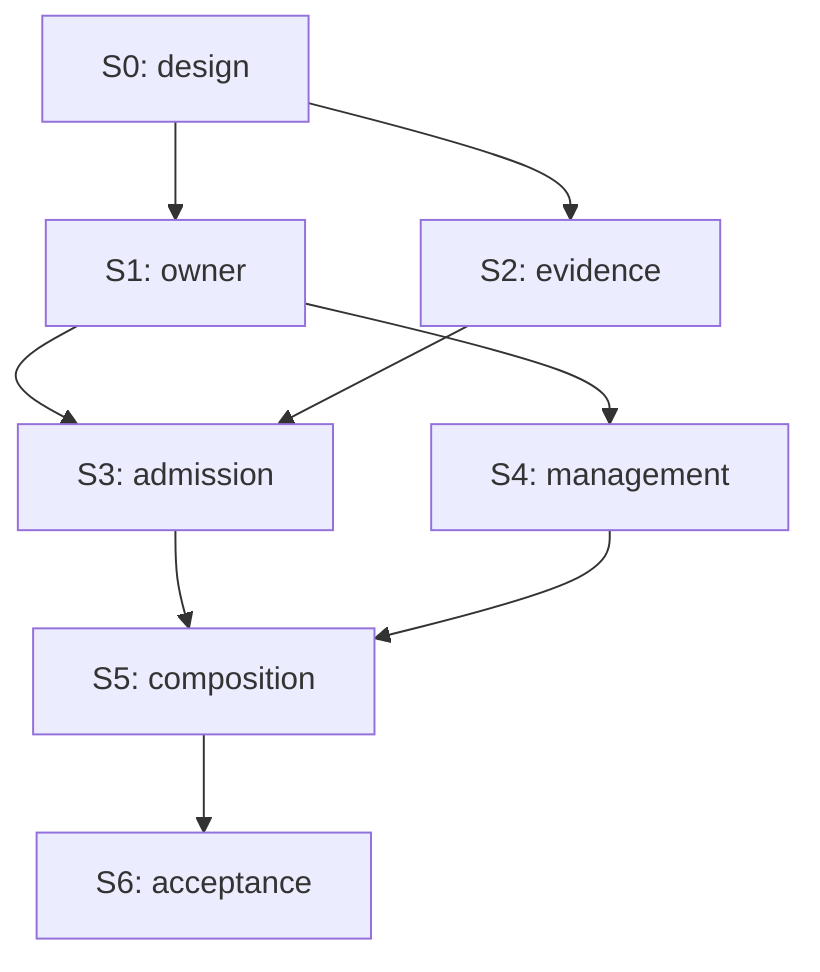

# Issue #58 planning package

**Implementation in progress, authorized by the owner on 2026-10-15.** Baseline main `8088f5bcf0c034ea5a4ae6df83e497430d6cec94`;
Laputa `4b2bec2cc2ab3374b7ec1ab8d448e612c1e4db24`.
Authoritative [design revision 3](../../specs/2026-10-15-issue-58-unified-context-design.md).
Reuse the [memory delivery history](../memory/index.md); do not reopen or duplicate
its completed Stories. This index alone owns status/dependencies.

Planning by GPT-6 Astra High using Superpowers and Supermanagement. Implementation:
**GPT-6.1 Sol High**, with a single owner/interface writer and independent review.
The owner's explicit development instruction accepts the corrected execution plan;
it does not authorize deployment, mainline merge or switching tenant data. Progress
and acceptance below must still derive from actual evidence.

## Recovery status — 2026-10-16

The owner authorized recovery in a new independent lane. Remote `66fabfd` and main
`5715950` were re-fetched; local integration `b91096c` plus recovery notes `ab382bf`
were published as tree-equivalent remote `cf9dbe18e2b40f41324d40ca80b95d8da22b72ca`
(tree `77f1cc77b84c26e70a5ed175de1e359a9340017b`). Different metadata/history does
not imply identical commit identity. No reset or clean was used.

The earlier Story rows below describe remote delivery history, not current
acceptance. Original `c113cac`/`858af73` source and S3 uncommitted files are
unavailable. Cleanup staging has zero files and no Git objects. Do not reuse
its old GREEN, independent review claims or checked progress as fresh evidence.

| Story | Current recovery disposition | Fresh evidence / next gate |
|---|---|---|
| S0 | Existing scope/design retained | No new product design or confirmation |
| S1 | Remote owner/facade present, revalidation underway | Exact bb57e93 owner: 114 passing events; final platform/candidate gates pending |
| S2 | Tasks 1–3 present; Task4 reimplemented at8ae1db9d, focused producer interface accepted after independent review and I1/I2 TDD fixes | Focused+race pass; original broad action BLOCKED, safer broad probe failures/interruption retained and fixture failures repaired. Final S3 input-focused SQLite/owner gates pass; full justci/real PostgreSQL still pending. This is not full Story/product acceptance |
| S3 | Task1 accepted at96adc4f7; native Task2 scoped runtime interface accepted at3e13019b after independent review and one consolidated TDD fix pass | Exact3e130 normal/race each228 tests pass, no fail/skip; all three unchanged reviewer probes pass. Native fold/reconcile/CAS/positive receipt/reopen and actual HTTP are present. Broader default runtime/App PASS1501 tests/3 conditional skips; DIVA/justci and integrated activation remain open, not whole S3 acceptance |
| S4 | Implementation started after frozen3e130 interface; not delivered | Same-owner actions/tools and complete UI in one serialized source lane; exact source expansion integrates at S5 |
| S5 | Planned, not delivered | BML/single sink/legacy exit; #66 installed producer absent |
| S6 | Not run | One fixed candidate; HTTP/scope/cancel/restart/race/migration/UI/Windows and real-model quality |

Baseline UI build/typecheck and 692 Vitest tests passed. These are baseline
regressions, not the missing Recap UI acceptance. Details and strict result
classification: [recovery record](../../../logs/2026-10-16-issue58-recovery/summary.md).
The seven-Story DAG and external EXT-66 boundary remain unchanged.

## Epics, dependencies and readiness

| Story | Epic / requirements | Outcome | Immediate predecessors / accepted output | Plan | State | Evidence / blocker |
|---|---|---|---|---|---|---|
| S0 | Foundation / R1–R7 | Baseline, design, contracts, executable package | None | [S0](S0.md) | Done | Corrected plan independently reviewed; owner authorized development on 2026-10-15 |
| S1 | Durable authority / R1,R6 | Existing Laputa owner supports free-text atomic Recap | S0: accepted C1 and policy/identity decisions | [S1](S1.md) | Implemented; scoped reviews passed | Tasks 1–2 and recovery/pin independently approved (Laputa4c7c6b2, root49fe1e8). Task 3 independently approved and published as Laputabb57e93. Task 4 normalbb57 pin/facade source2936b6d and evidence61b7684 independently approved with no findings; normal module authentication, Garden/Laputa/consumer and bootstrap11 passed. Native Windows/final candidate remain S6 gates |
| S2 | Retained experience / R2,R6 | Trusted identity, complete ordered original-evidence index and retention | S0: accepted C2 and singleton consumer seam | [S2](S2.md) | Implemented; scoped reviews passed | Tasks 1–2 independently approved, including Task 2 fix333a0bf/evidence d1a7c32 (I1/I2 addressed). Official Eino v0.9.20 remediation independently approved; required race82, full1404 pass/42 skips at fix candidate. Task 3 source3787f62/evidence738a430 independently accepted: 0 Critical/Important, one deferred distinct-new-source fingerprint test. Focused/race15 pass entries, affected84 pass/13 PostgreSQL skips. Complete Sources grants and same-cut pending guard are implemented. Real PostgreSQL and external #66 binding remain gates |
| S3 | Unified continuity / R3,R6 | Real admission and commit-before-retirement | S1: tested C1 owner; S2: tested C2 source/index | [S3](S3.md) | Reimplemented; scoped interface accepted, integrated gates open | Recovery3e130 normal/race and original reviewer-probe rerun pass. One shared receipt codec; whole-Story acceptance still needs broader/DIVA/justci and final composition |
| S4 | Governed management / R4,R6 | Full memory UI/headless/deferred tools | S1: accepted stable C1 API | [S4](S4.md) | In progress, not accepted | Bound facade/pin supplied; one S4 source writer released after3e130 race. History includes reconcile; exact sources/LIFE binding integrate at S5 with S2 |
| S5 | Composition closure / R5,R6 | BML first, selected sink, legacy writers disabled, full integration | S3: admission+source behavior; S4: management consumer | [S5](S5.md) | Planned | Composition/provider and source-action acceptance required |
| S6 | Central product acceptance / R7 | One exact candidate reviewed and accepted | S5: integrated candidate and dependency/artifact pins | [S6](S6.md) | Planned | Real-model/install/UI/Windows and DIVA/Mentle evidence pending |

Topological waves: `{S0}`, `{S1,S2}`, `{S3,S4}`, `{S5}`, `{S6}`. S4's owner-only
work may start as soon as S1's interface is accepted, without waiting for S2; source
navigation is explicitly completed in S5. A wave is not authorization or evidence.
All IDs/edges must be validated for uniqueness, unknown endpoints, self-edges and
cycles when this table changes. No redundant transitive edges are present.

## Write lanes and handoff

S1 owns the Laputa Store contract and narrow Garden facade; only that lane changes
C1. S2 owns core identity/index/migrations. Current producer amendments consume frozen design revision 3;
neither invents a competing owner. S3 owns runtime adaptation. S4 owns UI/actions and
tool adapters. `internal/cognitivecontract`, `internal/modules/diva-cognitive`,
`internal/app`, catalog/Recipe metadata are integration hot spots: serialize edits
under one integrator even where logical dependencies allow parallel work. Follow
AGENTS worktree rules for any concurrent write lane. Generated assembly is regenerated
through SDK, never hand edited. No task should be delegated until its producer
interfaces and exact allowed files are handed over.

Every Story plan specifies observed and proposed files, tests, evidence and rollback.
Use test-first steps in implementation; tests named `TestIssue58*` are proposed and
do not exist at the baseline. A test command naming them is a future verification
instruction, never a reported pass. Exact migration IDs are `044` at this baseline;
if main allocates that ID first, the integrator renumbers both dialects before work.
Do not modify released migrations.

## Open decision, acceptance and change control

**D1 withdrawn:** the owner confirmed LIFE as one persistent subject main
conversation, with no visible session create/switch/convert flow. Its permanent
sidebar entry above Sessions shows the current persona avatar/name. Remove residual
Coding/LIFE toggle/select controls; ordinary sessions cannot opt into LIFE. LIFE
retains governed tool execution and coding ability. This is confirmed intent, not a
question to ask again. Design revision 2 superseded revision 1's selector proposal; revision 3 preserves that confirmed product intent.

**External dependency EXT-66:** #66 owns the singleton main-conversation producer,
sidebar and trusted policy hook. #58 consumes MainConversationResolver; S2/S3 may
exercise the same binding through a governed headless/test composition, but S5/S6
installed integration cannot be accepted without the real producer and agreed seam.
This external producer is not an extra #58 Story or permission to implement #66.
The internal seven-Story DAG/waves above are unchanged; external readiness is an
additional gate. S1 owner work does not require sidebar completion. No Story is
Ready until its own prerequisites are met. Overall corrected-package execution was
authorized by the owner on 2026-10-15.
Budgets remain tunable seeds; nonempty legacy replacement requires separate review.

**Revision 3 producer refinement:** an already-covered source can be edited or
rewound with no new terminal interaction. The complete authorized-domain disposition
snapshot and same-owner zero-range `reconcile` receipt close this gap without
rewinding coverage or introducing a second acknowledgement cursor. S1 Tasks 3–4
and S2 Task 3 supply reviewed contracts before S3; S3 admission may not transmit
stale affected Recap while its compaction consumer is unfinished. Edit/restore
reset the certificate; clear cannot resurrect covered originals. Source mutations
after the admitted cut take effect at next admission, with clear epoch checked on
every provider leg/resume. These task gates refine the existing Story DAG, which
remains acyclic and unchanged.

Independent implementation reviews are preserved in
[the delivery review directory](../../../logs/2026-10-15-issue58-subject-binding/reviews/).
Earlier successful package evidence is historical, not centralized acceptance.
The corrected broad Eino app diagnostic still has one MemoryLoop live-delete
timeout despite an isolated pass; candidate-bound DIVA Recipe/S6 remains required.

The owner also requested removal of existing visible Coding/LIFE buttons. That
narrow, separately authorized [UI cleanup](../../../logs/2026-10-15-remove-conversation-mode-placeholder/summary.md)
is included in the delivery branch, with its own verification limits. It does not
start the #58 memory implementation or deliver the #66 sidebar.

Independent [review findings and final disposition](../../../logs/2026-10-15-issue-58-plan/review.md)
record the resolved findings and remaining approval/acceptance gates.
Baseline [verification](../../../logs/2026-10-15-issue-58-plan/verification.md)
distinguishes unavailable tools from failures. Product acceptance is centralized at
S6; BML and DIVA/Mentle gates are separate. No green status may combine evidence
from different candidate SHAs. Fixes update the candidate and rerun affected gates.

On contract change, update this design and affected producer/consumer plans, traverse
downstream dependencies, invalidate affected readiness/evidence and notify active
workers. Preserve unaffected historical evidence. Do not call a Story Done based
only on an implementation agent's report or CI.
