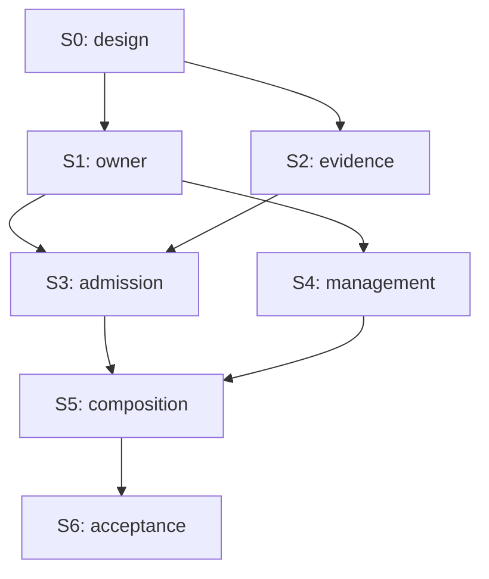

# Issue #58 planning package

**Implementation in progress, authorized by the owner on 2026-10-15.** Baseline main `8088f5bcf0c034ea5a4ae6df83e497430d6cec94`;
Laputa `4b2bec2cc2ab3374b7ec1ab8d448e612c1e4db24`.
Authoritative [design revision 2](../../specs/2026-10-15-issue-58-unified-context-design.md).
Reuse the [memory delivery history](../memory/index.md); do not reopen or duplicate
its completed Stories. This index alone owns status/dependencies.

Planning by GPT-6 Astra High using Superpowers and Supermanagement. Implementation:
**GPT-6.1 Sol High**, with a single owner/interface writer and independent review.
The owner's explicit development instruction accepts the corrected execution plan;
it does not authorize deployment, mainline merge or switching tenant data. Progress
and acceptance below must still derive from actual evidence.

## Epics, dependencies and readiness

| Story | Epic / requirements | Outcome | Immediate predecessors / accepted output | Plan | State | Evidence / blocker |
|---|---|---|---|---|---|---|
| S0 | Foundation / R1–R7 | Baseline, design, contracts, executable package | None | [S0](S0.md) | Done | Corrected plan independently reviewed; owner authorized development on 2026-10-15 |
| S1 | Durable authority / R1,R6 | Existing Laputa owner supports free-text atomic Recap | S0: accepted C1 and policy/identity decisions | [S1](S1.md) | Implemented; scoped review passed | Owner recovery and coordinated pin independently approved; published Laputa4c7c6b2, root49fe1e8. Normal module verification, bootstrap11 and focused consumers passed. Full candidate CI/native Windows remain S6 gates |
| S2 | Retained experience / R2,R6 | Trusted identity, complete ordered original-evidence index and retention | S0: accepted C2 and singleton consumer seam | [S2](S2.md) | In progress | Task 1 e1732e1 plus fix d54fa92 independently approved: grant replay and selected atomic admission repaired. Task 2 lossless tool/shell evidence now entering implementation. External #66 production binding remains an integration gate |
| S3 | Unified continuity / R3,R6 | Real admission and commit-before-retirement | S1: tested C1 owner; S2: tested C2 source/index | [S3](S3.md) | Planned | Both producer implementations required |
| S4 | Governed management / R4,R6 | Full memory UI/headless/deferred tools | S1: accepted stable C1 API | [S4](S4.md) | Planned | Can implement owner UI after S1; exact sources/LIFE binding integrate at S5 with S2 |
| S5 | Composition closure / R5,R6 | BML first, selected sink, legacy writers disabled, full integration | S3: admission+source behavior; S4: management consumer | [S5](S5.md) | Planned | Composition/provider and source-action acceptance required |
| S6 | Central product acceptance / R7 | One exact candidate reviewed and accepted | S5: integrated candidate and dependency/artifact pins | [S6](S6.md) | Planned | Real-model/install/UI/Windows and DIVA/Mentle evidence pending |

Topological waves: `{S0}`, `{S1,S2}`, `{S3,S4}`, `{S5}`, `{S6}`. S4's owner-only
work may start as soon as S1's interface is accepted, without waiting for S2; source
navigation is explicitly completed in S5. A wave is not authorization or evidence.
All IDs/edges must be validated for uniqueness, unknown endpoints, self-edges and
cycles when this table changes. No redundant transitive edges are present.

## Write lanes and handoff

S1 owns the Laputa Store contract and narrow Garden facade; only that lane changes
C1. S2 owns core identity/index/migrations. Both consume frozen design revision 2;
neither invents a competing owner. S3 owns runtime adaptation. S4 owns UI/actions and
tool adapters. `internal/cognitivecontract`, `internal/modules/diva-cognitive`,
`internal/app`, catalog/Recipe metadata are integration hot spots: serialize edits
under one integrator even where logical dependencies allow parallel work. Follow
AGENTS worktree rules for any concurrent write lane. Generated assembly is regenerated
through SDK, never hand edited. No task should be delegated until its producer
interfaces and exact allowed files are handed over.

Every Story plan specifies observed and proposed files, tests, evidence and rollback.
Use test-first steps in implementation; tests named `TestIssue58*` are proposed and
do not exist at the baseline. A test command naming them is a future verification
instruction, never a reported pass. Exact migration IDs are `044` at this baseline;
if main allocates that ID first, the integrator renumbers both dialects before work.
Do not modify released migrations.

## Open decision, acceptance and change control

**D1 withdrawn:** the owner confirmed LIFE as one persistent subject main
conversation, with no visible session create/switch/convert flow. Its permanent
sidebar entry above Sessions shows the current persona avatar/name. Remove residual
Coding/LIFE toggle/select controls; ordinary sessions cannot opt into LIFE. LIFE
retains governed tool execution and coding ability. This is confirmed intent, not a
question to ask again. Design revision 2 supersedes revision 1's selector proposal.

**External dependency EXT-66:** #66 owns the singleton main-conversation producer,
sidebar and trusted policy hook. #58 consumes MainConversationResolver; S2/S3 may
exercise the same binding through a governed headless/test composition, but S5/S6
installed integration cannot be accepted without the real producer and agreed seam.
This external producer is not an extra #58 Story or permission to implement #66.
The internal seven-Story DAG/waves above are unchanged; external readiness is an
additional gate. S1 owner work does not require sidebar completion. No Story is
Ready until its own prerequisites are met. Overall corrected-package execution was
authorized by the owner on 2026-10-15.
Budgets remain tunable seeds; nonempty legacy replacement requires separate review.

The owner also requested removal of existing visible Coding/LIFE buttons. That
narrow, separately authorized [UI cleanup](../../../logs/2026-10-15-remove-conversation-mode-placeholder/summary.md)
is included in the delivery branch, with its own verification limits. It does not
start the #58 memory implementation or deliver the #66 sidebar.

Independent [review findings and final disposition](../../../logs/2026-10-15-issue-58-plan/review.md)
record the resolved findings and remaining approval/acceptance gates.
Baseline [verification](../../../logs/2026-10-15-issue-58-plan/verification.md)
distinguishes unavailable tools from failures. Product acceptance is centralized at
S6; BML and DIVA/Mentle gates are separate. No green status may combine evidence
from different candidate SHAs. Fixes update the candidate and rerun affected gates.

On contract change, update this design and affected producer/consumer plans, traverse
downstream dependencies, invalidate affected readiness/evidence and notify active
workers. Preserve unaffected historical evidence. Do not call a Story Done based
only on an implementation agent's report or CI.
