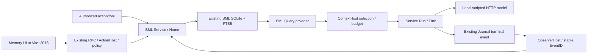

# BML acceptance boundary and source reconciliation

Scope and baseline are owned by [index](index.md). This is an acceptance design
note extending existing approved contracts, not a replacement product design.

## Authority and existing plans

Read in order: repository [AGENTS.md](../../../../../AGENTS.md),
[#81 E1](https://github.com/ProjectViVy/agent-vivy/issues/81),
the selected [unified memory contract](../../../../architecture/VIVY-UNIFIED-CONTEXT-MEMORY.md),
[memory profile](../../../../architecture/VIVY-MEMORY-PROFILE.md),
[host contracts](../../../../architecture/VIVY-MEMORY-HOST-CONTRACTS.md), then
the [existing memory index](../../memory/index.md) and MEM-1/1A/1B/1C plans.
The dated provider design and old Pulse/Work exclusions are historical where the
selected contract refines them. Requirements are not implementation evidence.

Remote plans were checked before drafting this package:

- Main's `docs/superpowers/plans/memory/` already records the delivered BML work.
  Rebuilding CRUD, tools, FTS, receipts or the mocked UI would duplicate it.
- Remote `docs/memory-policy-alignment-20261011` at
  `f7c241628220383946353dafd8d8fdf644713f85` retains that historical package.
- Remote `feat/issue-58-context-memory` at
  `536809c9be2048f34b168ba681a3ea31bd169dc6` and PR #79's later recovery head
  contain `docs/superpowers/plans/issue-58/`. Its S5 and recovery ledger cover a
  broader integrated LIFE/Recap design. Reuse its boundary decisions and candidate
  test ideas; do not copy its implementation schedule or historical greens here.
- At #79 head `b4c03754d2798404234ab7cd7f49bbb26e2bec63`,
  `bml/bound_mutation_test.go` contains
  `TestIssue58BoundImmutableNativeOutcomes` and
  `TestIssue58BoundMutationAtomicFailureAndConcurrentReplay`. These use proposed
  bound operations/operation lookup absent on main. They are useful conditional
  future references, not dependencies, evidence or APIs for the present Stories.

## Inspected main implementation and missing evidence

All paths below exist at the baseline unless explicitly proposed in a Story.
Tests were inspected, not executed in this task.

| Existing seam / tests | What the source supports | Acceptance gap / action |
|---|---|---|
| `bml/home.go`, `store.go`, `search.go`; `TestHomeLongTermCRUDIsRevisionedAndTombstoned`, `TestReopenExistingDatabase`, `TestSearchExcludesTombstonedAndSuperseded` | SQLite/FTS5, revisions, visible long-term CRUD, raw target retention plus tombstones, store reopen | 01 joins public mutation, full handle closure and post-reopen get/search in one chain. Reuse existing assertions; add only missing lifecycle joins. |
| `internal/modules/memory/{module,service,actions,tools}.go`; action/tool tests | One composition-owned Home via Active; add/update/remove and explicit errors; write effects already declared | 01 uses these APIs. Preserve current tool inventory/effect tests; do not rewrite them or add a new authority path. |
| `internal/modules/memory/provider.go`, `provider_test.go` | Stable `EventID{RunID,Seq}` → deterministic record/receipt IDs; receipt-aware run.completed sync; query maps native FTS results | Existing same-process dedupe test lacks the planned durable reopen join. 03 adds it, without changing receipts. |
| `bml/store_test.go`: `TestTombstoneSuppressionSurvivesTargetRewrite`, `TestImportRecords`; `home_test.go`: `TestHomeAddsIdenticalContentAtSameTime` | Tombstone suppression even if target row is rewritten; canonical import replay rules; repeated Add is distinct creation | 03 proves suppression across reopen. Do not infer operation-ID dedupe from record replay or import. |
| `internal/app/assembly_sources.go`, `app.go`; `internal/runtime/{service,contextadapter}.go`, `context_test.go` | Default generated BML source reaches ContextHost; Service.Run projects selected candidates as user data into Eino model input | 02 combines real BML disk state and actual default-App model HTTP consumption; generic fixture-source tests alone do not close it. |
| `internal/app/facehost_test.go` | Local scripted DeepSeek-shaped HTTP server; ordinary App and DialControl/RPC; env URL override; no live provider required | Reuse this pattern for 02, not a production fixture API or replacement runtime. |
| `internal/runtime/scriptedmodel.go` | Fixed answers; Generate ignores input | A fixed reply cannot establish consumption. Use a request-derived local HTTP script and capture actual requests instead. |
| `internal/app/memory_loop_*` | Extensive DIVA/mentle fixture tests, some require overlay and skip on default assembly | These are not BML/default-generation acceptance. Do not make them mandatory for E1 or count skips as passes. |
| `plugins/vivy-memory/ui/vivy-memory/src/{view,dialogs,rules,memory-client}.tsx` / `.ts`; `view.test.tsx` | Existing full management UI via nine real actions, CAS drafts and mocked transport tests | 04 adds actual backend/browser proof. [Historical verification](../../../../logs/2026-09-27-memory-ui/verification.md) explicitly deferred a live backend browser pass. |

## Decision record

The smallest adequate solution is test-only acceptance around existing seams:
public long-term module APIs, composed App/Service.Run/ContextHost and the shipped
UI. Add small local fixtures only where an existing helper cannot capture the
required request or restart. A new memory abstraction, store, plugin, receipt
protocol or runtime would add ownership and maintenance cost without closing a
missing capability. A pure library test is cheaper but cannot prove model/UI
integration; a paid model call adds cost and nondeterminism without proving the
plumbing more directly. No performance target or gain is claimed.

| Decision | Resolution and stop boundary |
|---|---|
| A1: State owners | BML owns its existing database/index; Core Storage owns Journal; runtime/policy own admission and permissions. Tests never add DDL, mirror a store or read tenant journals. |
| A2: Composition | Default Recipe and existing generated assembly, one App at a time, one Active BML service. Stop on unexpected module inventory; do not hand-edit generated files. |
| A3: Recall | Existing FTS query and ContextHost budget/timeout remain intact. Use a small one-token query, one matching record and adequate current budget. No cache, vector service or unbounded recall. |
| A4: Correction/removal | Long-term public CAS only. New requests see current visible state; old model requests and stored history are not retroactively edited. Deletion means selected BML visibility suppression, not erasure everywhere. |
| A5: Replay | Exact EventID replay and same-record Store replay are separate guarantees. Public `memory_add` has no operation ID and creates distinct IDs; after uncertain write outcome inspect first rather than automatically resubmit. |
| A6: History | `Home.GetRecord` / `RemoveRecord` filter to long_term; history can be recalled but has no current public management deletion. Library tombstone fixtures do not advertise a public history-delete capability. |
| A7: Authentic evidence | The model script receives only raw HTTP input; no expected-answer closure, DB lookup, direct ContextHost call or prefilled response. Decode string and native text-part content; candidate remains user-role data. |
| A8: Test isolation | Separate scratch root and fresh session per model scenario. No earlier model turn may copy the test secret into ordinary history/observer history and invalidate the deletion negative control. Global registry/env fixtures are serial. |
| A9: Scope of repair | If a new test exposes a product defect, preserve the failure and block only affected Story/descendants. Do not “fix” production code, import #79 changes or silently weaken acceptance under this planning authorization. |

Control/data flow to verify:

## Eino capability check

Main `go.mod` pins Eino **v0.9.13**, EinoExt OpenAI **v0.1.13** and Claude
**v0.1.25**. The #79 branch's different pins do not replace this baseline.
Inspected [upstream model API](https://github.com/cloudwego/eino/blob/v0.9.13/components/model/interface.go)
supports the existing Generate/Stream and ToolCallingChatModel boundary; inspected
[upstream message schema](https://github.com/cloudwego/eino/blob/v0.9.13/schema/message.go)
provides role-bearing messages and text parts. The inspected pinned
[EinoExt OpenAI API](https://github.com/cloudwego/eino-ext/blob/components/model/openai/v0.1.13/components/model/openai/chatmodel.go)
exposes `NewChatModel`, `ChatModelConfig` and Generate/Stream at that boundary.
Main `internal/provider/openai.go`
already constructs `einoopenai.NewChatModel` using `ChatModelConfig` with the
selected model, base URL and key. Main's context adapter owns Eino message parts.

02 reuses that provider and runtime rather than adding orchestration. Its local
HTTP server is test instrumentation at the existing boundary. No custom runtime
seam, new public API or Eino import outside `internal/runtime`/`internal/provider`
is needed. If that assumption fails, stop 02 and recheck the pinned Eino/EinoExt
surface; an absent orchestration capability is `DEFERRED-INDEFINITE`, not a cue
to build a substitute. Provider upgrade and AgenticModel migration stay in #80's
separate scope.

There is no unresolved product decision blocking these four main-based plans.
Native bound-operation receipt acceptance would be a separate conditional scope
after selection of a containing commit, not an undefined task hidden in this E1.
