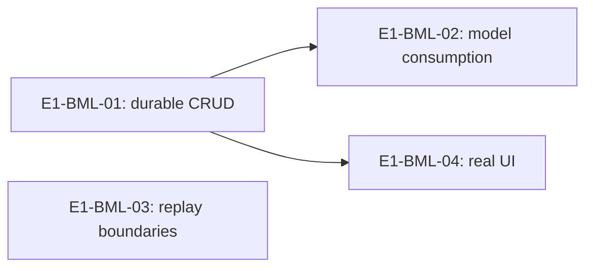

# E1 — BML phase-one closeout plan

Planning deliverable for [#81 E1](https://github.com/ProjectViVy/agent-vivy/issues/81),
owned feature [#4](https://github.com/ProjectViVy/agent-vivy/issues/4).
Date: 2026-10-18. Branch: `plan/issue81-bml-closeout`.
Baseline: **`7b42b2920f72de6f37de8b9e4ff4bf6a110a762f`**, fetched and checked
against remote main. Laputa lock: `4b2bec2cc2ab3374b7ec1ab8d448e612c1e4db24`.

This package plans acceptance of BML already on main. It implements nothing and
certifies no runtime result. Read [architecture and source reconciliation](architecture.md),
then the selected Story. [Planning verification](verification.md) distinguishes
inspection, historical evidence and work still to execute.

The owner explicitly requested the detailed planning workflow and isolated branch;
the existing product direction is reused. Superpowers brainstorming classifies
this as a continuation of an existing architectural initiative at its acceptance
planning stage. Writing-plans and Supermanagement provide the executable tasks
and dependency checks. No new product design or implementation approval is implied.

## Requirements and acceptance anchors

| ID | Required observable outcome | Owning Story |
|---|---|---|
| BML-R1 | A real disk-backed long-term write survives closing all owning handles and reopening the same root; get/search return its ID, content and revision. | E1-BML-01 |
| BML-R2 | A subsequent actual model request consumes BML through the composed ContextHost path; a request-derived scripted response proves plumbing. | E1-BML-02 |
| BML-R3 | CAS correction survives restart; stale correction/deletion cannot overwrite; targeted removal hides the selected long-term record from new reads/recall. | E1-BML-01, E1-BML-02 |
| BML-R4 | Exact stable EventID redelivery is idempotent across reopen; supported same-record replay does not defeat a durable tombstone. State the guarantee of each surface. | E1-BML-03 |
| BML-R5 | The existing memory UI displays and mutates the real backend state, including restart persistence and a genuine stale-revision conflict. | E1-BML-04 |
| BML-R6 | One exact candidate has targeted results, required CI, independent review and limitations; historical tests or skipped suites cannot stand in for that evidence. | All; Epic exit below |

## Story index and immediate dependencies

This table alone owns this package's Story state and edges. “Ready” means the
plan resolves implementation choices; execution still requires separate
authorization and a supported development environment. None has been executed.

| Story | Outcome / produced contract | Immediate predecessors and supplied evidence | Plan | Readiness |
|---|---|---|---|---|
| E1-BML-01 | Public long-term disk lifecycle, CAS and deletion evidence | None; existing main implementation is the input | [Disk lifecycle](E1-BML-01.md) | Ready |
| E1-BML-02 | Actual default-App model-request and consumption evidence for present/corrected/removed records | E1-BML-01: verified same-root lifecycle and public outcome semantics | [Model consumption](E1-BML-02.md) | Sequenced after 01 |
| E1-BML-03 | Separate stable-event dedupe and library tombstone/replay evidence | None; existing provider and Store APIs are the inputs | [Replay boundaries](E1-BML-03.md) | Ready |
| E1-BML-04 | Real split-origin UI/backend evidence | E1-BML-01: verified durable CRUD outcomes/revisions | [UI smoke](E1-BML-04.md) | Sequenced after 01 |

Topological waves: `{E1-BML-01, E1-BML-03}`, then
`{E1-BML-02, E1-BML-04}`. These are logical waves, not instructions to launch
sessions. Execute serially unless separately authorized. No unknown IDs,
self-edges, cycles, or duplicated transitive edges occur. Each requirement has
an owner; final acceptance consumes 02, 03 and 04 (01 is already their prerequisite
where needed).

File conflicts differ from logical dependencies: 01 and 03 use separate new files
in `internal/modules/memory`, but share its process-global Active service and must
not use `t.Parallel`. App tests likewise serialize global composition/env state.
04 owns new UI harness files only. Generation/digest refresh, if required by
repository checks, is one integrator's sequential operation, never competing edits.

## External dependencies and exclusions

| Input | Disposition / exact gate |
|---|---|
| Main MEM-1 / 1A / 1B / 1C | Reuse delivered library, adapter, tools and UI. Historical “Done” is not fresh acceptance. |
| [#79](https://github.com/ProjectViVy/agent-vivy/pull/79), head `b4c03754d2798404234ab7cd7f49bbb26e2bec63` at inspection | Read-only candidate reference. Its `bml/bound_mutation_test.go` is not on this main. No hard edge to the four Stories. If later selected, re-pin and reconcile changed APIs before running them. |
| [Laputa #10](https://github.com/ProjectViVy/laputa/pull/10), head `27da7b9e2d991857650b9e373627b65119a73eec` / friend's Recap repair | Read-only coordination dependency for the other work package. No repair, reassignment or new schedule here; current main BML acceptance proceeds independently. |
| [#80](https://github.com/ProjectViVy/agent-vivy/pull/80), head `001c563740a4ff32e1376f6bbfb2c6caaa7b22b3` | Read-only Provider lane. A demonstrated loopback-provider failure blocks 02 only; report the exact failure to the parent instead of expanding this Story into Provider repair. |
| Supported Go 1.26.4, Node/pnpm, pinned sibling Laputa, UI assets; browser for 04 | Operational execution prerequisites. Current planning host cannot certify them; see verification. Missing browser blocks 04; missing Go blocks executable verification, not plan production. Do not install unknown software or use paid APIs. |
| Independent reviewer | A later read-only review of the exact candidate, after execution is authorized. No reviewer or child session was launched by this planning task. |

Do not require all of #58 before validating existing main. This package does not
activate LIFE or implement Recap, bound-operation receipts, subject ownership,
backend migration, other providers, retention GC or new runtime capabilities.
DIVA/Mentle installed acceptance belongs to DIVA. #6/#7/#60–63 are unscheduled;
#57/#66 draft language is not runtime evidence. No merge, PR, deployment or issue
closure is authorized. All files produced now stay in this directory; shared
indexes and other sessions' paths remain untouched.

## Epic exit and review handoff

After separately authorized Story execution, one integrator must:

- Record candidate commit, Laputa lock, Recipe/Generation identity, toolchain,
  commands, test counts/skips and artifact digests. Invalidate affected evidence
  when those inputs change. Do not combine results from different candidates.
- Run each Story's named checks and repository `just ci` once on that candidate;
  include nested `bml` tests explicitly. Normal, race and real-browser results
  are distinct. Stop on unexplained failure or required-test skip.
- Obtain an independent review of data-path authenticity, CAS, replay boundaries,
  authority and evidence quality. Preserve findings and resolution against exact
  SHAs. This plan's self-review does not satisfy that independent gate.
- Record a compact `summary.md`, `verification.md`, and `acceptance.md` under the
  future execution log `docs/logs/<delivery-date>-issue81-bml-closeout/` (proposed),
  with the actual raw evidence or links and a human walkthrough of 01→02→04.
  This planning task does not write that directory or the shared backlog.
- Report E1 accepted only for tested BML behavior. Explicitly retain limitations:
  no operation-ID/exactly-once contract for `memory_add`; no public history-delete
  UI/tool; no cross-store erasure; deterministic inference proves data plumbing,
  not live-model memory quality. Paid quality evaluation requires separate scope.

Rollback for the future test-only work is to stop only its owned processes and
remove only disposable roots created by its fixture. Preserve failure evidence
first. Never clean tenant data, rewrite history, revert another lane or force-push.
