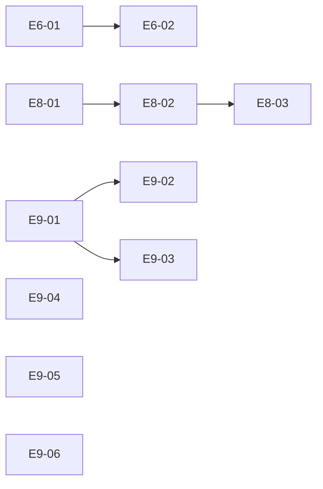

# Issue 81 VIVY integration closeout planning package

Planning delivery only. No implementation, merge, deployment, issue closure, paid inference, or DIVA work is authorized by this package. Product execution requires a later instruction. This directory owns only E6/E8/E9 plans and read-only E5/E7 coordination; the parent owns the Epic-wide index.

**Baseline:** `main` / `7b42b2920f72de6f37de8b9e4ff4bf6a110a762f`, fetched 2026-10-18 UTC. **Planning branch:** `plan/issue81-integration-closeout`. Read [source audit](source-audit.md), [architecture and decisions](architecture.md), and [coordination](dependencies.md) before a Story. All paths in Story plans are repository-relative; “branch-only” paths must be recovered from their cited source before modification. A proposed path is explicitly labelled.

The user requested GPT-6.1 Sol High. This session does not create additional agents or execution sessions. The planning workflow actually read Superpowers using-superpowers, brainstorming, writing-plans and verification-before-completion, Supermanagement, and the repository's vivy-plugin/vivy-eino instructions. [Verification](verification.md) distinguishes checks performed here from future product commands.

## Outcomes and requirement IDs

| Requirement | Outcome | Story coverage |
| --- | --- | --- |
| R6 | Same local Skill: proposal, explicit review, CAS apply, later use; refusal/stale/restart | E6-01, E6-02 |
| R8 | Existing ACP stdio branch aligns with main; permissions, questions, cancel, sealed omission and a client turn | E8-01, E8-02, E8-03 |
| R9 | All 28 original #32 findings have current-source dispositions; applicable VIVY repairs reuse old work | E9-01 through E9-06; source-audit.md |
| R57 | Existing peer Recap and Provider lanes remain dependencies with exact pins and honest CI | dependencies.md; no new implementation Story |
| RA | One Service.Run, Journal, permission and storage authority; small typed seams and optional composition | Every Story |

## Story DAG and readiness

“Ready” below means the plan has sufficient local decisions for later authorized execution, not implementation approval or passing acceptance. “Waiting” names a predecessor's evidence. “Blocked” names an external contract missing from the inspected sources. Each plan owns steps; this table alone owns readiness and immediate edges.

| Story | Deliverable | Immediate predecessors and supplied output | Readiness |
| --- | --- | --- | --- |
| [E6-01](E6-01-skill-candidate.md) | Reconciled #69/#9 candidate and durable operation regressions | None; consume pinned existing bridge and dependency together | Ready for review |
| [E6-02](E6-02-skill-loop.md) | Real VIVY review/apply/later-use and restart evidence | E6-01: tested Skill/review candidate | Waiting |
| [E8-01](E8-01-acp-alignment.md) | Existing ACP launcher, SDK pin, sessions and projection aligned to main | None; recover existing ACP-02/03 work | Ready for review |
| [E8-02](E8-02-acp-interactions.md) | Permission/question and all-owned-run teardown | E8-01: owned promptScope, committed reducer and verified SDK | Waiting |
| [E8-03](E8-03-acp-artifacts.md) | Selected/omitted artifacts and actual scripted-client turns | E8-02: complete interactions and cleanup | Waiting |
| [E9-01](E9-01-cognitive-intent.md) | Exact-window admission/recovery, C2 | None; preserve already-fixed C1/R4 main behavior | Ready for review |
| [E9-02](E9-02-authority-pins.md) | Current Mission and one durable policy pin, C3/C4 | E9-01: immutable admission input and intent | Blocked only on combined dependency pin: published Mission gate exists, but compatibility with selected #9/#10/peer repair is unverified; see D-LAPUTA-MISSION |
| [E9-03](E9-03-control-cleanup.md) | Scoped control cancellation and composition cleanup, C5/C6/C7 | E9-01: intent and phase vocabulary | Waiting |
| [E9-04](E9-04-workflow-residuals.md) | Workflow W1-W8 selectively recovered, with E3 owning shared edits | None; E3 ownership agreement is a scheduling constraint, not a logical code prerequisite | Ready for review; one shared workflow lane |
| [E9-05](E9-05-diagnostics.md) | Bounded diagnostic read/record continuation, R3 | None; retain main's R1 correction | Ready for review |
| [E9-06](E9-06-legacy-proof.md) | Test-only old proof; safe legacy history/refusal, W9 | None; retain main approval binding/recovery behavior | Ready for review |

Immediate edges: `E6-01 -> E6-02`; `E8-01 -> E8-02 -> E8-03`; `E9-01 -> E9-02`; `E9-01 -> E9-03`. No unknown ID, self-edge, cycle, or redundant transitive edge.

Topological waves (logical, not permission for simultaneous editors):

1. E6-01, E8-01, E9-01, E9-04, E9-05, E9-06.
2. E6-02, E8-02, E9-03; E9-02 only after D-LAPUTA-MISSION clears.
3. E8-03.

## Handoff and review

Use native sequential execution unless later authorization changes that method. Re-read actual skills and instructions when execution begins. The parent chooses a candidate order after the existing #80 disposition and actual #79 peer diff are reviewed; do not make every Story wait for unrelated CI. File conflicts in dependencies.md constrain execution independently of this DAG.

For each Story, a fresh independent reviewer later checks scope, shared authority, negative paths and exact candidate evidence. No independent reviewer or product tests were run in this planning session. A failed/blocked gate stays visible; never replace missing PostgreSQL/native/browser execution with a compile pass, nor a source-bound attestation with a guessed digest. Final Epic integration review must check the combined candidate, not merely add per-branch PASS counts.
