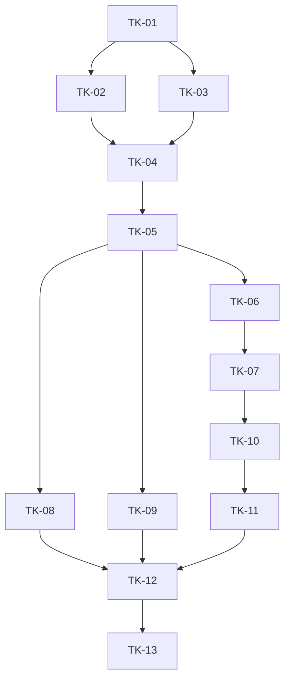

# Vivy Toolkits action plan package

**Revision:** TK-P1 / shared contract TK-C1, execution update 2026-10-12.\
**Requested outcome:** A native 工具包 / Toolkit system with Skills, Masks, Rules, Hooks, MCP and a dedicated management UI.\
**Architecture:** [Vivy Toolkits](../../../architecture/VIVY-CONTENT-BUNDLES.md), r2 and section 22.\
**Baseline inspected:** `1d6c9e236c11d929dd3423ed63272e88ed13e367`.\
**Feature tracker:** [#20](https://github.com/ProjectViVy/agent-vivy/issues/20). This local package does not mutate the external issue.

## 1. Scope and authorization

The user requested detailed planning with supermanagement. Confirmed direction: Toolkit/工具包 naming, Vivy-native format only, no converter/importer, multiple Masks, recommendation-only links to independently usable Skills, and a dedicated Toolkit UI. The package includes 5 Epics and one executable Plan for each of 13 Stories, shared contracts and an acceptance matrix.

Technical planning baseline: organism-wide activation; disabled install after exact native preview; separate executable consent; one coherent catalog published after all nonterminal runs drain; immediate availability-narrowing revocation; retained immutable run evidence. These are the architecture's selected proposals, carried into concrete plans for review. Their presence in this package is not evidence of user acceptance of every technical tradeoff.

The user approved full implementation and planned verification on 2026-10-11. Execute TK-01–13 inline on TOOLKITS. Existing branch-push authorization remains valid; merge and deployment are not scheduled. Story acceptance still requires observed evidence.

## 2. Authoritative artifacts

- [Shared contracts TK-C1](contracts.md): pure types, storage APIs, coordinator, owner projections, wire/UI contracts and verification boundaries.
- [Acceptance matrix](acceptance.md): requirements, failure scenarios, owning Stories and future evidence.
- Story status, immediate dependencies and evidence live only in this index. Story files link here; they do not maintain duplicate status tables.
- [Planning verification](../../../logs/2026-10-11-toolkit-planning/verification.md): inspected evidence and document/DAG checks, not product test results.

## 3. Epics

| Epic | Product outcome | Stories | Integration exit |
| --- | --- | --- | --- |
| E1 | Native toolkit content has stable identity and durable ownership | TK-01–03 | Native acquisition executes no toolkit content; both storage backends preserve receipts and digests |
| E2 | Updates and runs have one coherent content history | TK-04–05 | Drain, atomic admission, recovery and revocation proven through real Service/storage |
| E3 | All five kinds work through established authority owners | TK-06–09 | Skill/Mask independence, literal Rules, armed Hooks and governed MCP proven together |
| E4 | Users manage toolkits through a dedicated UI | TK-10–12 | Native preview/install, all five component views, consent, update/blockers and owner links work on real backend |
| E5 | The assembled product meets the complete failure and acceptance matrix | TK-13 | Full required CI, both databases, real split UI and artifact omission/inspection evidence accepted |

E1/E2 are enabling increments. The first user-facing slice is TK-11 with its accepted predecessors, not a backend-only claim. Full v1 requires TK-12 and TK-13; unavailable kinds are rejected or explicitly inactive according to owner/consent state, never silently skipped.

## 4. Story graph and current state

The following table is the sole dependency/status data source. Graph and waves below are derived from it. An edge requires the named accepted output, not merely an interface file.

| Story | Epic / requirements | Outcome | Immediate predecessors and required output | Plan | Status | Evidence / blocker |
| --- | --- | --- | --- | --- | --- | --- |
| TK-01 | E1; B1 B2 B3 B4 B6 B11 B12 B14 | Native values, schema, identifiers and digest | None — root | [TK-01](TK-01.md) | Review | Contract, strict parser and digest tests pass; complete CI and the full adversarial matrix remain open. [Evidence](../../../logs/2026-10-12-toolkits-closure/verification.md) |
| TK-02 | E1; B4 B6 B8 B10 B11 B14 | Confined local/Git acquisition and immutable objects | TK-01: validated native values and digest | [TK-02](TK-02.md) | Review | Local/Git acquisition, declared-file integrity, tamper checks and packaged artifact inspection pass; full failure matrix remains open. [Evidence](../../../logs/2026-10-12-toolkits-closure/verification.md) |
| TK-03 | E1; B4 B5 B8 B9 B10 | Paired storage, receipts, epochs, consent and evidence | TK-01: pure identity/operation/snapshot values | [TK-03](TK-03.md) | Review | SQLite and live disposable PostgreSQL conformance pass; full cross-version/fault recovery matrix and CI remain open. [Evidence](../../../logs/2026-10-12-toolkits-closure/verification.md) |
| TK-04 | E2; B1 B5 B6 B8 B9 B10 B11 B12 | Prepared lifecycle, publication and recovery | TK-02: verified object store; TK-03: transactional registry and receipts | [TK-04](TK-04.md) | In progress | Real App preview/install/enable/read/disable/uninstall/reopen and orphan history pass; crash points, reference-retention and consent recovery remain open. [Evidence](../../../logs/2026-10-12-toolkits-closure/verification.md) |
| TK-05 | E2; B5 B8 B9 B10 B12 | All-path admission, drain, resume and fences | TK-04: working coordinator with injected gate | [TK-05](TK-05.md) | In progress | Focused root/report/workflow snapshot and revocation tests pass; complete admission branches, concurrency, resume and publication fault proof remain open. [Evidence](../../../logs/2026-10-12-toolkits-closure/verification.md) |
| TK-06 | E3; B1 B3 B4 B5 B11 B12 | Hosted Skills and confined resource reads | TK-05: captured run Views and live fence checks | [TK-06](TK-06.md) | In progress | Real App/UI reads the captured Skill body; SkillHost resource confinement tests pass. Full run-admission/restart matrix remains open. [Evidence](../../../logs/2026-10-12-toolkits-closure/verification.md) |
| TK-07 | E3; B1 B2 B3 B5 B9 B10 | Multi-Mask definitions and independent recommendations | TK-06: stable recommended Skill identity/availability | [TK-07](TK-07.md) | In progress | PM/Dev Mask recommendations remain independent of Skills in the real UI; catalog, copy, provenance and storage tests pass. Full selection/revocation race matrix remains open. [Evidence](../../../logs/2026-10-12-toolkits-closure/verification.md) |
| TK-08 | E3; B1 B5 B6 B7 B9 B11 B12 | Captured Rules and exact-consent PreToolUse Hooks | TK-05: snapshot and revocation integration | [TK-08](TK-08.md) | In progress | Rule/Hook owner tests and exact Hook consent refresh after update pass in UI; complete Hook failure protocol and publication race matrix remain open. [Evidence](../../../logs/2026-10-12-toolkits-closure/verification.md) |
| TK-09 | E3; B1 B4 B5 B6 B8 B9 B11 B12 | MCP merge, consent and coherent publication | TK-05: working admission/publication boundary | [TK-09](TK-09.md) | In progress | Official `server-everything` stdio discovery/call/approval/result/shutdown passes through MCPHost and ToolHost; an isolated cold-cache discovery and echo call passed in 10.89 seconds under the MCP-specific 30-second budget. A real Service path now proves consent can be granted to an installed disabled declaration and that the exact consent provenance is captured before the approved MCP call. Unreachable-server behavior, settings/publication races and the broader MCP schema/revocation matrix remain open. [Evidence](../../../logs/2026-10-12-toolkits-closure/verification.md) |
| TK-10 | E4; B1 B6 B7 B8 B9 B11 B12 B13 B14 | Authenticated native lifecycle and inspection actions | TK-07: usable Skill/Mask lifecycle and metadata | [TK-10](TK-10.md) | Review | Authenticated App/RPC lifecycle, strict action input and human-origin policy tests pass; agent/anonymous/explicit-policy denial tests pass. Full CI remains open. [Evidence](../../../logs/2026-10-12-toolkits-closure/verification.md) |
| TK-11 | E4; B1 B2 B3 B8 B11 B13 B14 | Dedicated Toolkit UI with native install and basic lifecycle | TK-10: real authenticated action transport and schemas | [TK-11](TK-11.md) | Review | Dedicated UI passes typecheck, build, SDK verification, full UI suite and desktop/mobile browser smoke; broader viewport and operation-state coverage remains open. [Evidence](../../../logs/2026-10-12-toolkits-closure/verification.md) |
| TK-12 | E4; B2 B3 B6 B7 B8 B9 B11 B13 | All components, authorization, update and recovery UI | TK-08: real Rule/Hook states; TK-09: real MCP states; TK-11: working compiled toolkit page/client | [TK-12](TK-12.md) | In progress | Real UI covers five component sections, consent/bindings, recommendations, update/orphan flow, and 390px keyboard/detail dialog behavior; broader error/recovery and full matrix remain open. [Evidence](../../../logs/2026-10-12-toolkits-closure/verification.md) |
| TK-13 | E5; B1 B2 B3 B4 B5 B6 B7 B8 B9 B10 B11 B12 B13 B14 | Real app/browser/storage/artifact integration evidence | TK-12: fully integrated toolkit product and fixtures | [TK-13](TK-13.md) | In progress | Default App/browser/storage, omission recipes and desktop/mobile browser checks pass; full A01–A28/B1–B14 reconciliation, crash/admission matrices, broader responsive states and `just ci` remain open. [Evidence](../../../logs/2026-10-12-toolkits-closure/acceptance.md) |

## 5. Topological execution waves

1. TK-01.
2. TK-02, TK-03.
3. TK-04.
4. TK-05.
5. TK-06, TK-08, TK-09.
6. TK-07.
7. TK-10.
8. TK-11.
9. TK-12.
10. TK-13.

Waves describe dependency availability, not automatic parallel authorization or readiness. The longest dependency chain runs through format → artifacts/storage → coordinator → admission → Skills → Masks → actions → basic UI → integrated UI → acceptance. No durations, estimates or progress percentages are claimed.

## 6. Shared-file conflicts and lane rules

| Stories | Shared boundary | Integration rule |
| --- | --- | --- |
| TK-02 / TK-03 | Shared contract values | Contracts belong to TK-01; revise TK-C1 and consumers before merging a signature change |
| TK-06 / TK-08 / TK-09 | Runtime engine, app owner preparation and app wiring | Logical peers after TK-05, but serialize edits/integration to these files; use isolated worktrees for any authorized parallel work |
| TK-07 / TK-08 | Prompt schema/composition | TK-07 owns Mask-origin fields, TK-08 owns Rule payload; common snapshot version is 2 and both changes must be reconciled |
| TK-08 / TK-09 / TK-10 | Consent and Manager/action contracts | TK-03 owns persistence; TK-10 owns public action inventory; owner availability gates allow staged actions without claiming execution support |
| TK-10 / TK-11 | Default Recipe and generated Assembly | Integrate action owner first, then UI owner; SDK regeneration is sequential, never concurrent manual edits |
| TK-11 / TK-12 | Toolkit page/client/state/i18n | Sequential; TK-12 extends the same owner, no second page implementation |

A shared file conflict is not an invented logical prerequisite. One active write lane in the root worktree; concurrent implementation requires separate worktrees under AGENTS.md. Implementation is proceeding inline in that single lane.

## 7. Planning refinements and cost choices

Use existing protected skill_view supporting-file reads for toolkit resources, rather than introduce a filesystem mount. Native Skill frontmatter is deliberately narrow. Use the existing compiled action/UI Module mechanisms; artifact installation never supplies Module code. Add explicit preview/confirm and prepare/publish operations so the UI can review the exact digest it later installs or activates. The UI reads operation status with bounded polling rather than a new event transport.

The initial idle gate may delay updates behind suspended runs; the operator sees blockers and can cancel the pending update. Multi-epoch executable runtimes remain out of scope. Eino/SQL/credential authority boundaries stay in their established owners. No new dependencies or performance targets are proposed. Exact planning refinements are linked from architecture section 22 and TK-C1.

## 8. Readiness and evidence transitions

The user authorized implementation and planned verification on 2026-10-11; work is proceeding inline on `TOOLKITS`. Before each Story is marked Done, confirm predecessor outputs, contract revision and integration evidence. Keep `In progress` when focused evidence passes but required app, browser, database or platform checks remain open. Test names in plans are proposals until recorded in the verification log.

Use Planned → Ready → In progress → Review → Done only on observed evidence. Blocked records the previous state and exact missing contract, environment or decision. Live PostgreSQL and packaged UI smoke now pass. The full `just ci` gate is unavailable because this macOS environment has no `just`, `pwsh` or `powershell`; full fault/admission and broader responsive acceptance remain open. Never infer Epic completion merely from Story checkboxes.

At handoff provide the Story, TK-C1 sections, architecture sections, accepted predecessor commits/evidence, allowed files and stop conditions. Changes to internal details within scope may be resolved by the planner; public scope, acceptance or significant architecture/cost changes require user review. Traverse this table's downstream graph and invalidate stale plans/readiness after a contract change.

## 9. Evidence and next action

Contracts, storage, acquisition, lifecycle, Runtime owners, authenticated actions and the dedicated UI are now integrated in the default App and packaged browser flow. The current [closure summary](../../../logs/2026-10-12-toolkits-closure/summary.md), [verification log](../../../logs/2026-10-12-toolkits-closure/verification.md) and [acceptance reconciliation](../../../logs/2026-10-12-toolkits-closure/acceptance.md) supersede the earlier 2026-10-11 implementation log for current status. PostgreSQL is no longer blocked, and the reported sibling API mismatch is resolved in the current working tree. The complete Epic still has unaccepted failure-matrix, full CI, broader responsive and admission/recovery gates, so TK-13 remains In progress.
