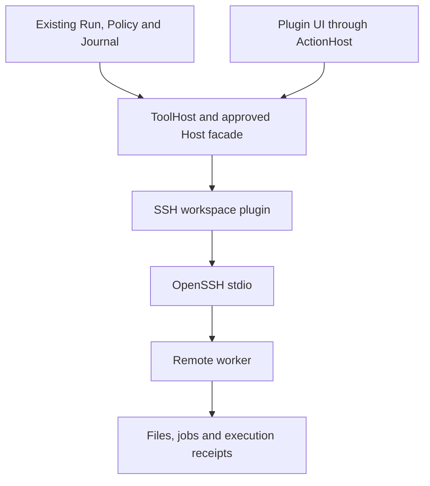

# Code SSH: plugin and lightweight remote worker design

**Issue:** [agent-vivy #15](https://github.com/ProjectViVy/agent-vivy/issues/15).
**Baseline:** `ce33bc8776b9f52ab13bed5f2cdaf8ebad01f666`.
**Branch:** `code-ssh`. **Revision:** SSH-D1, 2026-10-11.
**Authority:** This is the initiative's design proposal; the existing Module,
Port, Plugin and Assembly standards remain normative. The user approved the
plugin + lightweight remote worker direction and requested a detailed plan
and branch. Product implementation and public-contract changes are not
authorized by this documentation delivery.
**Plan and current state:** [authoritative index](../plans/code-ssh/index.md).
**Exact shared interfaces and payloads:** [SSH-C1](../plans/code-ssh/contracts.md).

## 1. Outcome, scope and requirements

Enable one remote coding workspace whose files, commands, jobs, instructions
and deliverables identify the same SSH target and remote root. Keep the
existing Vivy Agent, Service.Run, Journal, Policy and approval ownership.
The remote worker executes operations; it has no model, agent loop, prompt,
persona, core database, or independent approval system.

| ID | Required observable behavior |
| --- | --- |
| R1 | An explicitly selected, revisioned target and remote root are bound to a session and frozen for each admitted Run and operation. Local/remote origin is always visible; no silent local fallback. |
| R2 | Listing, bounded read/search, write/patch/multiedit and commands operate on that binding. Remote project instructions are loaded from that project; unrelated local project instructions are not silently substituted. |
| R3 | Foreground commands and connection-owned background jobs expose bounded stdout/stderr, exit status, job identity and confirmed cancellation. |
| R4 | Retries and reconnects preserve stable operation identity and reconcile receipts; an ambiguous write/command is never automatically re-executed. |
| R5 | Existing Host Policy, Grants, approvals and audit remain authoritative. SSH credentials stay with their approved resolver/profile; host keys are verified; remote filesystem and command boundaries are enforced. |
| R6 | The GUI can inspect/select a target, connect/disconnect, see availability and capabilities, inspect jobs and outputs, cancel/reconcile, and access explicit remote deliverables. |
| R7 | An explicit Recipe selects the plugin. Omission physically removes its Go code, UI, Grants and assets and does not change local defaults or require SSH to build/start. |
| R8 | Plugin production code imports public SDK contracts, never `agent-vivy/internal/*` or Eino. SSH-specific behavior remains entirely in the plugin/worker. Any unavoidable generic Host change is a separately reviewed decision. |
| R9 | A real remote inspect/edit/test/build/present/download loop and representative failure matrix provide acceptance evidence; unavailable environments are recorded as unverified. |

Initial remote platform: Linux amd64 and arm64. Local Windows/macOS/Linux
clients use an installed OpenSSH client. Linux is a proposed V1 platform
boundary, not a claim that other remote platforms are implemented. A selected
but unconfigured instance performs no network action. No cluster scheduling,
multiple active targets per Run, persistent interactive terminal, port
forwarding, external-agent delegation, or remote desktop is included.

V1's default cwd is the remote root (`.`); each command may choose a validated
relative cwd inside it, recorded with the job. Target inspection shows approved
host/port/user, authenticated worker identity, root/default cwd, actual platform,
approved shell/PATH and redacted environment metadata. No mutable interactive
shell cwd or secret environment projection is introduced.

The complete issue remains open until R1-R9 are verified. A single-target
namespaced-tool probe does not lower the issue's acceptance criteria.

## 2. Inspected implementation and concrete gaps

| Existing path / symbol | Reuse or limitation |
| --- | --- |
| `sdk/port/toolworld/toolworld.go`: `Provider`, `Host`, `SpawnSpec`, `Proc` | Dynamic tools enter ToolHost. Host currently exposes ModuleID, Workspace, OpenRead/OpenWrite and Spawn only; public callers cannot read Run/Session/Operation identity. |
| `sdk/port/pretool/pretool.go`: `Request`, `RewriteArgs` | Can revalidate/constrain arguments; cannot change tool identity or dispatch another tool. Request exposes only ToolID and Arguments. |
| `internal/app/assembly_worlds.go`: `generatedWorldHost.Spawn` | Existing governed process entry checks executable constraints, uses a local cwd, and detaches cancellation with `context.WithoutCancel`. It does not enforce net.client target constraints at this Spawn boundary. |
| `internal/runtime/tool_operation.go`: coordinator | Existing admitted/claimed/completed operations and unknown-outcome replay fence remain the sole local authority. Public Providers do not receive its identity or reconciliation interface. |
| `internal/runtime/tooladapter.go`: persisted middleware revalidation | Middleware is rerun against stored pre-rewrite inputs and must reproduce exactly the admitted effective arguments. Injecting a fresh random operation ID during each middleware pass breaks resume; it is not an accepted workaround. |
| `internal/modules/sandbox/module.go`: `compose` | Instantiates concrete local WorkspaceManager, filesystem and command backends. No selectable public workspace backend exists. |
| `internal/runtime/isolation.go`: `Workspace`, `WorkspaceManager` | Workspace currently has a local Path. Treating an SSH URI as that Path would reach local filesystem operations. |
| `internal/runtime/project_agentsmd.go`; `workspace_files.go`; `deliverable_transfer.go` | Existing instruction, preview and delivery paths open local files. They need a proven public resource path or an approved generic adapter for full remote acceptance. |
| `sdk/port/controlaction/action.go`; `sdk/port/catalog.go` | Actions provide schema/effect/approval control, but their Port grant allow-list currently includes rpc.client and net.client, not proc.spawn/secret.read; action Host has no Spawn or generic network facade. Do not assume an Action can start SSH. |
| `sdk/internal/assembly/runtime_generate.go` | Inspect actual constructor sharing and supported projection of ToolWorld/Action/Context/Status contributions. Separate constructor calls cannot silently create competing state owners. |
| `sdk/internal/source_verify_v1.go` | Direct raw capability calls are rejected. A linkable plugin source tree cannot contain package main. Worker source must be a separate source boundary. |
| `docs/architecture/VIVY-PORT-CATALOG.md` | Fourteen public Ports; protected local tool IDs cannot be replaced/aliased by T2 plugins. No new selectable Port is created by this proposal. |

Current branches were checked before this package: no SSH design/plan was
found. ACP/A2A branches do not establish a remote workspace backend contract.
Recheck main and those branches at execution; this pinned inspection is not
evidence that future code remains identical.

## 3. Decision and dependency direction

Choose one public plugin plus a small, separately packaged Go worker reached
through OpenSSH stdio. This reuses SSH authentication/host-key handling and
keeps remote file/process semantics in one place. A helper-free SFTP + shell
approach saves installation but adds separate job, receipt and cleanup
mechanisms. An SSH-carried MCP worker can reuse existing MCPHost but does not
by itself fix Run binding, instructions or delivery; do not add a second MCP
client to the plugin. No measured performance advantage is claimed.

Proposed source boundaries, all absent at the baseline:

- `plugins/coding/ssh-workspace/`: public T2 Module, its own `go.mod`, public
  SDK imports, pure descriptors, client transport, typed remote tools and UI.
- `extensions/ssh-worker/`: independent Go module, worker executable and
  small shared `wire` package. It is a T3 execution endpoint, not a public
  in-process Module; package main is legal here, outside SDK source scanning.
- `recipes/code-ssh.vivy.yml`: explicit optional interactive Generation.
- `docs/dev/code-ssh.md`: install/operation/recovery instructions.

The plugin may import the worker's data-only versioned `wire` package through
an explicit module version/source pin; it never imports worker execution
packages. If SDK packing cannot resolve this source pin without a new loader,
report the packaging gap rather than inventing runtime module discovery.



Expected public contributions are ToolWorld, UI Extension, Control Actions,
Status and bounded Context Source. Their availability is not assumed merely
because a Port is SUPPORTED. SSH-00 must prove lifecycle, shared ownership and
actual Host capabilities for this exact contribution set before integration.
Namespaced remote tools may be used for a probe; protected IDs stay protected.
No source catalog promotion to T1 and no raw credential/database escape hatch
is permitted.

## 4. Host feasibility gate and escalation boundary

SSH-00 produces a checked gap ledger for:

| Gap | Required proof or decision |
| --- | --- |
| H1 | Public, server-owned session/workspace/Run/operation scope reaches the Provider and cannot be chosen by model arguments. |
| H2 | Target/profile/root revision and approved egress are frozen before approval and remain identical on resume. |
| H3 | Remote receipts can be reconciled through the existing local operation authority, including a crash after remote completion but before local settlement. |
| H4 | Instructions, previews and explicit deliverables use the bound remote resources without local-path fallback. |
| H5 | ToolWorld, Action, Context and Status views share one explicitly lifecycle-owned instance; UI status does not create a connection. |
| H6 | Connect/disconnect/reconcile are available through approved control paths with no raw routes or Action grant bypass. |

The gate has exactly two dispositions: **ZERO-INTERNAL-PROVED**, backed by
executable conformance on current public contracts; or **HOST-EXCEPTION-
REQUIRED**, backed by the failing cases and a concrete smallest generic seam
proposal. The current baseline has unresolved H1-H6, so no complete integration
Story is released as Ready. Worker-only work can proceed independently after
the package is approved for execution.

An exception proposal must name exact changed files/signatures, retained Host
authority, all consumers, failure semantics, seven-artifact evidence, and the
alternative that avoids the change. It needs an explicit user decision before
implementation or normative catalog changes. A new Port, if necessary, must
first be cataloged and supported; do not implement a SPECIFIED stub.
Do not pre-create `internal/ssh`, add SSH settings/branches to the agent loop,
or modify AGENTS.md. Generic CallScope/resource/backend concepts may be
proposed, but this design grants no new public API or internal implementation.

H2 also resolves the issue's literal no-cleartext persistence criterion for
credentials and host keys. Conventional OpenSSH known_hosts contains public
host-key material; using it cannot by itself attest that literal criterion.
Record the approved encrypted/opaque resolver path or obtain an explicit
interpretation decision before acceptance. Never expose key material to the
model or copy private keys into plugin settings, artifacts or logs.

## 5. Worker protocol and authoritative ownership

The proposed `wire` contract uses a four-byte big-endian length followed by
strict UTF-8 JSON. Protocol version is `vivy.ssh-worker/1`. Reject unknown
versions, duplicate keys, unknown envelope fields, oversized frames and
trailing payloads before side effects. Requests carry a method-specific typed
payload; raw polymorphic payload bytes are decoded against a closed method
schema, not passed to a generic execution registry.

The following types/signatures are proposed worker/plugin-owned interfaces,
not additions to the public Vivy SDK:

```go
type Binding struct {
    TargetID, TargetRevision, WorkspaceID, SessionID string
    RemoteRoot, PolicyDigest, WorkerDigest string
}
type CallScope struct { RunID, OperationID string }
type Request struct {
    Version, Method string
    Binding Binding
    Scope CallScope
    RequestDigest string
    Payload json.RawMessage
}
type Reply struct {
    OperationID, BindingDigest, RequestDigest string
    State string
    Result json.RawMessage
    Fault *Fault
}
type Fault struct { Code, Message string; Retry string }
func Encode(io.Writer, Request, Limits) error
func Decode(io.Reader, Limits) (Request, error)
func EncodeReply(io.Writer, Reply, Limits) error
func DecodeReply(io.Reader, Limits) (Reply, error)
func CanonicalRequestDigest(Request) (string, error)
func BindingDigest(Binding) (string, error)
type Transport interface {
    RoundTrip(context.Context, Request) (Reply, error)
    Close(context.Context) error
}
```

Binding and CallScope originate at a verified Host authority. UI and model
claims are requests only. Digests use canonical, duplicate-free JSON and
include protocol, method, scope, binding and payload, excluding the digest
field itself. Reject an existing operation ID with a different digest. Two
intentional identical commands with different operation IDs remain two
operations; content hashes are not logical operation identities.

Closed methods: `hello`, `fs.list`, `fs.read`, `fs.search`, `fs.write`,
`fs.patch`, `fs.multiedit`, `process.execute`, `jobs.list`, `jobs.output`,
`jobs.cancel`, `operations.get`, `artifacts.stat`, `artifacts.read`,
`lease.renew`, `close`. Mutations and execution require a Host-issued operation
identity. Read/query request correlation is generated by the client and cannot
authorize a side effect. `hello` returns actual platform, protocol/build
digest, supported methods, sandbox capabilities and effective limits.

Proposed resource envelopes reuse the current product bounds where possible:
file read/write 1 MiB, inline output 64 KiB, artifact 32 MiB/item and 128 MiB/set,
artifact chunk 256 KiB; frame maximum 2 MiB includes JSON/base64 overhead.
These are safety/compatibility limits, not benchmark claims. The effective
value is the minimum of Host and worker limits; large output stays remotely
owned and is retrieved by cursor. A limit change revisits all consumers/tests.

## 6. Files, receipts, processes and failure semantics

Paths are POSIX workspace-relative names under the bound root, never local
`filepath` resolution. The worker opens a trusted root handle, rejects escapes,
symlink traversal and irregular files, and preserves existing sensitive-path
policy at the approved boundary. A command cwd is rooted in the same binding.
File path containment is not advertised as a sandbox for arbitrary commands.
If no approved OS isolation backend is available, advertise sandbox unavailable
and reject requests that require it; do not silently run them unsandboxed.

Writes require the prior content digest; edits reject stale/ambiguous matches.
Single-file updates use same-directory temporary files, fsync, atomic rename
and parent-directory fsync. Multiedit preflights every requested edit before
the first mutation; commits are explicitly per-file, not cross-file atomic.
Its receipt records completed and unresolved files so partial failure is
truthful. Mutations cannot read/modify the worker's private state directory.

The worker uses a private state directory outside the project, mode 0700, and
durable per-operation JSON receipts, mode 0600; no core database or new DB
dependency. Exclusive admission, durable replace and directory fsync protect
receipt identity. Receipts are remote execution evidence only; local Journal
remains authoritative for admission, approval and surfaced outcomes.

```text
accepted -> started -> completed | failed | cancelled
                  -> unknown (crash or unconfirmed outcome)
```

Persist intent before side effects and final receipt before returning a
terminal reply. Crash between a side effect and final receipt leaves unknown;
observing matching file bytes is diagnostic evidence, not proof of who wrote
them. `operations.get` is read-only. Duplicate identical requests return the
retained state/result without rerunning; conflicting payloads fail. Evicted
receipts must not enable replay: retain compact identity/tombstones, or refuse
that identity as unavailable. Retention is explicit operator maintenance,
not automatic deletion in V1.

Private directory permissions protect other users, not arbitrary commands run
under the same remote uid. Receipts are not tamper-proof evidence. The approved
execution/isolation profile must state how jobs are kept from worker state and
credentials; otherwise that trust limitation remains an explicit acceptance
gap. Damaged/missing evidence never permits automatic replay.

The worker owns foreground processes and connection-owned background jobs in
their own Linux process groups. V1 does not promise jobs survive a disconnect.
EOF, close or lease expiry stops admission, attempts TERM then KILL, drains
bounded output and persists confirmed outcomes. Process birth identity is
verified before signaling; recycled PIDs are not trusted. A crashed worker or
unconfirmed process-tree cleanup produces unknown and a query/reconciliation
hint. SSH closure alone is never reported as confirmed cancellation. Arbitrary
daemonized descendants need an approved OS isolation mechanism; do not claim
process-group signaling provides complete containment.

A proposed 10-second renewal / 30-second worker lease is a lifecycle default,
not a performance target. It uses the already owned stdio connection, creates
no listener/daemon/service installer, and must be tested with a fake clock.
Worker code performs no autonomous task admission or automatic command retry.

| Failure | Required visible behavior |
| --- | --- |
| Auth/host-key/build-digest failure | Unavailable; no workspace operation; no local fallback. |
| Disconnect during a read | Return unavailable/incomplete; a fresh bounded read may be requested. |
| Disconnect after a mutation was sent | Unknown until receipt lookup confirms outcome; no automatic replay. |
| Timeout/cancel | Attempt scoped remote cancellation; report confirmed cancelled only after acknowledgement or retained terminal receipt. |
| Resume after target/root/policy change | Reject stale binding/approval; require a new authorized operation. |
| Remote completion, local Journal settlement failure | Preserve unknown/reconciliation state on the existing authority; never declare success merely from the remote reply. |
| Remote sandbox unavailable | Advertise unavailable and refuse sandbox-required execution. |
| Artifact changed between presentation and read | Changed/unavailable; do not download newer bytes under an old digest. |

## 7. Transport, credentials, control and presentation

Use Host-governed Spawn only after SSH-00 proves profile and egress authority.
The plugin builds fixed OpenSSH argv from the approved target, never accepts a
model-supplied host, option list, private key, worker command or remote root.
Require batch mode, strict host-key checking, no agent forwarding, no port/X11
forwarding, and an explicit approved authentication/known-hosts profile.
Inherited arbitrary SSH config and environment cannot silently widen that
profile. OpenSSH does the signing; private key bytes do not enter wire,
Descriptor, Recipe, tool result or Journal. No generic payload redaction or
argument veto is added to core; resolver-owned credentials stay contained.

The worker binary is installed explicitly by the operator from a pinned
artifact and verified at hello. No automatic downloads, shell bootstrap,
systemd service, or model-triggered installation is included. Missing worker
returns an actionable unavailable state. Transport Stop/Close is idempotent;
Provider cancellation closes its owned local process only after recording the
remote outcome/uncertainty. Reconnect validates the same target/root/digest and
queries receipts first; it does not resubmit pending mutations.

Proposed model-visible operations form one namespaced remote catalog with the
same functional schema categories as local file/process/job operations.
ToolHost governs every call. Capability-specific denied/unavailable results
do not turn into local calls. A remote-only probe Recipe may remove local
coding exposure through supported composition; UI hiding alone is not proof.
Seamless standard-tool routing is a separate H1/H2/H4 acceptance obligation.

Remote AGENTS.md and imports preserve provenance and use the existing
instruction authority. A Context Source returning bounded data is not proof
that system-instruction semantics are preserved. File previews and explicit
deliverables must resolve a target/root/digest-bound reference through the
existing authorized delivery path or a reviewed public resource contract.
Plugin-only cards that bypass the delivery authority do not meet R6.

UI contributes a target page and persistent local/remote indicator. Connect,
disconnect and reconcile use ActionHost; job side effects reenter ToolHost.
State derives from backend snapshots. Do not import shell store internals,
create a second RPC transport, or store authoritative target identity in
localStorage. Backend rejects switching while an admitted/running/awaiting-
approval operation still owns the binding. Offline diagnostics retain the
last-known state and timestamp and are visibly stale.

## 8. Eino check, costs and acceptance

Inspected pinned `github.com/cloudwego/eino v0.9.13`:
`adk/filesystem.Backend`, `Shell`, `StreamingShell`; Vivy's filesystem already
implements that Backend behind the Eino quarantine. Inspected
`eino-ext/components/tool/mcp v0.0.9`: `GetTools` and
`Config.ToolCallResultHandler`; `internal/runtime/mcpadapter.go` already uses
it. These primitives do not supply public Vivy target binding, remote receipts,
SSH credentials or resource delivery authority. Reuse them in an approved
existing adapter if needed; do not expose Eino types to the plugin or implement
a parallel LLM/MCP runtime. Missing Eino-scoped capabilities remain subject to
the repository's DEFERRED-INDEFINITE rule.

Worker file/process/stdio I/O is outside LLM orchestration. It uses the Go
standard library first. Do not add x/crypto, SFTP, a database, container runtime,
pool, file synchronization cache or always-on service without evidence of a
specific unmet requirement. One reusable connection per selected binding is
justified by unified identity/lifecycle; its throughput is unmeasured. Measure
connect, read, edit, command-start, cancellation and download in the real
acceptance environment before proposing additional machinery.

Delivery requires focused deterministic tests, real SSH/Linux tests, SDK
verify/pack/Inspect and omission checks, `just ci`, a real split-GUI smoke at
`http://127.0.0.1:3015`, amd64/arm64 worker builds, and documented recovery.
No live network in unit tests. Missing SSH host, GUI environment or CI runner
means pending evidence, never PASS. Record execution in the index and
`docs/logs/<execution-date>-code-ssh-implementation/`; do not overwrite this
planning delivery's evidence.

Repository constraints and full issue acceptance are preserved. H1-H6 must be
settled before downstream integration becomes Ready, and any public/internal
exception is presented for approval with concrete code boundaries first.

Primary transport references inspected for this design:
[OpenSSH ssh_config(5)](https://man.openbsd.org/ssh_config),
[ssh(1)](https://man.openbsd.org/ssh). Recheck installed client versions/options
at execution; these manuals do not attest Vivy's Host authority or worker cleanup.
